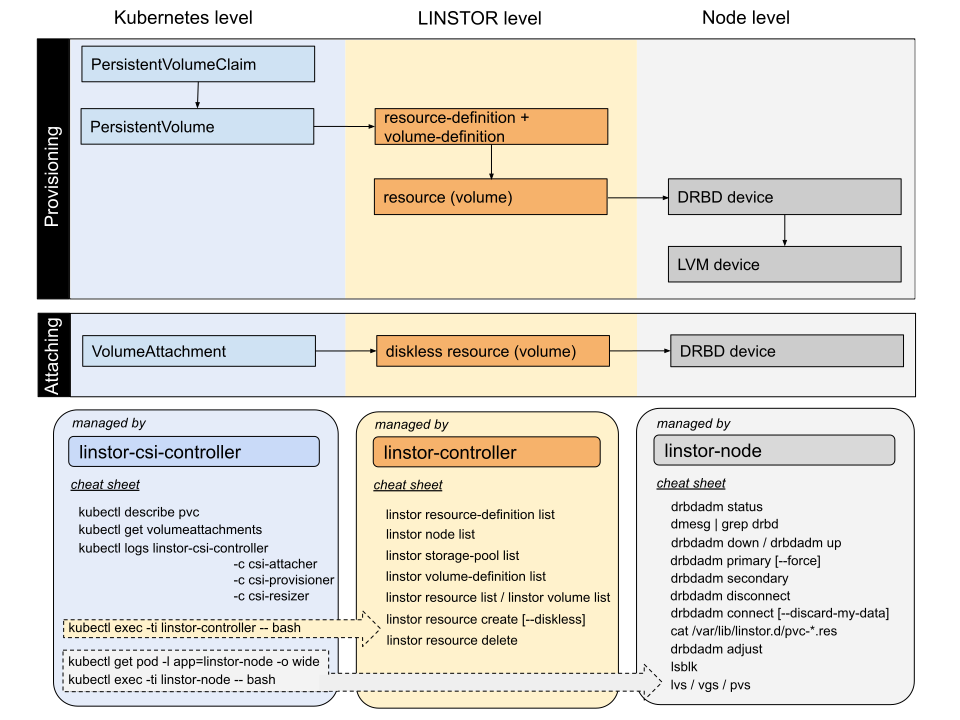


The module is only guaranteed to work if the [system requirements](./readme.html#system-requirements-and-recommendations) are met.
As for any other configurations, the module may work, but its smooth operation is not guaranteed.


## What is difference between LVM and LVMThin?

- LVM is simpler and has high performance that is similar to that of native disk drives, but it does not support snapshots;
- LVMThin allows for snapshots and overprovisioning; however, it is slower than LVM.


Overprovisioning of LVMThin pools in this module is limited by LINSTOR, not by the `allocationLimit` field of the thin pool in the [LVMVolumeGroup](/modules/sds-node-configurator/cr.html#lvmvolumegroup) resource: that field has no effect on the volumes of `sds-replicated-volume`. Use overprovisioning with caution and monitor the free space in the pool (the cluster monitoring system generates separate alerts when the free space in a LINSTOR storage pool falls below 20%, 10%, 5%, and 1%).

In case of no free space in the pool, degradation in the module's operation as a whole will be observed, and there is a real possibility of data loss!


## What happens to snapshots and restored volumes when one of them is deleted?

Snapshots are available for volumes in LVMThin pools only.

- A snapshot is taken on every replica of the volume, and each replica keeps the data of its snapshot in its own thin pool.
- Any order of deletion is allowed. Deleting the PVC of a volume that has snapshots removes the replicas of the volume, and its snapshots can still be restored. A VolumeSnapshot can be deleted while a volume restored from it exists: the restored volume depends neither on the snapshot nor on the volume it was taken from. A restored volume can be snapshotted and restored in turn.
- In a thin pool, a block that a snapshot shares with its volume is freed when no volume or snapshot uses it any more. The free space LINSTOR reports for an LVMThin pool already includes the space snapshots take.

## What happens to a snapshot, a restore or a clone of a volume in an LVM (thick) pool?

Snapshots, restoring a PVC from a VolumeSnapshot and cloning a PVC (a `spec.dataSource` or `spec.dataSourceRef` of kind `PersistentVolumeClaim`) are available only for StorageClasses with a pool of type `LVMThin`. The pool type is `spec.type` of the [ReplicatedStoragePool](./cr.html#replicatedstoragepool) named in `spec.storagePool` of the [ReplicatedStorageClass](./cr.html#replicatedstorageclass) in the LINSTOR control plane, and `spec.storage.type` of the ReplicatedStorageClass in the new control plane.

For a StorageClass with an `LVM` (thick) pool:

- The StorageClass does not have the `storage.deckhouse.io/volumesnapshotclass` annotation, so the module's VolumeSnapshotClass is not filled in for snapshots of its volumes. The module removes the annotation from such StorageClasses created by earlier versions when it is updated; the StorageClass is not recreated.
- The module rejects creating a VolumeSnapshot of a PVC of this StorageClass, a PVC of this StorageClass restored from a VolumeSnapshot or cloned from a PVC, and a clone of a PVC of this StorageClass. The request fails right away with a message like this:

  ```text
  admission webhook "d8-sds-replicated-volume-volumesnapshot-validation.deckhouse.io" denied the request: PersistentVolumeClaim "data" uses StorageClass "replicated-thick", which keeps its volumes in the thick (LVM) ReplicatedStoragePool "thick-pool"; snapshots need a storage pool of type LVMThin.
  ```

  A VolumeSnapshot created from an existing VolumeSnapshotContent (`spec.source.volumeSnapshotContentName`) is not checked.

## Supported disk configurations and performance

### Supported disk types

HDD — suitable for capacity-oriented workloads with moderate load.  
SSD and NVMe — fully supported and recommended for high-performance workloads (databases, high-IOPS virtual machines, all-flash configurations).  
The LINSTOR/DRBD architecture allows efficient use of SSD/NVMe block devices.

TRIM/Discard support  
TRIM operations are passed transparently through DRBD (supported since DRBD 8.4.3). If the underlying disk (SSD/NVMe) supports TRIM, the feature works automatically — this speeds up initial synchronization, formatting, and general SSD maintenance.

### Performance requirements

For storage disks, performance depends on disk type, network, and workload.  
Recommendations for heavy workloads: SSD/NVMe with thousands of IOPS + 10+ Gbps network with latency <5 ms (ideally <1 ms). With NVMe, the network must match disk capabilities; otherwise it becomes the bottleneck.  
For all-flash configurations, the general recommendation for aggregate network throughput is on the order of 25–100 GbE — depending on disk workload.

### Additional recommendations

Avoid hardware RAID for disks used in the storage pool — prefer JBOD or direct disk access.  
For capacity-oriented workloads — LVM + HDD mode.  
For performance-oriented workloads and snapshots — LVMThin + SSD/NVMe (always monitor free space in the thin pool to avoid over-provisioning issues).

There are no architectural limitations for all-flash configurations.

## Which Replication Modes to Use and When?

There are three replication modes in total:

- **None** – A single data replica. Equivalent to a regular PV resource, with no fault tolerance or availability.  
- **Availability** – Two data replicas + one diskless replica (contains no data; when used, it accesses any available "full" replica over the network). Provides a certain level of availability if one replica fails but does not guarantee data consistency (integrity).  
- **ConsistencyAndAvailability** – Three data replicas, full fault tolerance with guaranteed data preservation in case of failures.  

By default, the `ConsistencyAndAvailability` mode is used when creating a `ReplicatedStorageClass`. It can be specified as follows:  

```yaml
apiVersion: storage.deckhouse.io/v1alpha1
kind: ReplicatedStorageClass
metadata:
  name: test-rsc
spec:
  reclaimPolicy: Delete
  replication: ConsistencyAndAvailability
  storagePool: sample
  topology: Ignored
  volumeAccess: Local
```

### When and Which Modes to Use?  

- **None** – Suitable for test environments or clustered applications (e.g., if you deploy a multi-node cluster of RabbitMQ/MongoDB/MySQL/etc.).  
- **Availability** – A compromise mode that ensures availability but, in case of network connectivity issues (one of the quorum replicas is diskless, and accessing data through it happens over the network), may lead to desynchronization and, optionally, data loss.  
  Best suited for non-critical data and applications that require some level of high availability (e.g., when nodes periodically go into maintenance) but do not have strict reliability or data integrity requirements.  
- **ConsistencyAndAvailability** – The most reliable replication mode, recommended for mission-critical applications, vital data, and deploying virtual machines in a DVP environment.  

### How does the replication mode affect latency and IOPS?

The difference between the modes comes from the number of replicas that hold data: one for `None`, two for `Availability` (the third, diskless replica holds no data and takes no writes), three for `ConsistencyAndAvailability`. The module replicates synchronously (DRBD protocol C): a write completes only when every replica with data has written it to its disk.

Writes:

- Write latency is the slowest of the local disk write and, for every other replica with data, the network round trip plus the write on that node's disk. With three replicas it is the slower of the two remote ones, with two replicas it is the only remote one. The third replica therefore adds little when the nodes have the same disks and network, and noticeably more when one of the nodes, disks or links is slower — for example a replica in another zone with `topology: TransZonal`.
- A node writing to a volume sends each written block to every other replica with data: write traffic from the node is twice the write throughput with three replicas and once with two. Sequential write throughput is limited by the slowest of the disks and the network share each replica gets.
- Write IOPS at a high queue depth fall less than latency suggests, since requests are in flight in parallel, but they are capped by the slowest replica and by the network.

Reads:

- When the Pod runs on a node with a replica that holds data, reads are served from the local disk, and the number of replicas does not change read latency or IOPS. `volumeAccess: Local` always places the Pod there. With `EventuallyLocal` a replica with data is created on the Pod's node some time after the Pod starts; until then reads and writes go over the network, as described below.
- When the Pod runs on a node without such a replica (`volumeAccess: PreferablyLocal` or `Any`), every read and every write goes over the network, and a write is sent to all replicas with data, three or two of them.

#### Measuring it on your nodes

The figures depend on the disks and the network, so measure them on the nodes the volumes will use. Create one ReplicatedStorageClass per mode you are choosing between (the same `storagePool`, `topology` and `volumeAccess: Local`), a PVC of each, and run `fio` from a Pod that mounts the PVC on a node holding a replica. For comparison, run the same tests on a volume of a local disk of that node, for example from the `sds-local-volume` module.

In the commands below, `/data` is where the PVC is mounted in the Pod.

Write latency (queue depth 1):

```shell
fio --name=write-latency --filename=/data/fio.test --size=4G --direct=1 \
  --ioengine=libaio --rw=randwrite --bs=4k --iodepth=1 --numjobs=1 \
  --runtime=60 --time_based --group_reporting
```

Write IOPS (high queue depth):

```shell
fio --name=write-iops --filename=/data/fio.test --size=4G --direct=1 \
  --ioengine=libaio --rw=randwrite --bs=4k --iodepth=32 --numjobs=4 \
  --runtime=60 --time_based --group_reporting
```

For reads, run the same commands with `--rw=randread`. Compare the `clat` percentiles (p50, p99) for latency and `IOPS` for throughput. The difference between a replicated volume and the local disk is the cost of replication; the difference between the two classes is the cost of the third replica.

## How do I get info about the space used?

There are two options:

1. Through the Grafana dashboard:

   Navigate to "Dashboards" → "Storage" → "LINSTOR/DRBD" in the Grafana interface. The current space usage in the cluster is displayed in the top-right corner of the dashboard.

   > **Note.** This information reflects the total available space in the cluster. If volumes need to be created in two replicas, divide these values by two to understand how many such volumes can be accommodated in the cluster.

2. Using the command line:

   ```shell
   kubectl exec -n d8-sds-replicated-volume deploy/linstor-controller -- linstor storage-pool list
   ```

   >****Note.** This information reflects the total available space in the cluster. When creating volumes with two replicas, these two replicas must fit entirely across two nodes of your cluster.

## How do I set the default StorageClass?

Add corresponding StorageClass name to `spec.settings.defaultClusterStorageClass` of `ModuleConfig/global` config.

```shell
   apiVersion: deckhouse.io/v1alpha1
   kind: ModuleConfig
   metadata:
      name: global
   spec:
      version: 2
      settings:
         defaultClusterStorageClass: 'default-fast'
```

## How do I add the existing LVM Volume Group or LVMThin pool?

1. Manually add the `storage.deckhouse.io/enabled=true` LVM tag to the Volume Group:

   ```shell
   vgchange myvg-0 --add-tag storage.deckhouse.io/enabled=true
   ```

   This VG will be automatically discovered and a corresponding LVMVolumeGroup resource will be created in the cluster for it.

2. Specify this resource in the [ReplicatedStoragePool](./cr.html#replicatedstoragepool) parameters in the `spec.lvmVolumeGroups[].name` field (note that for the LVMThin pool, you must additionally specify its name in `spec.lvmVolumeGroups[].thinPoolName`).

## How to expand ReplicatedStoragePool to new cluster node?

The `spec.lvmVolumeGroups` list of an existing ReplicatedStoragePool cannot be edited in place: the change is rejected with the `Value is immutable` error. To add a new LVM Volume Group to the pool, recreate the resource with the extended list. Deleting a ReplicatedStoragePool does not affect its Storage Pools in LINSTOR, the volumes or the ReplicatedStorageClasses that use the pool.

1. Create new LVMVolumeGroup with [sds-node-configurator](/modules/sds-node-configurator/resources.html#creating-an-lvmvolumegroup-resource)

1. Look at the current resource:

   ```shell
   kubectl get replicatedstoragepool your-pool-name -o yaml
   ```

1. Prepare a manifest with the same `metadata.name` and `spec.type` and the extended `spec.lvmVolumeGroups` list:

   ```yaml
   apiVersion: storage.deckhouse.io/v1alpha1
   kind: ReplicatedStoragePool
   metadata:
     name: your-pool-name
   spec:
     type: LVM
     lvmVolumeGroups:
     - name: existing-vg-name
     - name: new-vg-name  # Add this line
   ```

   For LVMThin pools, additionally specify the thin pool name for every Volume Group:

   ```yaml
   spec:
     type: LVMThin
     lvmVolumeGroups:
     - name: existing-vg-name
       thinPoolName: existing-thin-pool
     - name: new-vg-name
       thinPoolName: new-thin-pool  # Add this line
   ```

1. Delete the resource and create it again right away from the prepared manifest:

   ```shell
   kubectl delete replicatedstoragepool your-pool-name
   kubectl apply -f your-pool-name.yaml
   ```

   While the resource is absent, the StorageClasses of the pool may get the `storage.deckhouse.io/nonOperational-not-enough-nodes-in-zones` label; it is removed once the resource is created again.

1. Check that the resource is `Ready` and the Storage Pool is present on the new node:

   ```shell
   kubectl get replicatedstoragepool your-pool-name
   kubectl -n d8-sds-replicated-volume exec -ti deploy/linstor-controller -- linstor storage-pool list -s your-pool-name
   ```

## How to increase the DRBD device limit or change the ports used by DRBD clusters to communicate?

To increase the limit on the number of DRBD devices / change the ports through which DRBD clusters communicate with each other, you can use the drbdPortRange setting. By default, DRBD resources use TCP ports 7000-7999. These values can be redefined using minPort and maxPort.


Changing the drbdPortRange minPort/maxPort will not affect existing DRBD resources; they will continue to operate on their original ports.

After changing the drbdPortRange values, the linstor-controller needs to be restarted.


## How to properly reboot a node with DRBD resources


For greater stability of the module, it is not recommended to reboot multiple nodes simultaneously.


1. Drain the node.

   ```shell
   kubectl drain test-node-1 --ignore-daemonsets --delete-emptydir-data
   ```

2. Check that there are no problematic resources in DRBD / resources in SyncTarget. If there are any, wait for synchronization / take measures to restore normal operation.

   ```console
   $ kubectl -n d8-sds-replicated-volume exec -t deploy/linstor-controller -- linstor r l --faulty
   Defaulted container "linstor-controller" out of: linstor-controller, kube-rbac-proxy
   +----------------------------------------------------------------+
   | ResourceName | Node | Port | Usage | Conns | State | CreatedOn |
   |================================================================|
   +----------------------------------------------------------------+
   ```

3. Reboot the node and wait for the synchronization of all DRBD resources. Then uncordon the node. If another node needs to be rebooted, repeat the algorithm.

   ```shell
   kubectl uncordon test-node-1
   node/test-node-1 uncordoned
   ```

## How do I free some space on storage pool by moving resources to another

1. Check the storage pool: `kubectl exec -n d8-sds-replicated-volume deploy/linstor-controller -- linstor storage-pool list -n OLD_NODE`

2. Check the volumes: `kubectl exec -n d8-sds-replicated-volume deploy/linstor-controller -- linstor volume list -n OLD_NODE`

3. Identify the resources you want to move:

   ```shell
   kubectl exec -n d8-sds-replicated-volume deploy/linstor-controller -- linstor resource list-volumes
   ```

4. Move resources to another node (no more than 1-2 resources at a time):

   ```shell
   kubectl exec -n d8-sds-replicated-volume deploy/linstor-controller -- linstor --yes-i-am-sane-and-i-understand-what-i-am-doing resource create NEW_NODE RESOURCE_NAME
   ```

   ```shell
   kubectl exec -n d8-sds-replicated-volume deploy/linstor-controller -- linstor resource-definition wait-sync RESOURCE_NAME
   ```

   ```shell
   kubectl exec -n d8-sds-replicated-volume deploy/linstor-controller -- linstor --yes-i-am-sane-and-i-understand-what-i-am-doing resource delete OLD_NODE RESOURCE_NAME
   ```

### Can I automate the management of replicas and monitoring of LINSTOR state?

Replica management and state monitoring are automated in the `replicas_manager.sh` script.
It checks the availability of the LINSTOR controller, identifies faulty or corrupted resources, creates database backups, and manages disk replicas, including configuring TieBreaker for quorum.

To check the existence of the `replicas_manager.sh` script, run the following command on any master node:

   ```shell
   ls -l /var/lib/deckhouse/sbin/replicas_manager.sh
   ```

Upon execution, the script performs the following actions:
- Verifies the availability of the controller and connectivity to satellites
- Identifies faulty or corrupted resources
- Creates a backup of the database
- Manages the number of disk replicas, adding new ones as needed
- Configures TieBreaker for resources with two replicas
- Logs all actions to a file named linstor_replicas_manager_<date_time>.log
- Provides recommendations for resolving issues, such as stuck replicas

Configuration variables for `replicas_manager.sh`:
- NON_INTERACTIVE — enables non-interactive mode
- TIMEOUT_SEC — timeout between attempts, in seconds (default: 10)
- EXCLUDED_RESOURCES_FROM_CHECK — regular expression to exclude resources from checks
- CHUNK_SIZE — chunk size for processing resources (default: 10)
- NODE_FOR_EVICT — name of the node excluded from creating replicas
- LINSTOR_NAMESPACE — Kubernetes namespace (default: d8-sds-replicated-volume)
- DISKLESS_STORAGE_POOL — pool for diskless replicas (default: DfltDisklessStorPool)

### How to evict DRBD resources from a node?

Eviction of DRBD resources from a node is performed using the `evict.sh` script. It can operate in two modes:

- **Node Deletion Mode** – in this mode, the following actions are executed:
  - Additional replicas are created for each resource hosted on the specified node;
  - The node is removed from `LINSTOR`;
  - The node is removed from `Kubernetes`;

- **Resource Deletion Mode** – in this mode, the following actions are executed:
  - Additional replicas are created for each resource hosted on the specified node;
  - The resources hosted on the specified node are removed from `LINSTOR`;

Before proceeding with the eviction, the following steps must be performed:

1. Check existence of `evict.sh` script on any master node:

   ```shell
   ls -l /var/lib/deckhouse/sbin/evict.sh
   ```

2. Fix all faulty resources in the cluster. Run the following command to filter them:

   ```shell
   kubectl -n d8-sds-replicated-volume exec -ti deploy/linstor-controller -- linstor resource list --faulty
   ```

3. Check that all the pods in the `d8-sds-replicated-volume` namespace are in the Running state:

   ```shell
   kubectl -n d8-sds-replicated-volume get pods | grep -v Running
   ```

### Example of removing a node from LINSTOR and Kubernetes

Run the `evict.sh` script on any master node in interactive mode by specifying the delete mode `--delete-node`:

```shell
/var/lib/deckhouse/sbin/evict.sh --delete-node
```

To run the `evict.sh` script in non-interactive mode, you need to add the `--non-interactive` flag when invoking it, as well as the name of the node from which you want to evict the resources. In this mode, the script will execute all actions without asking for user confirmation.

Example invocation:

```shell
/var/lib/deckhouse/sbin/evict.sh --non-interactive --delete-node --node-name "worker-1"
```

### Example of removing resources from a node without removing the node itself

1. Run the `evict.sh` script on any master node in interactive mode (`--delete-resources-only`):

   ```shell
   /var/lib/deckhouse/sbin/evict.sh --delete-resources-only
   ```

   To run the `evict.sh` script in non-interactive mode, add the `--non-interactive` flag followed by the name of the node to evict the resources from. In this mode, the script will perform all the necessary actions automatically (no user confirmation is required).

   Example:

   ```shell
   /var/lib/deckhouse/sbin/evict.sh --non-interactive --delete-resources-only --node-name "worker-1"
   ```

   > **Caution!** After the script finishes its job, the node will still be in the Kubernetes cluster albeit in *SchedulingDisabled* status. In LINSTOR, the *AutoplaceTarget=false* property will be set for this node, preventing the its scheduler from creating resources on this node.

2. Run the following command to allow DRBD resources and pods to be scheduled on the node again:

   ```shell
   alias linstor='kubectl -n d8-sds-replicated-volume exec -ti deploy/linstor-controller -- linstor'
   linstor node set-property "worker-1" AutoplaceTarget
   kubectl uncordon "worker-1"
   ```

3. Run the following command to check the `AutoplaceTarget` property for all nodes (the AutoplaceTarget field will be empty for nodes that are allowed to host LINSTOR resources):

   ```shell
   alias linstor='kubectl -n d8-sds-replicated-volume exec -ti deploy/linstor-controller -- linstor'
   linstor node list -s AutoplaceTarget
   ```

### Description of the `evict.sh` script parameters

- `--delete-node` — Removes the node from LINSTOR and Kubernetes after first creating additional replicas for all resources hosted on that node.
- `--delete-resources-only` — Removes the resources from the node without deleting the node from LINSTOR and Kubernetes, after first creating additional replicas for all resources hosted on that node.
- `--non-interactive` — Runs the script in non-interactive mode.
- `--node-name` — Specifies the name of the node from which resources should be evicted. This parameter is mandatory when using non-interactive mode.
- `--skip-db-backup` — Skips creating a backup of the LINSTOR database before executing the operations.
- `--ignore-advise` — Proceeds with the operations despite warnings from the `linstor advise resource` command. Use if the script was interrupted and the number of replicas for some resources does not match the value specified in the `ReplicatedStorageClass`.
- `--exclude-resources-from-check` — Excludes from checks the resources listed using the `|` (vertical bar) as a separator.

## How do I clean a node of DRBD and module volumes when the cluster is unavailable?


The procedure destroys the data of the module's volumes on the node. Use it only for a node that has left the cluster for good or for a cluster that no longer exists. If the cluster is working, evict the resources with `evict.sh` instead, see [How do I evict DRBD resources from a node?](#how-do-i-evict-drbd-resources-from-a-node).


The `cleanup_static_node.sh` script of the `node-manager` module does not know about DRBD or LVM: after it runs, the `drbd` kernel module stays loaded, its configuration files stay in `/etc`, and the logical volumes of the module stay in the volume groups. The `srv-node-cleanup.sh` script below removes these leftovers on a node without a running cluster. It works for both control planes of the module (LINSTOR and the new one) and needs nothing but the tools that are installed on the node (`lvm2`, `kmod`, `awk`; `drbdsetup` if DRBD resources are up).

1. Make sure the data you need is kept elsewhere: a node's replicas disappear together with its volumes.

1. Take the node out of the cluster, if the cluster exists, and stop `kubelet` on it:

   ```shell
   d8 k drain <node> --ignore-daemonsets --delete-emptydir-data
   d8 k delete node <node>
   ```

   ```shell
   systemctl disable --now bashible.timer kubelet
   ```

   `bashible.timer` is stopped as well: if it runs after a reboot of a node that has left the cluster, it enables `kubelet` again.

1. Save the script from the end of this section on the node as `/root/srv-node-cleanup.sh` and make it executable:

   ```shell
   chmod +x /root/srv-node-cleanup.sh
   ```

1. Run the script without flags. It is a dry run: it changes nothing and prints everything it would do, so check the list, especially the logical volumes:

   ```shell
   /root/srv-node-cleanup.sh --delete-volumes --vg <volume-group>
   ```

1. Run it again with `--apply`:

   ```shell
   /root/srv-node-cleanup.sh --delete-volumes --vg <volume-group> --apply
   ```

   The script is idempotent: a repeated run finds nothing and does nothing. The actions of an `--apply` run are written to `/var/log/srv-node-cleanup-<date>.log`.

1. Run the cleanup script of the `node-manager` module, as described in [How to clean up a node for adding to the cluster?](/modules/node-manager/faq.html#how-to-clean-up-a-node-for-adding-to-the-cluster):

   ```shell
   bash /var/lib/bashible/cleanup_static_node.sh --yes-i-am-sane-and-i-understand-what-i-am-doing
   ```

   The script removes the users that the platform created on the node (including the one you may be logged in as) and reboots the node when it finishes.

1. Check that nothing is left:

   ```shell
   lsmod | grep drbd
   ls /etc/modprobe.d/drbd.conf /etc/modules-load.d/d8_drbd.conf /etc/multipath/conf.d/drbd.conf /opt/deckhouse/drbd
   ```

   Both commands must print nothing (the second one must only report missing files).

### Flags of the `srv-node-cleanup.sh` script

- `--apply` — perform the actions. Without it the script only prints what it would do.
- `--delete-volumes` — also remove the logical volumes of the module. Requires at least one `--vg`. Without it the volumes are only listed.
- `--vg <name>` — the volume group to look for the module's logical volumes in. May be repeated. The script never looks in a volume group that is not named.
- `--force` — bring down DRBD resources that are in the `Primary` role. Without it the script refuses to run while such a resource exists.
- `-h`, `--help` — print the help.

Before doing anything the script checks that `kubelet` is stopped, that the node is not registered in a cluster (as far as the node can tell: with the kubelet credentials left on it; if the API server cannot be reached, the script says that it could not check), and that no DRBD resource is `Primary`. If a check fails, `--apply` changes nothing and the dry run still prints the plan. DRBD resources are brought down with `drbdsetup`, which the module runs in its containers and which is usually not installed on the host: if DRBD devices exist and there is no `drbdsetup`, install `drbd-utils` or reboot the node with `kubelet` and `bashible.timer` disabled and run the script again.

### What the script removes and what it leaves

It removes:

- the running containers of the module (`crictl stop` for the `d8-sds-replicated-volume` namespace), so that the agent does not bring the resources back, and disables `bashible.timer` and `bashible.service`, which would otherwise start again after a reboot, re-enable `kubelet` and put the files of the module back;
- DRBD resources (`drbdsetup down`) and the `drbd` kernel module with its transport modules (`drbd_transport_tcp`, `drbd_transport_lb_tcp`, `drbd_transport_rdma`), if they are loaded and are version 9 (the module the cluster installed); a DRBD module of another version that comes with the kernel is not touched. If the module stays in use, the script says so: it stays loaded until the node is rebooted, which `cleanup_static_node.sh` does at the end, and it is not loaded again, since its files and configuration are removed;
- the module files of that version (`drbd*.ko*`) from `/lib/modules/<kernel>/` and the result of `depmod`;
- `/etc/modprobe.d/drbd.conf` and `/etc/modules-load.d/d8_drbd.conf`, if they hold only what the module wrote (a modified file is left and reported), the `drbd` line in `/etc/modules`, and `/etc/multipath/conf.d/drbd.conf` (with a reload of `multipathd`);
- `/opt/deckhouse/drbd`, `/var/cache/registrypackages/drbd`, `/var/cache/registrypackages/drbdLegacy` and `/dev/sdsrv`;
- the `"r|^/dev/drbd|"` element of `devices/global_filter` and the `global/use_lvmetad = 0` line in `/etc/lvm/lvm.conf`. The module leaves no marker on these edits, so the script rewrites the lines by their content, prints the difference first and saves a copy as `/etc/lvm/lvm.conf.srv-cleanup.<date>` before changing the file. A `global_filter` that the script cannot rewrite (for example, one spread over several lines) is reported for manual editing. The `lvm2-lvmetad` units that the module masked stay masked; unmask them with `systemctl unmask lvm2-lvmetad.socket lvm2-lvmetad.service` if the node needs them;
- with `--delete-volumes`, in the volume groups from `--vg` only, the logical volumes whose names match `pvc-<uuid>_NNNNN` (LINSTOR control plane) or `pvc-<uuid>-N-<hash>` (new control plane). Other logical volumes, including the snapshots of the module, are listed as kept. Snapshots of the module have other names: remove them by hand with `lvs` and `lvremove` if they are no longer needed.

It does not touch:

- volume groups, physical volumes and thin pools: they belong to the `sds-node-configurator` module, and without a cluster nothing deletes them for you;
- the `dm-thin-pool` module and the `/run/lock/lvm` directory;
- everything that `cleanup_static_node.sh` handles.

To free the disks of the node completely, remove the volume group by hand after the script has finished. In a working cluster the LVMVolumeGroup resource does this itself, see [the documentation of sds-node-configurator](/modules/sds-node-configurator/faq.html#how-do-i-disable-the-module):

```shell
vgs
vgremove <volume-group>
pvremove <device>
wipefs -a <device>
```

The script text:

```bash
#!/usr/bin/env bash
# Copyright 2026 Flant JSC
#
# Licensed under the Apache License, Version 2.0 (the "License");
# you may not use this file except in compliance with the License.
# You may obtain a copy of the License at
#
#     http://www.apache.org/licenses/LICENSE-2.0
#
# Unless required by applicable law or agreed to in writing, software
# distributed under the License is distributed on an "AS IS" BASIS,
# WITHOUT WARRANTIES OR CONDITIONS OF ANY KIND, either express or implied.
# See the License for the specific language governing permissions and
# limitations under the License.

set -Eeuo pipefail

export LVM_SUPPRESS_FD_WARNINGS=1
ROOT="${SRV_NODE_CLEANUP_ROOT:-}"
APPLY=0
DELETE_VOLUMES=0
FORCE=0
VGS=()
FAILURES=0
REBOOT_NEEDED=0
PREFLIGHT_FAILED=0
TS="$(date +%Y%m%d-%H%M%S)"
LOG_FILE="${ROOT}/var/log/srv-node-cleanup-${TS}.log"

LINSTOR_LV_RE='^pvc-[0-9a-f]{8}-[0-9a-f]{4}-[0-9a-f]{4}-[0-9a-f]{4}-[0-9a-f]{12}_[0-9]{5}$'
NEW_CP_LV_RE='^pvc-[0-9a-f]{8}-[0-9a-f]{4}-[0-9a-f]{4}-[0-9a-f]{4}-[0-9a-f]{12}-[0-9]{1,2}-[0-9a-f]{32}$'
DRBD_FILTER_ELEMENT='"r|^/dev/drbd|"'

usage() {
  cat <<'EOF'
Usage: srv-node-cleanup.sh [--apply] [--delete-volumes --vg <name> ...] [--force]

Removes DRBD and sds-replicated-volume leftovers from a node that is no longer
managed by a cluster. Without --apply it only prints what it would do.

  --apply            perform the actions; without it nothing is changed
  --delete-volumes   also remove the module's logical volumes (LINSTOR
                     "pvc-<uuid>_NNNNN" and new control plane
                     "pvc-<uuid>-N-<hash>") from the volume groups given by --vg
  --vg <name>        volume group to look for the module's logical volumes in;
                     may be repeated; volume groups, physical volumes and thin
                     pools are never removed
  --force            bring down DRBD resources that are Primary
  -h, --help         show this help
EOF
}

die() {
  echo "ERROR: $*" >&2
  exit 2
}

while [[ $# -gt 0 ]]; do
  case "$1" in
    --apply) APPLY=1 ;;
    --delete-volumes) DELETE_VOLUMES=1 ;;
    --force) FORCE=1 ;;
    --vg)
      [[ $# -ge 2 ]] || die "--vg requires a volume group name"
      VGS+=("$2")
      shift
      ;;
    -h | --help)
      usage
      exit 0
      ;;
    *)
      usage >&2
      die "unknown argument: $1"
      ;;
  esac
  shift
done

if [[ ${DELETE_VOLUMES} -eq 1 && ${#VGS[@]} -eq 0 ]]; then
  die "--delete-volumes requires at least one --vg"
fi
if [[ ${#VGS[@]} -gt 0 && ${DELETE_VOLUMES} -eq 0 ]]; then
  echo "NOTE: --vg without --delete-volumes only lists the volumes that would be removed"
fi

if [[ ${EUID} -ne 0 && -z "${ROOT}" ]]; then
  die "must be run as root"
fi

if [[ ${APPLY} -eq 1 ]]; then
  mkdir -p "$(dirname "${LOG_FILE}")"
  exec > >(tee -a "${LOG_FILE}") 2>&1
  echo "Log file: ${LOG_FILE}"
  MODE_LABEL="DOING"
else
  echo "Dry run: nothing is changed. Pass --apply to perform the actions."
  MODE_LABEL="WOULD"
fi

have() {
  command -v "$1" >/dev/null 2>&1
}

act() {
  local description="$1"
  shift
  echo "${MODE_LABEL}  ${description}"
  if [[ ${APPLY} -eq 1 ]]; then
    if ! "$@"; then
      echo "FAILED  ${description}" >&2
      FAILURES=$((FAILURES + 1))
      return 1
    fi
  fi
  return 0
}

preflight_fail() {
  echo "PREFLIGHT  $*" >&2
  PREFLIGHT_FAILED=1
}

drbd_resources() {
  have drbdsetup || return 0
  drbdsetup status 2>/dev/null | awk '/^[^[:space:]]/ { print $1 }' || true
}

primary_resources() {
  have drbdsetup || return 0
  drbdsetup status 2>/dev/null | awk '/^[^[:space:]]+[[:space:]]+role:Primary/ { print $1 }' || true
}

drbd_devices_present() {
  local dev
  for dev in "${ROOT}"/sys/block/drbd*; do
    if [[ -e "${dev}" ]]; then
      return 0
    fi
  done
  return 1
}

module_loaded() {
  grep -q "^$1 " "${ROOT}/proc/modules" 2>/dev/null
}

check_preflight() {
  echo "== Preflight"
  if have systemctl && systemctl is-active --quiet kubelet 2>/dev/null; then
    preflight_fail "kubelet is active: stop it (systemctl disable --now bashible.timer kubelet) once the node is out of the cluster"
  fi

  local kubeconfig="${ROOT}/etc/kubernetes/kubelet.conf"
  local kubectl_bin="${ROOT}/opt/deckhouse/bin/kubectl"
  if [[ -f "${kubeconfig}" && -x "${kubectl_bin}" ]]; then
    local node answer
    node="$(hostname | tr '[:upper:]' '[:lower:]')"
    if answer="$(timeout 15 "${kubectl_bin}" --kubeconfig "${kubeconfig}" get node "${node}" -o name 2>&1)"; then
      preflight_fail "node ${node} is still registered in a cluster: use evict.sh instead of this script"
    elif [[ "${answer}" == *NotFound* ]]; then
      echo "node ${node} is not registered in the cluster"
    else
      answer="${answer%%$'\n'*}"
      echo "WARNING: cannot verify from the node that it left the cluster (${answer:0:100}), make sure it did"
    fi
  else
    echo "no kubelet credentials on the node, cluster membership is not checked"
  fi

  local primaries
  primaries="$(primary_resources)"
  if [[ -n "${primaries}" && ${FORCE} -eq 0 ]]; then
    preflight_fail "DRBD resources in the Primary role: $(echo "${primaries}" | tr '\n' ' ')- stop what uses them or pass --force"
  fi

  if ! have drbdsetup && drbd_devices_present; then
    preflight_fail "DRBD devices exist but drbdsetup is not installed on the host: install drbd-utils or reboot the node with kubelet and bashible.timer disabled, then run the script again"
  fi

  if [[ ${PREFLIGHT_FAILED} -eq 1 && ${APPLY} -eq 1 ]]; then
    echo "Preflight failed, nothing was changed." >&2
    exit 1
  fi
  if [[ ${PREFLIGHT_FAILED} -eq 1 ]]; then
    echo "Preflight failed: the plan below is informational, --apply would stop here."
  fi
}

stop_bashible() {
  have systemctl || return 0
  local unit state
  for unit in bashible.timer bashible.service; do
    state="$(systemctl is-enabled "${unit}" 2>/dev/null || true)"
    if [[ "${state}" == enabled* ]]; then
      act "systemctl disable --now ${unit}" systemctl disable --now "${unit}" || true
    elif systemctl is-active --quiet "${unit}" 2>/dev/null; then
      act "systemctl stop ${unit}" systemctl stop "${unit}" || true
    fi
  done
}

stop_module_containers() {
  echo "== Containers of the module"
  local crictl_bin="${ROOT}/opt/deckhouse/bin/crictl"
  if [[ ! -x "${crictl_bin}" ]]; then
    crictl_bin="$(command -v crictl || true)"
  fi
  if [[ -z "${crictl_bin}" ]]; then
    echo "crictl is not installed, containers are not looked for"
    return 0
  fi
  local ids id found=0
  if ! ids="$("${crictl_bin}" ps -q --label io.kubernetes.pod.namespace=d8-sds-replicated-volume 2>/dev/null)"; then
    echo "WARNING: cannot list containers, make sure no container of the module is running"
    return 0
  fi
  while IFS= read -r id; do
    [[ -n "${id}" ]] || continue
    found=1
    act "crictl stop ${id}" "${crictl_bin}" stop "${id}" || true
  done <<<"${ids}"
  [[ ${found} -eq 1 ]] || echo "no running containers of the module"
}

bring_down_drbd() {
  echo "== DRBD resources"
  local resource found=0
  while IFS= read -r resource; do
    [[ -n "${resource}" ]] || continue
    found=1
    if [[ ${FORCE} -eq 1 ]]; then
      act "drbdsetup down --force ${resource}" drbdsetup down --force "${resource}" || true
    else
      act "drbdsetup down ${resource}" drbdsetup down "${resource}" || true
    fi
  done < <(drbd_resources)
  [[ ${found} -eq 1 ]] || echo "no DRBD resources"
}

drbd_module_files() {
  have modinfo || return 0
  local path version dir
  path="$(modinfo -n drbd 2>/dev/null || true)"
  [[ -f "${path}" ]] || return 0
  version="$(modinfo -F version drbd 2>/dev/null || true)"
  [[ "${version}" == 9* ]] || return 0
  dir="$(dirname "${path}")"
  for path in "${dir}"/drbd*.ko*; do
    if [[ -f "${path}" ]]; then
      echo "${path}"
    fi
  done
}

rmmod_retry() {
  local module="$1" attempts=10
  while [[ ${attempts} -gt 0 ]]; do
    if rmmod "${module}"; then
      return 0
    fi
    attempts=$((attempts - 1))
    sleep 2
  done
  echo "WARNING: module ${module} is still in use (refcnt $(cat "${ROOT}/sys/module/${module}/refcnt" 2>/dev/null || echo unknown)) and stays loaded until the node is rebooted"
  REBOOT_NEEDED=1
  return 0
}

unload_drbd_modules() {
  echo "== DRBD kernel modules"
  local module version=""
  if [[ -r "${ROOT}/sys/module/drbd/version" ]]; then
    version="$(cat "${ROOT}/sys/module/drbd/version")"
  fi
  if [[ -n "${version}" && "${version}" != 9* ]]; then
    echo "loaded drbd module is version ${version} (not installed by the module), left alone"
    return 0
  fi
  local any=0 transports
  transports="$(awk '/^drbd_transport_/ { print $1 }' "${ROOT}/proc/modules" 2>/dev/null || true)"
  for module in ${transports} drbd; do
    if module_loaded "${module}"; then
      any=1
      act "rmmod ${module}" rmmod_retry "${module}" || true
    fi
  done
  [[ ${any} -eq 1 ]] || echo "no DRBD modules loaded"
}

remove_path() {
  local path="$1"
  if [[ -e "${path}" || -L "${path}" ]]; then
    act "rm -rf ${path}" rm -rf "${path}" || true
  fi
}

remove_if_content() {
  local path="$1" expected="$2"
  [[ -f "${path}" ]] || return 0
  if [[ "$(grep -v '^[[:space:]]*$' "${path}")" == "${expected}" ]]; then
    act "rm ${path}" rm -f "${path}" || true
  else
    echo "SKIP  ${path} was modified, left alone"
  fi
}

remove_files() {
  echo "== Files and directories"
  remove_if_content "${ROOT}/etc/modprobe.d/drbd.conf" "options drbd usermode_helper=disabled"
  remove_if_content "${ROOT}/etc/modules-load.d/d8_drbd.conf" "drbd"

  if [[ -f "${ROOT}/etc/modules" ]] && grep -q -E '^drbd$' "${ROOT}/etc/modules"; then
    act "remove the drbd line from /etc/modules" sed -i '/^drbd$/d' "${ROOT}/etc/modules" || true
  fi

  local multipath_conf="${ROOT}/etc/multipath/conf.d/drbd.conf"
  if [[ -f "${multipath_conf}" ]]; then
    act "rm ${multipath_conf}" rm -f "${multipath_conf}" || true
    if have systemctl && systemctl is-enabled --quiet multipathd 2>/dev/null; then
      act "systemctl reload multipathd" systemctl reload multipathd || true
    fi
  fi

  remove_path "${ROOT}/opt/deckhouse/drbd"
  remove_path "${ROOT}/var/cache/registrypackages/drbd"
  remove_path "${ROOT}/var/cache/registrypackages/drbdLegacy"
  remove_path "${ROOT}/dev/sdsrv"
}

lvm_conf_rewrite() {
  awk -v element="${DRBD_FILTER_ELEMENT}" '
    function drop(line,    pre, post, i) {
      i = index(line, element)
      if (i == 0) return line
      pre = substr(line, 1, i - 1)
      post = substr(line, i + length(element))
      if (match(post, /^[[:space:]]*,[[:space:]]*/)) {
        post = substr(post, RLENGTH + 1)
      } else if (match(pre, /,[[:space:]]*$/)) {
        pre = substr(pre, 1, RSTART - 1)
      }
      return pre post
    }
    /^[[:space:]]*#/ { print; next }
    /^[[:space:]]*global_filter[[:space:]]*=[[:space:]]*\[.*\]/ {
      if (index($0, element) > 0) {
        line = drop($0)
        if (line ~ /=[[:space:]]*\[[[:space:]]*\]/) next
        print line
        next
      }
    }
    /^[[:space:]]*use_lvmetad[[:space:]]*=[[:space:]]*0[[:space:]]*(#.*)?$/ { next }
    { print }
  ' "$1"
}

edit_lvm_conf() {
  echo "== LVM configuration"
  local conf="${ROOT}/etc/lvm/lvm.conf"
  if [[ ! -f "${conf}" ]]; then
    echo "no ${conf}"
    return 0
  fi
  local tmp leftover=0
  tmp="$(mktemp "${conf}.XXXXXX")"
  lvm_conf_rewrite "${conf}" >"${tmp}"
  if cmp -s "${conf}" "${tmp}"; then
    echo "no DRBD filter or use_lvmetad=0 in ${conf}"
  else
    echo "${MODE_LABEL}  edit ${conf} (backup ${conf}.srv-cleanup.${TS}):"
    diff -u "${conf}" "${tmp}" | sed 's/^/    /' || true
    if [[ ${APPLY} -eq 1 ]]; then
      cp -a "${conf}" "${conf}.srv-cleanup.${TS}"
      cat "${tmp}" >"${conf}"
    fi
  fi
  if grep -v '^[[:space:]]*#' "${tmp}" | grep -qF "${DRBD_FILTER_ELEMENT}"; then
    leftover=1
  fi
  rm -f "${tmp}"
  if [[ ${leftover} -eq 1 ]]; then
    echo "MANUAL  ${DRBD_FILTER_ELEMENT} is still in ${conf} in a form the script does not rewrite (for example a multi-line global_filter): remove it by hand"
  fi
}

find_lvm() {
  local candidate
  if have lvm; then
    echo lvm
    return 0
  fi
  for candidate in \
    "${ROOT}/var/lib/deckhouse/sds/bin/lvm" \
    "${ROOT}/opt/deckhouse/sds/bin/lvm" \
    "${ROOT}/opt/deckhouse/sds/bin/lvm.static"; do
    if [[ -x "${candidate}" ]]; then
      echo "${candidate}"
      return 0
    fi
  done
}

remove_volumes() {
  [[ ${#VGS[@]} -gt 0 ]] || return 0
  echo "== Logical volumes"
  local lvm_bin vg lv matched
  lvm_bin="$(find_lvm)"
  if [[ -z "${lvm_bin}" ]]; then
    echo "WARNING: lvm is not found in PATH or in the sds-node-configurator directories, logical volumes are not looked for"
    return 0
  fi
  for vg in "${VGS[@]}"; do
    if ! "${lvm_bin}" vgs --noheadings -o vg_name "${vg}" >/dev/null 2>&1; then
      echo "volume group ${vg} not found"
      continue
    fi
    matched=0
    while IFS= read -r lv; do
      lv="${lv//[[:space:]]/}"
      [[ -n "${lv}" ]] || continue
      if [[ "${lv}" =~ ${LINSTOR_LV_RE} || "${lv}" =~ ${NEW_CP_LV_RE} ]]; then
        matched=1
        if [[ ${DELETE_VOLUMES} -eq 1 ]]; then
          act "lvremove ${vg}/${lv}" "${lvm_bin}" lvremove -y "${vg}/${lv}" || true
        else
          echo "FOUND  ${vg}/${lv} (kept, pass --delete-volumes to remove)"
        fi
      else
        echo "KEEP  ${vg}/${lv} (not a volume of the module)"
      fi
    done < <("${lvm_bin}" lvs --noheadings -o lv_name "${vg}" 2>/dev/null)
    [[ ${matched} -eq 1 ]] || echo "no volumes of the module in ${vg}"
  done
}

main() {
  check_preflight
  stop_bashible
  local module_files
  module_files="$(drbd_module_files)"
  stop_module_containers
  bring_down_drbd
  unload_drbd_modules
  remove_volumes
  remove_module_files_from "${module_files}"
  remove_files
  edit_lvm_conf

  echo "== Summary"
  if [[ ${FAILURES} -gt 0 ]]; then
    echo "${FAILURES} action(s) failed, see FAILED lines above" >&2
    exit 1
  fi
  if [[ ${PREFLIGHT_FAILED} -eq 1 ]]; then
    exit 1
  fi
  if [[ ${APPLY} -eq 1 ]]; then
    if [[ ${REBOOT_NEEDED} -eq 1 ]]; then
      echo "The drbd module stays loaded until the node is rebooted, which cleanup_static_node.sh does at the end: its files and its configuration are already removed, so it is not loaded again."
    fi
    echo "Done. Run cleanup_static_node.sh to finish the node cleanup."
  else
    echo "Dry run finished. Review the plan and run again with --apply."
  fi
}

remove_module_files_from() {
  local file removed=0
  while IFS= read -r file; do
    [[ -n "${file}" ]] || continue
    removed=1
    act "rm ${file}" rm -f "${file}" || true
  done <<<"$1"
  if [[ ${removed} -eq 1 ]]; then
    act "depmod" depmod || true
  fi
}

main
```

## Troubleshooting

Problems can occur at different levels of component operation.
This cheat sheet will help you quickly navigate through the diagnosis of various problems with the LINSTOR-created volumes:


<!--- Source: https://docs.google.com/drawings/d/19hn3nRj6jx4N_haJE0OydbGKgd-m8AUSr0IqfHfT6YA/edit --->

Some common problems are described below.

### linstor-node fail to start because the drbd module cannot be loaded

1. Check the status of the `linstor-node` pods:

   ```shell
   kubectl get pod -n d8-sds-replicated-volume -l app=linstor-node
   ```

2. If some of those pods got stuck in `Init` state, check the DRBD version as well as the bashible logs on the node:

   ```shell
   cat /proc/drbd
   journalctl -fu bashible
   ```

The most likely reasons why bashible is unable to load the kernel module:

- You have the in-tree version of the DRBDv8 module preloaded, whereas DRBDv9 is required.
  Verify the preloaded module version using the following command: `cat /proc/drbd`. If the file is missing, then the module is not preloaded and this is not your case.

- You have Secure Boot enabled.
  Since the DRBD module is compiled dynamically for your kernel (similar to dkms), it is not digitally signed.
  Currently, running the DRBD module with a Secure Boot enabled is not supported.

- The kernel headers package is not available in the OS repository, or the node has no access to the repository.
  See [DRBD is not built: no kernel headers package or no access to the repository](#drbd-is-not-built-no-kernel-headers-package-or-no-access-to-the-repository).

### DRBD is not built: no kernel headers package or no access to the repository

The module builds `DRBD` on the node from source. For this, the `NodeGroupConfiguration` script installs the kernel headers package for the running kernel and the build tools from the OS repositories (see the list in the ["System requirements and recommendations"](./readme.html#system-requirements-and-recommendations) section).

Symptoms:

- with the LINSTOR control plane, the `linstor-node` pod on the node is stuck in the `Init` state;
- the `/proc/drbd` file is missing on the node;
- the bashible logs contain package installation errors (`apt`, `dnf`) or a message that a package is not found.

Check the bashible logs on the node:

```shell
journalctl -u bashible --no-pager | tail -n 200
```

Check that the headers package for the running kernel is available in the repository (on ALT Linux, run `apt-get update` first):

- Debian/Ubuntu-like:

  ```shell
  apt-cache policy linux-headers-$(uname -r)
  ```

- CentOS/RHEL-like. The script derives the package name from the package that owns the kernel modules directory (`kernel` and `kernel-core` give `kernel-devel`, `kernel-lt` and `kernel-lt-core` give `kernel-lt-devel`):

  ```shell
  pkg="$(rpm -qf --qf '%{NAME}' /lib/modules/$(uname -r) | sed 's/\(-modules-core\)\?$//; s/\(-core\)\?$/-devel/')"
  dnf list "${pkg}-$(uname -r)"
  ```

- ALT Linux-like. The script extracts the kernel flavour from `uname -r`:

  ```shell
  flavour="$(uname -r | sed -E 's/^[^-]+-(.+)-alt[0-9]+.*$/\1/')"
  apt-cache policy kernel-headers-modules-${flavour}
  ```

  On ALT Linux, the package version may differ from the running kernel: if `/lib/modules/$(uname -r)/build` is missing after the headers are installed, the script updates the kernel and requests a reboot of the node; if the node group requires manual approval of disruptions, the reboot has to be approved.

If the package is not in the repository, on Debian the script looks for it on `snapshot.debian.org` and on Rocky Linux in the Rocky Linux vault (`dl.rockylinux.org/vault`); the bashible log then shows the archive sources it tried. If the package is not found there either and the node is booted into an old kernel whose headers are no longer in the repository, restore access to the required repositories or mirror, or boot the node into a kernel whose headers are in the repository. If Secure Boot is enabled, building `DRBD` is not supported; see the [previous section](#linstor-node-fail-to-start-because-the-drbd-module-cannot-be-loaded).

### PVC expansion fails with `resize2fs: Permission denied to resize filesystem … on-line resizing required`

The PVC size is already increased, but the volume is not expanded, and the pod has a `VolumeResizeFailed` event (or `FailedMount`, if the expansion runs when the volume is mounted) with an error like this:

```text
resize2fs: Permission denied to resize filesystem … on-line resizing required
```

The cause is an ext4 filesystem that is marked as having errors. The kernel refuses to resize such a filesystem while it is mounted (`EPERM`) and writes the reason only to the node kernel log. With the new control plane of the module the CSI driver adds this explanation to the error; with the LINSTOR control plane the steps below are the only way to find it out.

To check it, find the device of the volume on the node where the pod runs and inspect it:

```shell
findmnt -o SOURCE,TARGET | grep <PV name>
dumpe2fs -h /dev/drbdNNNN | grep -E 'Filesystem state|FS Error count'
dmesg | grep EXT4-fs
```

The state `clean with errors` (or `not clean with errors`) or a non-zero `FS Error count` confirms the cause, and `dmesg` shows a line like `EXT4-fs warning (device drbdNNNN): ext4_resize_begin:NN: There are errors in the filesystem, so online resizing is not allowed`. While the volume is mounted, the superblock that `dumpe2fs` reads may not show the errors yet, so rely on `dmesg` as well.

To fix it with the LINSTOR control plane:

1. Stop the pod (for a StatefulSet, scale it down) so that the volume is unmounted. Do not run `e2fsck` on a mounted filesystem.
1. Make sure that the volume is not in use on any node, and find a node with a replica that holds data and the device of the volume on it:

   ```shell
   alias linstor='kubectl -n d8-sds-replicated-volume exec -ti deploy/linstor-controller -- linstor'
   linstor resource list -r <PV name>
   linstor resource list-volumes -r <PV name>
   ```

   No node may be marked `InUse`.

1. On a node with a replica in the `UpToDate` state, check and repair the filesystem. DRBD makes the device Primary while `e2fsck` keeps it open and returns it to Secondary afterwards:

   ```shell
   e2fsck -f /dev/drbdNNNN
   ```

1. Start the pod. The expansion is retried by the kubelet and the CSI driver and completes when the volume is mounted.

With the new control plane DRBD does not make a device Primary when it is opened, so `e2fsck` cannot open the device of a stopped volume; the steps above apply to the LINSTOR control plane only.

### The Pod cannot start due to the FailedMount error

#### The Pod is stuck at the ContainerCreating phase

If the Pod is stuck at the `ContainerCreating` phase, and if the errors like those shown below are displayed when the `kubectl describe pod` command is invoked, then it means that the device is mounted on one of the nodes.

```console
rpc error: code = Internal desc = NodePublishVolume failed for pvc-b3e51b8a-9733-4d9a-bf34-84e0fee3168d: checking
for exclusive open failed: wrong medium type, check device health
```

Use the command below to see if this is the case:

```shell
alias linstor='kubectl -n d8-sds-replicated-volume exec -ti deploy/linstor-controller -- linstor'
linstor resource list -r pvc-b3e51b8a-9733-4d9a-bf34-84e0fee3168d
```

The `InUse` flag will point to the node on which the device is being used. You will need to manually unmount the disk on that node.

#### Errors of the Input/output error type

These errors usually occur during the file system (mkfs) creation.

Check `dmesg` on the node where the pod is being run:

```shell
dmesg | grep 'Remote failed to finish a request within'
```

If the command output is not empty (the `dmesg` output contains lines like *"Remote failed to finish a request within ... "*), most likely your disk subsystem is too slow for DRBD to run properly.

## I deleted a ReplicatedStoragePool resource, but its Storage Pool in the backend is still there. Is that expected?

Yes, this is the expected behavior. Currently, the `sds-replicated-volume` module does not process operations when deleting the ReplicatedStoragePool resource.

## I am unable to update the fields in the ReplicatedStorageClass resource spec. Is this the expected behavior?  

Yes, this is the expected behavior. Changing the `spec` of an existing ReplicatedStorageClass is not supported: most fields are rejected on update, and a change to `replication`, while accepted by the API, switches the resource to the `InvalidConfiguration` phase and leaves its StorageClass unchanged. Revert the change to bring the resource back to `Ready`, or recreate the resource to apply a new configuration.

If the resource is already in the `InvalidConfiguration` phase because its `reclaimPolicy` was changed on an earlier module version, the change cannot be reverted, since `reclaimPolicy` is now immutable. Recreate the resource instead.

## Deleting a ReplicatedStorageClass resource does not delete its child StorageClass in Kubernetes. What can I do?

The child StorageClass is only deleted if the status of the ReplicatedStorageClass resource is `Ready`. Otherwise, you will need to either restore the ReplicatedStorageClass resource to a working state or delete the StorageClass yourself.

## An error occurred while creating a Storage Pool or StorageClass, but the entity was created anyway. Is that acceptable?

This is the expected behavior. The module will automatically retry the unsuccessful operation if the error was caused by circumstances beyond the module's control (for example, a momentary disruption in the Kubernetes API).

## CLI commands fail with "You're not allowed to change state of linstor cluster manually. Please contact tech support"

In the `sds-replicated-volume` module, we have restricted the list of commands that are allowed to be run in LINSTOR, because we plan to automate all manual operations. Some of them are already automated, e.g., creating a Tie-Breaker in cases when it doesn't create them for resources with 2 replicas. Use the command below to see the list of allowed commands:

```shell
alias linstor='kubectl -n d8-sds-replicated-volume exec -ti deploy/linstor-controller -- linstor'
linstor --help
```

## How do I restore DB from backup?

The backups of LINSTOR resources are stored in Custom Resources `replicatedstoragemetadatabackups.storage.deckhouse.io` and have a segmented format. Backup occurs automatically on a schedule.

An example of a correctly formatted backup looks like this:

```shell
sds-replicated-volume-daily-backup-20241112130501-backup-0    97m     completed=true,sds-replicated-volume.deckhouse.io/sds-replicated-volume-db-backup=20241112130501
sds-replicated-volume-daily-backup-20241112130501-backup-1    97m     completed=true,sds-replicated-volume.deckhouse.io/sds-replicated-volume-db-backup=20241112130501
sds-replicated-volume-daily-backup-20241112140501-backup-0    37m     completed=true,sds-replicated-volume.deckhouse.io/sds-replicated-volume-db-backup=20241112140501
sds-replicated-volume-daily-backup-20241112140501-backup-1    37m     completed=true,sds-replicated-volume.deckhouse.io/sds-replicated-volume-db-backup=20241112140501
sds-replicated-volume-weekly-backup-20241112130400-backup-0   98m     completed=true,sds-replicated-volume.deckhouse.io/sds-replicated-volume-db-backup=20241112130400
sds-replicated-volume-weekly-backup-20241112130400-backup-1   98m     completed=true,sds-replicated-volume.deckhouse.io/sds-replicated-volume-db-backup=20241112130400
```

The backup is stored in encoded segments in Custom Resources `replicatedstoragemetadatabackups.storage.deckhouse.io` of the form `sds-replicated-volume-{daily|weekly}-backup-%date_time%-backup-{0..2}`.

### Restoration process

Set the environment variables:

```shell
NAMESPACE="d8-sds-replicated-volume"
BACKUP_NAME="linstor_db_backup"
```

Check for the presence of backup copies:

```shell
kubectl get rsmb --show-labels
```

Example output:

```shell
sds-replicated-volume-daily-backup-20241112130501-backup-0    97m     completed=true,sds-replicated-volume.deckhouse.io/sds-replicated-volume-db-backup=20241112130501
sds-replicated-volume-daily-backup-20241112130501-backup-1    97m     completed=true,sds-replicated-volume.deckhouse.io/sds-replicated-volume-db-backup=20241112130501
sds-replicated-volume-daily-backup-20241112140501-backup-0    37m     completed=true,sds-replicated-volume.deckhouse.io/sds-replicated-volume-db-backup=20241112140501
sds-replicated-volume-daily-backup-20241112140501-backup-1    37m     completed=true,sds-replicated-volume.deckhouse.io/sds-replicated-volume-db-backup=20241112140501
sds-replicated-volume-weekly-backup-20241112130400-backup-0   98m     completed=true,sds-replicated-volume.deckhouse.io/sds-replicated-volume-db-backup=20241112130400
sds-replicated-volume-weekly-backup-20241112130400-backup-1   98m     completed=true,sds-replicated-volume.deckhouse.io/sds-replicated-volume-db-backup=20241112130400
```

Each backup has its own label with the creation time. Choose the desired one and copy its label into an environment variable.
For example, let's take the label of the most recent copy from the output above:

```shell
LABEL_SELECTOR="sds-replicated-volume.deckhouse.io/linstor-db-backup=20240425074718"
```

Create a temporary directory to store archive parts:

```shell
TMPDIR=$(mktemp -d)
echo "Temporary directory: $TMPDIR"
```

Next, create an empty archive and combine the secret data into one file:

```shell
COMBINED="${BACKUP_NAME}_combined.tar"
> "$COMBINED"
```

Then, retrieve the list of secrets by label, decrypt the data, and place the backup data into the archive:

```shell
MOBJECTS=$(kubectl get rsmb -l "$LABEL_SELECTOR" --sort-by=.metadata.name -o jsonpath="{.items[*].metadata.name}")

for MOBJECT in $MOBJECTS; do
  echo "Process: $MOBJECT"
  kubectl get rsmb "$MOBJECT" -o jsonpath="{.spec.data}" | base64 --decode >> "$COMBINED"
done
```

Unpack the combined tar file to obtain the backup resources:

```shell
mkdir -p "./backup"
tar -xf "$COMBINED" -C "./backup --strip-components=2
```

Check the contents of the backup:

```shell
ls ./backup
```

```shell
ebsremotes.yaml                    layerdrbdvolumedefinitions.yaml        layerwritecachevolumes.yaml  propscontainers.yaml      satellitescapacity.yaml  secidrolemap.yaml         trackingdate.yaml
files.yaml                         layerdrbdvolumes.yaml                  linstorremotes.yaml          resourceconnections.yaml  schedules.yaml           secobjectprotection.yaml  volumeconnections.yaml
keyvaluestore.yaml                 layerluksvolumes.yaml                  linstorversion.yaml          resourcedefinitions.yaml  secaccesstypes.yaml      secroles.yaml             volumedefinitions.yaml
layerbcachevolumes.yaml            layeropenflexresourcedefinitions.yaml  nodeconnections.yaml         resourcegroups.yaml       secaclmap.yaml           sectyperules.yaml         volumegroups.yaml
layercachevolumes.yaml             layeropenflexvolumes.yaml              nodenetinterfaces.yaml       resources.yaml            secconfiguration.yaml    sectypes.yaml             volumes.yaml
layerdrbdresourcedefinitions.yaml  layerresourceids.yaml                  nodes.yaml                   rollback.yaml             secdfltroles.yaml        spacehistory.yaml
layerdrbdresources.yaml            layerstoragevolumes.yaml               nodestorpool.yaml            s3remotes.yaml            secidentities.yaml       storpooldefinitions.yaml
```

If everything is fine, restore the desired entity by applying the YAML file:

```shell
kubectl apply -f %something%.yaml
```

Or apply bulk-apply if full restoration is needed:

```shell
kubectl apply -f ./backup/
```

## Service pods of sds-replicated-volume components fail to be created on the node I need

Most likely this is due to node labels.

- Check [dataNodes.nodeSelector](./configuration.html#parameters-datanodes-nodeselector) in the module settings:

  ```shell
  kubectl get mc sds-replicated-volume -o=jsonpath={.spec.settings.dataNodes.nodeSelector}
  ```

- Check the selectors that `sds-replicated-volume-controller` uses:

  ```shell
  kubectl -n d8-sds-replicated-volume get secret d8-sds-replicated-volume-controller-config  -o jsonpath='{.data.config}' | base64 --decode
  ```

- The `d8-sds-replicated-volume-controller-config` secret should contain exactly the selector specified in the module settings, or `kubernetes.io/os: linux` if the parameter is not set.

- Make sure that the target node has all the labels specified in the `d8-sds-replicated-volume-controller-config` secret:

  ```shell
  kubectl get node worker-0 --show-labels
  ```

- If there are no labels, add them to the NodeGroup or to the node via templates.

- If there are labels, check if the target node has the `storage.deckhouse.io/sds-replicated-volume-node=` label attached. If there is no label, check if the sds-replicated-volume-controller is running and if it is running, examine its logs:

  ```shell
  kubectl -n d8-sds-replicated-volume get po -l app=sds-replicated-volume-controller
  kubectl -n d8-sds-replicated-volume logs -l app=sds-replicated-volume-controller
  ```

## I have not found an answer to my question and am having trouble getting the module to work. What do I do?

Information about the reasons for the failure is saved to the `Status.Reason` field of the ReplicatedStoragePool and ReplicatedStorageClass resources.
If the information provided is not enough to identify the problem, refer to the sds-replicated-volume-controller logs.

## Migrating from the Deckhouse Kubernetes Platform [linstor](https://deckhouse.io/documentation/v1.57/modules/041-linstor/)  built-in module to sds-replicated-volume

Note that the `LINSTOR` control-plane and its CSI will be unavailable during the migration process. This will make it impossible to create/expand/delete PVs and create/delete pods using its PV during the migration.

> **Please note!** User data will not be affected by the migration. Basically, the migration to a new namespace will take place. Also, new components will be added (in the future, they will take over all volume management functionality).

### Migration steps

1. Make sure there are no faulty resources in the module's backend. The command below should return an empty list:

   ```shell
   alias linstor='kubectl -n d8-linstor exec -ti deploy/linstor-controller -- linstor'
   linstor resource list --faulty
   ```

   > **Caution!** You should fix all resources before migrating.

2. Disable the `linstor` module:

   ```shell
   kubectl patch moduleconfig linstor --type=merge -p '{"spec": {"enabled": false}}'
   ```

3. Wait for the `d8-linstor` namespace to be deleted:

   ```shell
   kubectl get namespace d8-linstor
   ```

4. Create a ModuleConfig resource for `sds-node-configurator`:

   ```yaml
   kubectl apply -f -<<EOF
   apiVersion: deckhouse.io/v1alpha1
   kind: ModuleConfig
   metadata:
     name: sds-node-configurator
   spec:
     enabled: true
     version: 1
   EOF
   ```

5. Wait for the `sds-node-configurator` module to become `Ready`:

   ```shell
   kubectl get moduleconfig sds-node-configurator
   ```

6. Create a ModuleConfig resource for `sds-replicated-volume`.

   > **Caution.** Failing to specify the `settings.dataNodes.nodeSelector` parameter in the `sds-replicated-volume` module settings would result in the value for this parameter to be derived from the `linstor` module when installing the `sds-replicated-volume` module. If this parameter is not defined there as well, the default value `kubernetes.io/os: linux` is used and all Linux nodes in the cluster will be treated as storage nodes.

   ```yaml
   kubectl apply -f - <<EOF
   apiVersion: deckhouse.io/v1alpha1
   kind: ModuleConfig
   metadata:
     name: sds-replicated-volume
   spec:
     enabled: true
     version: 2
   EOF
   ```

7. Wait for the `sds-replicated-volume` module to become `Ready`:

   ```shell
   kubectl get moduleconfig sds-replicated-volume
   ```

8. Check the `sds-replicated-volume` module settings:

   ```shell
   kubectl get moduleconfig sds-replicated-volume -oyaml
   ```

9. Wait for all pods in the `d8-sds-replicated-volume` and `d8-sds-node-configurator` namespaces to become `Ready` or `Completed`:

   ```shell
   kubectl get po -n d8-sds-node-configurator
   kubectl get po -n d8-sds-replicated-volume
   ```

10. Override the `linstor` command alias and check the resources:

   ```shell
   alias linstor='kubectl -n d8-sds-replicated-volume exec -ti deploy/linstor-controller -- linstor'
   linstor resource list --faulty
   ```

If there are no faulty resources, then the migration was successful.

### Migrating to ReplicatedStorageClass

Note that StorageClasses in this module are managed via the ReplicatedStorageClass resource. StorageClasses should not be created manually.

When migrating from the linstor module, delete old StorageClasses and create new ones via the ReplicatedStorageClass resource (refer to the table below).

Note that in the old StorageClasses, you should pick up the option from the parameter section of the StorageClass itself, while for the new StorageClass, you should specify the corresponding option in ReplicatedStorageClass.

| StorageClass parameter                     | ReplicatedStorageClass      | Default parameter | Notes                                                     |
|-------------------------------------------|-----------------------|-|----------------------------------------------------------------|
| linstor.csi.linbit.com/placementCount: "1" | replication: "None"   | | A single volume replica with data will be created                  |
| linstor.csi.linbit.com/placementCount: "2" | replication: "Availability" | | Two volume replicas with data will be created                  |
| linstor.csi.linbit.com/placementCount: "3" | replication: "ConsistencyAndAvailability" | Yes | Three volume replicas with data will be created                   |
| linstor.csi.linbit.com/storagePool: "name" | storagePool: "name"   | | Name of the storage pool to use for storage               |
| linstor.csi.linbit.com/allowRemoteVolumeAccess: "false" | volumeAccess: "Local" | | Pods are not allowed to access data volumes remotely (only local access to the disk within the Node is allowed) |

On top of these, the following parameters are available:

- `reclaimPolicy` (Delete, Retain) — corresponds to the reclaimPolicy parameter of the old StorageClass.
- `zones` — list of zones to be used for hosting resources ( the actual names of the zones in the cloud). Please note that remote access to a volume with data is only possible within a single zone!
- `volumeAccess` can be `Local` (access is strictly within the node), `EventuallyLocal` (the data replica will be synchronized on the node with the running pod a while after the start), `PreferablyLocal` (remote access to the volume with data is allowed, volumeBindingMode: WaitForFirstConsumer), `Any` (remote access to the volume with data is allowed, volumeBindingMode: Immediate).
- If you need to use `volumeBindingMode: Immediate`, set the volumeAccess parameter of the ReplicatedStorageClass to `Any`.

You can read more about working with ReplicatedStorageClass resources [in the documentation](./usage.html).

### Migrating to ReplicatedStoragePool

The `ReplicatedStoragePool` resource allows you to create a `Storage Pool` in the modules's backend. It is recommended to create this resource for the `Storage Pools` that already exist and specify the existing `LVMVolumeGroups` in this resource. In this case, the controller will see that the corresponding `Storage Pool` has been created and leave it unchanged, while the `status.phase` field of the created resource will be set to `Ready`. Refer to the [sds-node-configurator](/modules/sds-node-configurator/resources.html) documentation to learn more about `LVMVolumeGroup` resources. To learn more about working with `ReplicatedStoragePool` resources, refer to the [module usage documentation](./usage.html).

## Migrating from sds-drbd module to sds-replicated-volume

Note that the module control-plane and its CSI will be unavailable during the migration process. This will make it impossible to create/expand/delete PVs and create/delete pods using DRBD PV during the migration.

> **Note.** User data will not be affected by the migration. Basically, the migration to a new namespace will take place. Also, new components will be added (in the future, they will take over all module volume management functionality).

### Procedure for migration

1. Make sure there are no faulty DRBD resources in the cluster. The command below should return an empty list:

   ```shell
   alias linstor='kubectl -n d8-sds-drbd exec -ti deploy/linstor-controller -- linstor'
   linstor resource list --faulty
   ```

   > **Caution.** You should fix all DRBD resources before migrating.

2. Disable the `sds-drbd` module:

   ```shell
   kubectl patch moduleconfig sds-drbd --type=merge -p '{"spec": {"enabled": false}}'
   ```

3. Wait for the `d8-sds-drbd` namespace to be deleted.

   ```shell
   kubectl get namespace d8-sds-drbd
   ```

4. Create a ModuleConfig resource for `sds-replicated-volume`.

   > **Caution.** Failing to specify the `settings.dataNodes.nodeSelector` parameter in the `sds-replicated-volume` module settings would result in the value for this parameter to be derived from the `sds-drbd` module when installing the `sds-replicated-volume` module. If this parameter is not defined there as well, the default value `kubernetes.io/os: linux` is used and all Linux nodes in the cluster will be treated as storage nodes.

   ```yaml
   kubectl apply -f - <<EOF
   apiVersion: deckhouse.io/v1alpha1
   kind: ModuleConfig
   metadata:
     name: sds-replicated-volume
   spec:
     enabled: true
     version: 2
   EOF
   ```

5. Wait for the `sds-replicated-volume` module to become `Ready`.

   ```shell
   kubectl get moduleconfig sds-replicated-volume
   ``

6. Check the `sds-replicated-volume` module settings.

   ```shell
   kubectl get moduleconfig sds-replicated-volume -oyaml
   ```

7. Wait for all pods in the `d8-sds-replicated-volume` namespaces to become `Ready` or `Completed`.

   ```shell
   kubectl get po -n d8-sds-replicated-volume
   ```

8. Override the `linstor` command alias and check the DRBD resources:

   ```shell
   alias linstor='kubectl -n d8-sds-replicated-volume exec -ti deploy/linstor-controller -- linstor'
   linstor resource list --faulty
   ```

If there are no faulty resources, then the migration was successful.

> **Caution.** The resources DRBDStoragePool and DRBDStorageClass will be automatically migrated to ReplicatedStoragePool and ReplicatedStorageClass during the process, no user intervention is required for this. The functionality of these resources will not change. However, it is worth checking if there are any DRBDStoragePool or DRBDStorageClass left in cluster. If they exist after the migration, please inform our support team.

## Why is it not recommended to use RAID for disks that are used by the sds-replicated-volume module?

DRBD with a replica count greater than 1 provides de facto network RAID. Using RAID locally may be inefficient because:

- Redundant RAID dramatically increases the overhead in terms of space utilization.
  Here is an example: Suppose, a ReplicatedStorageClass is used with `replication` set to `ConsistencyAndAvailability`. With this setting, DRBD will store data in three replicas (one replica per three different hosts). If RAID1 is used on these hosts, a total of 6 GB of disk space will be required to store 1 GB of data. Redundant RAID is worth using for easier server maintenance when the storage costs are irrelevant. RAID1 in this case will allow you to change disks on servers without having to move data replicas from the "problem" disk.

- As for RAID0, the performance gain will be unnoticeable, since data replication will be performed over the network and the network is likely to be the bottleneck. On top of that, decreased storage reliability on the host will potentially lead to data unavailability given that in DRBD, switching from a faulty replica to a healthy one is not instantaneous.

## Why do you recommend using local disks (and not NAS)?

DRBD uses the network for data replication. When using NAS, network load will increase significantly because nodes will synchronize data not only with NAS but also between each other. Similarly, read/write latency will also increase. NAS typically involves using RAID on its side, which also adds overhead.

## How are the module certificates renewed?

The module certificates are renewed automatically, no operator action is required.

Certificates are grouped by the CA signing them. Every group keeps its CA, both the certificate
and the private key, in a dedicated secret:

| CA secret | Certificates signed by it |
| --- | --- |
| `linstor-ca` | `linstor-controller-https-cert`, `linstor-client-https-cert`, `linstor-controller-ssl-cert`, `linstor-node-ssl-cert` |
| `webhooks-ca` | `webhooks-https-certs` |
| `spaas-ca` | `spaas-certs` |
| `linstor-scheduler-extender-ca` | `linstor-scheduler-extender-https-certs` |

A CA is issued for ten years, the certificates it signs for one year. A certificate is re-signed
by the same CA 45 days before it expires, and the workloads consuming it are restarted on the
convergence that follows, once the renewed certificate is in its secret. The restarts need no coordination, and the
delay is harmless: the CA does not change, so a component trusts both the old and the new
certificate, and the old one stays valid for the remaining 45 days.

The whole group, its CA included, is re-issued only when the CA itself is missing or is about to
expire. That invalidates every certificate of the group at once, so all its consumers are
restarted. For the LINSTOR group this means the LINSTOR control plane is unavailable until the
`linstor-controller` Deployment and the `linstor-node` DaemonSet are rolled out; data access is not
affected, since DRBD devices keep working without the control plane.

To inspect the expiration dates:

```shell
kubectl -n d8-sds-replicated-volume get secret -l 'heritage=deckhouse,module=sds-replicated-volume' \
  -o custom-columns='NAME:.metadata.name,CERT:.data.tls\.crt,CA:.data.ca\.crt' --no-headers \
  | while read -r name cert ca; do
      for data in "$cert" "$ca"; do
        [ "$data" = '<none>' ] && continue
        echo "$name $(echo "$data" | base64 -d | openssl x509 -noout -subject -enddate | tr '\n' ' ')"
      done
    done
```

The monitoring system alerts about a certificate which is about to expire but has not been renewed,
see the `D8LinstorCertificateExpiringIn30d` alert. Such an alert means the renewal is blocked:
inspect the Deckhouse log and queue for errors reported by the module hooks.

## How to renew the module certificates manually?

Renewing a certificate manually is only needed when the automatic renewal is blocked and the cause
cannot be fixed.

To re-sign a single certificate by the CA of its group, delete its secret:

```shell
kubectl -n d8-sds-replicated-volume delete secret <secret name>
```

To re-issue a whole group, delete the secret with its CA as well, for example:

```shell
kubectl -n d8-sds-replicated-volume delete secret linstor-ca
```

Deleting a secret is not enough on its own: the module keeps the certificate in its values and
restores the deleted secret unchanged. Restart Deckhouse, which makes the module mint the
certificate anew before deploying the module, and wait until the queue is empty:

```shell
kubectl -n d8-system rollout restart deployment deckhouse
kubectl -n d8-system exec -ti deployments/deckhouse -- deckhouse-controller queue main
# Queue 'main': length 0, status: 'waiting for task 16s'
```

The workloads consuming the re-created certificates are restarted by the module itself, on the next
convergence rather than on the one that re-created them. Restart them manually if the new
certificate has to take effect right away:

```shell
kubectl -n d8-sds-replicated-volume rollout restart deployment
kubectl -n d8-sds-replicated-volume rollout restart daemonset
```

## How much of a volume is reserved for the superuser?

Nothing, by default: a volume of this module is formatted with `-m 0`, so the whole volume is available to the workload.

Where the classic 5% ext4 reserve is wanted — for example to keep a filesystem writable for a privileged process after a workload has filled it — set the percentage to reserve in an annotation when creating the `ReplicatedStorageClass`:

```yaml
metadata:
  name: <name>
  annotations:
    storage.deckhouse.io/ext4-reserved-percent: "5"
```

The value is a whole number of percent between 0 and 50; an invalid one is rejected by the validating webhook. Only the ext filesystems keep blocks for the superuser, so the annotation is ignored for XFS volumes.

Set the annotation when creating the resource: adding or changing it on an existing ReplicatedStorageClass switches the resource to the `InvalidConfiguration` phase and leaves its StorageClass unchanged; revert the change to bring the resource back to `Ready`.

The percentage is applied through the `FileSystem/MkfsParameters` property of the LINSTOR resource definition. The one exception is the rescue path that formats a volume when LINSTOR did not: it always uses the module default of 0%, because the percentage does not reach it.

## How do I disable the module?

Disabling the module removes its controllers, the CSI driver and the replication components on the nodes, and nothing else. Volumes stay on the nodes with the data on them; PersistentVolumes and the module's resources stay in the cluster (the module only removes the finalizers of ReplicatedStorageClass, ReplicatedStoragePool and ReplicatedStorageMetadataBackup resources and of their StorageClasses), and so does the LINSTOR database. A volume left in place cannot be mounted by a Pod that starts after the module is disabled, and deleting its PersistentVolumeClaim no longer frees the space.

Remove the volumes and the classes while the module is still running:

1. Find the volumes of the module and delete their PersistentVolumeClaims, including those of Deckhouse modules (for example, monitoring) that use the module's StorageClasses:

   ```shell
   kubectl get pv -o jsonpath='{range .items[?(@.spec.csi.driver=="replicated.csi.storage.deckhouse.io")]}{.metadata.name}{"\t"}{.spec.claimRef.namespace}/{.spec.claimRef.name}{"\t"}{.spec.persistentVolumeReclaimPolicy}{"\n"}{end}'
   ```

   A volume with the `Retain` policy is not deleted together with its PersistentVolumeClaim. Switch its PersistentVolume to `Delete` before deleting the claim:

   ```shell
   kubectl patch pv <pv-name> -p '{"spec":{"persistentVolumeReclaimPolicy":"Delete"}}'
   ```

   Wait until the command above returns nothing.

1. If one of the module's StorageClasses is the default one for the cluster, switch the default to another class, see [How do I set the default StorageClass?](#how-do-i-set-the-default-storageclass).

1. Delete the ReplicatedStorageClass resources. The controller deletes their StorageClasses, see [Deleting a ReplicatedStorageClass resource does not delete its child StorageClass in Kubernetes. What can I do?](#deleting-a-replicatedstorageclass-resource-does-not-delete-its-child-storageclass-in-kubernetes-what-can-i-do).

   ```shell
   kubectl get replicatedstorageclasses.storage.deckhouse.io
   kubectl delete replicatedstorageclasses.storage.deckhouse.io <name>
   ```

1. Delete the ReplicatedStoragePool resources:

   ```shell
   kubectl get replicatedstoragepools.storage.deckhouse.io
   kubectl delete replicatedstoragepools.storage.deckhouse.io <name>
   ```

1. Disable the module:

   ```shell
   kubectl patch moduleconfig sds-replicated-volume --type=merge -p '{"spec":{"enabled":false}}'
   ```

1. Delete the LINSTOR database. It is kept in cluster-wide custom resources of the `internal.linstor.linbit.com` group that the module does not remove; if they stay, the module starts from the old state the next time it is enabled. Skip this step if the data of the remaining volumes may still be needed.

   ```shell
   kubectl get crds -o name | grep '\.internal\.linstor\.linbit\.com$' | xargs --no-run-if-empty kubectl delete
   ```

   The database backups (the ReplicatedStorageMetadataBackup resources, see [How do I restore DB from backup?](#how-do-i-restore-db-from-backup)) stay as well; delete them if they are no longer needed:

   ```shell
   kubectl delete replicatedstoragemetadatabackups.storage.deckhouse.io --all
   ```

1. Remove the module's labels from the nodes:

   ```shell
   for node in $(kubectl get nodes -o name); do
     kubectl get $node -o jsonpath='{.metadata.labels}' | jq -r 'keys[] | select(startswith("storage.deckhouse.io/sds-replicated-volume-"))' | while read label; do
       kubectl label $node "$label"-
     done
   done
   ```

1. If the LVM Volume Groups are no longer needed, delete them and disable the `sds-node-configurator` module as described in [its documentation](/modules/sds-node-configurator/faq.html#how-do-i-disable-the-module), unless other modules (`sds-local-volume`, `sds-elastic`) still use it.

What stays on the nodes: the `drbd` kernel module (loaded at boot through `/etc/modules-load.d/d8_drbd.conf`) and the DRBD device filters in the LVM and multipath configuration.
