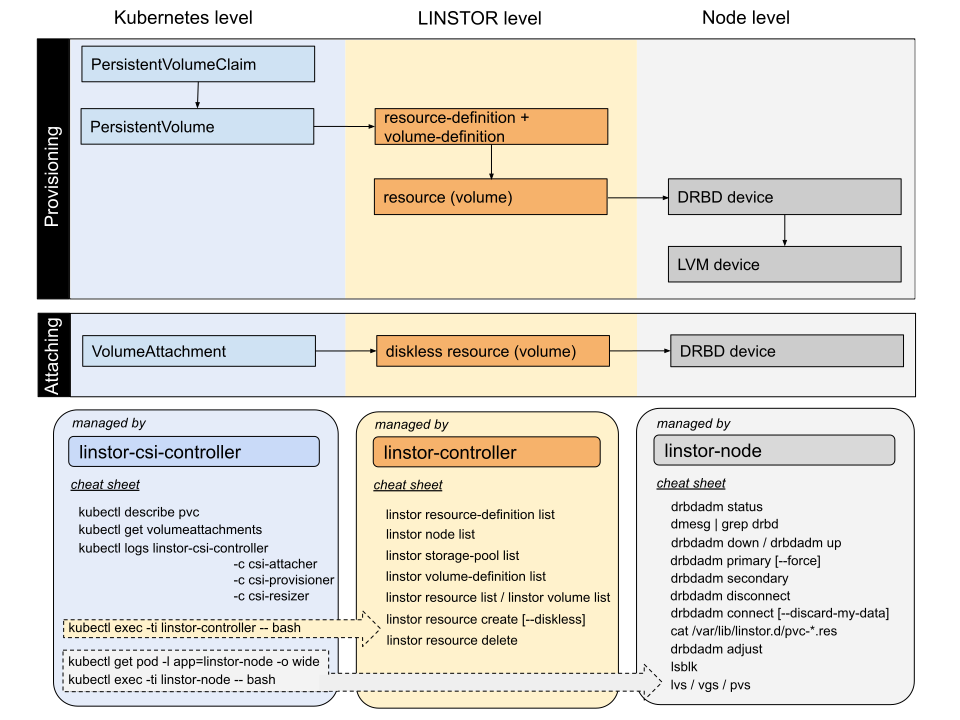


Работоспособность модуля гарантируется только при соблюдении [системных требований](./readme.html#системные-требования-и-рекомендации).
Использование в других условиях возможно, но стабильная работа в таких случаях не гарантируется.


## Когда следует использовать LVM, а когда LVMThin?

- LVM — это более простой вариант, который обеспечивает высокую производительность, близкую к производительности самого накопителя. Однако LVM не поддерживает использование снапшотов.
- LVMThin — позволяет создавать снапшоты и применять overprovisioning, что делает его более гибким, но с понижением общей производительности по сравнению с LVM.


Overprovisioning в LVMThin-пулах этого модуля ограничивает LINSTOR, а не поле `allocationLimit` у thin pool в ресурсе [LVMVolumeGroup](/modules/sds-node-configurator/cr.html#lvmvolumegroup): на тома `sds-replicated-volume` это поле не влияет. Используйте overprovisioning с осторожностью и контролируйте уровень свободного места в пуле (система мониторинга кластера уведомляет о снижении свободного места в пуле хранения LINSTOR ниже порогов 20%, 10%, 5% и 1%).

Если пул полностью исчерпает доступное место, это может привести к снижению производительности модуля и риску потери данных.


## Что происходит со снапшотами и восстановленными томами, когда один из них удаляют?

Снапшоты доступны только для томов в пулах LVMThin.

- Снапшот снимается на каждой реплике тома, и каждая реплика хранит данные своего снапшота в своём thin pool (пуле тонких томов).
- Удалять можно в любом порядке. Удаление PVC тома, у которого есть снапшоты, удаляет реплики тома, а его снапшоты по-прежнему можно восстановить. VolumeSnapshot можно удалить, пока существует восстановленный из него том: восстановленный том не зависит ни от снапшота, ни от тома, с которого снят снапшот. С восстановленного тома тоже можно снять снапшот и восстановить его.
- В thin pool блок, который снапшот делит со своим томом, освобождается, когда его больше не использует ни один том или снапшот. Свободное место, которое LINSTOR показывает для пула LVMThin, уже учитывает место, занятое снапшотами.

## Поддерживаемые дисковые конфигурации и производительность

### Поддерживаемые типы дисков

HDD — подходят для задач, ориентированных на объём и умеренную нагрузку.
SSD и NVMe — полностью поддерживаются и рекомендуются для высокопроизводительных нагрузок (базы данных, виртуальные машины с высокой IOPS, All-Flash конфигурации).
Архитектура LINSTOR/DRBD позволяет эффективно использовать SSD/NVMe блочные устройства.

Поддержка TRIM/Discard
Операции TRIM передаются прозрачно через DRBD (поддержка с версии DRBD 8.4.3). Если нижележащий диск (SSD/NVMe) поддерживает TRIM, функция работает автоматически — это ускоряет начальную синхронизацию, форматирование и общее обслуживание SSD.

### Требования к производительности

Для storage-дисков производительность определяется типом дисков, сетью и нагрузкой.
Рекомендации для высоких нагрузок: SSD/NVMe с тысячами IOPS + сеть 10+ Gbps с задержкой <5 мс (оптимально <1 мс). При использовании NVMe сеть должна соответствовать возможностям дисков, иначе станет узким местом.
Для All-Flash конфигураций общая рекомендация по пропускной способности сети составляет порядка 25-100 GbE - всё в зависимости от дисковой нагрузки.

### Дополнительные рекомендации

Избегайте аппаратного RAID для дисков, используемых в Storage Pool — лучше JBOD или прямой доступ к дискам.
Для capacity-oriented задач — режим LVM + HDD.
Для performance-oriented задач и снапшотов — режим LVMThin + SSD/NVMe (обязательно мониторить свободное место в thin-pool во избежание переполнения).

Каких либо архитектурных ограничений для All-Flash конфигураций нет.

## Какие режимы репликации и в каких случаях стоит использовать?

Всего существуют три режима репликации:

- None - одна реплика с данными. Равносильно обычному PV ресурсу, отказоустойчивость и доступность отсутствуют.
- Availability - две реплики с данными + одна бездисковая реплика (не содержит данных, в случае использования обращается к любой доступной "полноценной" реплике по сети). Обеспечивает определённую степень доступности в случае выхода одной из реплик из строя, но не гарантирует консистентость (целостность) данных.
- ConsistencyAndAvailability - три реплики с данными, полноценная отказоустойчивость с гарантированным сохранением данных в нештатной ситуации.

По умолчанию, при создании ReplicatedStorageClass используется режим ConsistencyAndAvailability, его можно задать следующим образом:

```yaml
apiVersion: storage.deckhouse.io/v1alpha1
kind: ReplicatedStorageClass
metadata:
  name: test-rsc
spec:
  reclaimPolicy: Delete
  replication: ConsistencyAndAvailability
  storagePool: sample
  topology: Ignored
  volumeAccess: Local
```

### Когда и какие режимы использовать?

None - подойдёт для тестовых сред, для кластерных приложений (например, если вы разворачиваете кластер из нескольких узлов RabbitMQ/MongoDB/MySQL/etc.).

Availability - компромиссный режим, обеспечивающий доступность, но, в случае проблем с сетевой связностью (одна из реплик в кворуме - diskless, обращение к данным в случае её использования происходит по сети) - возможна ситуация с рассинхроном и, опционально, потерей данных.
Подойдёт для не критически важных данных и приложений, которым требуется некая высокая доступность (к примеру, когда узлы периодически должны уходить в maintenance), но которым не предъявляются высокие требования к надёжности и целостности данных.

ConsistencyAndAvailability - Максимально надёжный режим репликации, рекомендуется к использованию для mission-critical приложений, критически важных данных, развёртывания виртуальных машин в среде DVP

### Как режим репликации влияет на задержку и IOPS?

Разница между режимами определяется числом реплик с данными: одна у `None`, две у `Availability` (третья, бездисковая реплика данных не хранит и записей не принимает), три у `ConsistencyAndAvailability`. Модуль реплицирует синхронно (протокол DRBD C): запись завершается, только когда её записали на диск все реплики с данными.

Запись:

- Задержка записи равна наибольшей из задержки записи на локальный диск и, для каждой другой реплики с данными, суммы сетевой задержки туда и обратно и записи на диск её узла. При трёх репликах это худшая из двух удалённых, при двух — единственная удалённая. Поэтому третья реплика добавляет немного, если у узлов одинаковые диски и сеть, и заметно больше, если один из узлов, дисков или каналов медленнее — например, реплика в другой зоне при `topology: TransZonal`.
- Узел, который пишет в том, отправляет каждый записанный блок всем остальным репликам с данными: исходящий трафик записи с узла вдвое больше объёма записи при трёх репликах и равен ему при двух. Скорость последовательной записи ограничена самым медленным из дисков и долей сети, которая достаётся каждой реплике.
- IOPS записи при большой глубине очереди падают меньше, чем можно ожидать по росту задержки, потому что запросы выполняются параллельно, но они ограничены самой медленной репликой и сетью.

Чтение:

- Если под работает на узле с репликой, хранящей данные, чтение идёт с локального диска, и число реплик не влияет на задержку и IOPS чтения. `volumeAccess: Local` всегда размещает под там. При `EventuallyLocal` реплика с данными появляется на узле пода через некоторое время после его запуска; до этого чтение и запись идут по сети, как описано ниже.
- Если под работает на узле без такой реплики (`volumeAccess: PreferablyLocal` или `Any`), каждое чтение и каждая запись идут по сети, а запись отправляется всем репликам с данными — трём или двум.

#### Как измерить на своих узлах

Цифры зависят от дисков и сети, поэтому измеряйте их на тех узлах, где будут тома. Создайте по ReplicatedStorageClass на каждый сравниваемый режим (с одинаковыми `storagePool`, `topology` и `volumeAccess: Local`), по PVC каждого класса и запустите `fio` в поде, который монтирует PVC на узле с репликой. Для сравнения выполните те же тесты на томе локального диска этого узла, например из модуля `sds-local-volume`.

В командах ниже `/data` — путь, по которому PVC смонтирован в поде.

Задержка записи (глубина очереди 1):

```shell
fio --name=write-latency --filename=/data/fio.test --size=4G --direct=1 \
  --ioengine=libaio --rw=randwrite --bs=4k --iodepth=1 --numjobs=1 \
  --runtime=60 --time_based --group_reporting
```

IOPS записи (большая глубина очереди):

```shell
fio --name=write-iops --filename=/data/fio.test --size=4G --direct=1 \
  --ioengine=libaio --rw=randwrite --bs=4k --iodepth=32 --numjobs=4 \
  --runtime=60 --time_based --group_reporting
```

Для чтения выполните те же команды с `--rw=randread`. Сравнивайте перцентили `clat` (p50, p99) для задержки и `IOPS` для производительности. Разница между реплицируемым томом и локальным диском — цена репликации, разница между двумя классами — цена третьей реплики.

## Как получить информацию об используемом пространстве?

Существует два варианта:

1. Через дашборд Grafana:

   Перейдите в «Dashboards» → «Storage» → «LINSTOR/DRBD» в интерфейсе Grafana. В правом верхнем углу дашборда отображается информация о текущем использовании пространства в кластере.

   > **Внимание.** Эта информация отражает состояние всего доступного пространства в кластере.  Если необходимо создать тома в двух репликах, то эти значения стоит делить на два, чтобы получить представление о том, сколько таких томов можно разместить в кластере.

2. Через командный интерфейс:

   ```shell
   kubectl exec -n d8-sds-replicated-volume deploy/linstor-controller -- linstor storage-pool list
   ```

   > **Внимание.** Эта информация отражает состояние всего доступного пространства в кластере. Если создаются тома в двух репликах, то эти две реплики обязательно должны целиком поместиться на двух узлах вашего кластера.

## Как назначить StorageClass по умолчанию?

Добавить в имя соответствующего StorageClass в поле `spec.settings.defaultClusterStorageClass` для конфигурации `ModuleConfig/global`.

```shell
   apiVersion: deckhouse.io/v1alpha1
   kind: ModuleConfig
   metadata:
      name: global
   spec:
      version: 2
      settings:
         defaultClusterStorageClass: 'default-fast'
```

## Как добавить существующую LVM Volume Group или LVMThin-пул?

1. Вручную назначьте на Volume Group LVM-тег `storage.deckhouse.io/enabled=true`:

   ```shell
   vgchange myvg-0 --add-tag storage.deckhouse.io/enabled=true
   ```

   Данный VG будет автоматически обнаружен и в кластере для него будет создан соответствующий ресурс `LVMVolumeGroup`.

2. Полученный ресурс укажите в параметрах [ReplicatedStoragePool](./cr.html#replicatedstoragepool) в поле `spec.lvmVolumeGroups[].name` (для LVMThin-пула необходимо дополнительно указать имя в `spec.lvmVolumeGroups[].thinPoolName`).

## Как расширить ReplicatedStoragePool на новый узел кластера?

Список `spec.lvmVolumeGroups` существующего ReplicatedStoragePool нельзя отредактировать на месте: изменение отклоняется с ошибкой `Value is immutable`. Чтобы добавить в пул новую LVM Volume Group, пересоздайте ресурс с расширенным списком. Удаление ReplicatedStoragePool не затрагивает его Storage Pool в LINSTOR, тома и ReplicatedStorageClass, использующие этот пул.

1. Создайте новую LVMVolumeGroup с помощью модуля [sds-node-configurator](/modules/sds-node-configurator/resources.html#создание-ресурса-lvmvolumegroup)

1. Посмотрите текущий ресурс:

   ```shell
   kubectl get replicatedstoragepool your-pool-name -o yaml
   ```

1. Подготовьте манифест с теми же `metadata.name` и `spec.type` и расширенным списком `spec.lvmVolumeGroups`:

   ```yaml
   apiVersion: storage.deckhouse.io/v1alpha1
   kind: ReplicatedStoragePool
   metadata:
     name: your-pool-name
   spec:
     type: LVM
     lvmVolumeGroups:
     - name: existing-vg-name
     - name: new-vg-name  # Добавьте эту строку
   ```

   Для LVMThin-пулов дополнительно укажите имя тонкого пула для каждой Volume Group:

   ```yaml
   spec:
     type: LVMThin
     lvmVolumeGroups:
     - name: existing-vg-name
       thinPoolName: existing-thin-pool
     - name: new-vg-name
       thinPoolName: new-thin-pool  # Добавьте эту строку
   ```

1. Удалите ресурс и сразу создайте его заново из подготовленного манифеста:

   ```shell
   kubectl delete replicatedstoragepool your-pool-name
   kubectl apply -f your-pool-name.yaml
   ```

   Пока ресурса нет, StorageClass'ы этого пула могут получить лейбл `storage.deckhouse.io/nonOperational-not-enough-nodes-in-zones`; он снимается после повторного создания ресурса.

1. Убедитесь, что ресурс перешёл в состояние `Ready`, а Storage Pool появился на новом узле:

   ```shell
   kubectl get replicatedstoragepool your-pool-name
   kubectl -n d8-sds-replicated-volume exec -ti deploy/linstor-controller -- linstor storage-pool list -s your-pool-name
   ```

## Как увеличить ограничение на количество DRBD-томов / изменить порты, по которым DRBD-кластера общаются между собой?

Воспользуйтесь настройкой `drbdPortRange`. По умолчанию для DRBD-ресурсов используются TCP-порты 7000-7999. С помощью `minPort` и `maxPort` эти значения можно переопределить.


После изменения параметров `drbdPortRange`, `minPort` и `maxPort` перезапуск контроллера LINSTOR обязателен для применения новых настроек.

Изменение портов не повлияет на уже существующие DRBD-ресурсы — они продолжат работать на тех портах, которые были назначены ранее.

После изменения drbdPortRange minPort/maxPort linstor-controller нужно перезапустить.



## Как правильно перезагрузить узел с DRBD-ресурсами


Для повышения стабильности работы модуля рекомендуется избегать перезагрузки нескольких узлов одновременно.


1. Выполните drain узла:

   ```shell
   kubectl drain test-node-1 --ignore-daemonsets --delete-emptydir-data
   ```

2. Проверьте, что в DRBD нет проблемных ресурсов или ресурсов в `SyncTarget`. Если они есть, дождитесь синхронизации или примите меры для восстановления нормальной работоспособности.

   ```console
   kubectl -n d8-sds-replicated-volume exec -t deploy/linstor-controller -- linstor r l --faulty
   ```

   Пример вывода:

   ```console
   Defaulted container "linstor-controller" out of: linstor-controller, kube-rbac-proxy
   +----------------------------------------------------------------+
   | ResourceName | Node | Port | Usage | Conns | State | CreatedOn |
   |================================================================|
   +----------------------------------------------------------------+
   ```

3. Перезагрузите узел и дождитесь синхронизации **всех** DRBD-ресурсов. Выполните uncordon узла. При необходимости перезагрузки еще одного узла — повторите алгоритм.

   ```shell
   kubectl uncordon test-node-1
   node/test-node-1 uncordoned
   ```

## Как освободить место в Storage Pool через перенос ресурсов на другой узел

1. Проверьте список Storage Pool:

   ```shell
   `kubectl exec -n d8-sds-replicated-volume deploy/linstor-controller -- linstor storage-pool list -n OLD_NODE`
   ```

2. Проверьте расположение томов:

   ```shell
   `kubectl exec -n d8-sds-replicated-volume deploy/linstor-controller -- linstor volume list -n OLD_NODE`
   ```

3. Определитесь с ресурсами, которые вы хотите переместить:

   ```shell
   `kubectl exec -n d8-sds-replicated-volume deploy/linstor-controller -- linstor resource list-volumes`
   ```

4. Переместите ресурсы на другой узел (не более 1-2 ресурсов одновременно):

   ```shell
   kubectl exec -n d8-sds-replicated-volume deploy/linstor-controller -- linstor --yes-i-am-sane-and-i-understand-what-i-am-doing resource create NEW_NODE RESOURCE_NAME
   ```

   ```shell
   kubectl exec -n d8-sds-replicated-volume deploy/linstor-controller -- linstor resource-definition wait-sync RESOURCE_NAME
   ```

   ```shell
   kubectl exec -n d8-sds-replicated-volume deploy/linstor-controller -- linstor --yes-i-am-sane-and-i-understand-what-i-am-doing resource delete OLD_NODE RESOURCE_NAME
   ```

## Можно ли автоматизировать управление репликами и мониторинг состояния LINSTOR?

Управление репликами и мониторинг состояния автоматизированы в скрите `replicas_manager.sh`.
Он проверяет доступность контроллера LINSTOR, выявляет неисправные или поврежденные ресурсы, создает резервные копии базы данных и управляет дисковыми репликами, включая настройку TieBreaker для кворума.

Чтобы проверить существование скрипта `replicas_manager.sh`, выполните команду на любом из master-узлов:

   ```shell
   ls -l /var/lib/deckhouse/sbin/replicas_manager.sh
   ```

После запуска скрипт выполняет следующие действия:
- Проверяет доступность контроллера и соединение с сателлитами
- Выявляет неисправные или поврежденные ресурсы
- Создает резервную копию базы данных
- Управляет количеством дисковых реплик, добавляя новые при необходимости
- Настраивает TieBreaker для ресурсов с двумя репликами
- Логирует все действия в файл linstor_replicas_manager_<дата_и_время>.log
- Предоставляет рекомендации по устранению проблем, таких как застрявшие реплики

Переменные для настройки replicas_manager.sh:
- NON_INTERACTIVE — включает неинтерактивный режим
- TIMEOUT_SEC — таймаут между попытками, в секундах (по умолчанию: 10)
- EXCLUDED_RESOURCES_FROM_CHECK — регулярное выражение для исключения ресурсов из проверок
- CHUNK_SIZE — размер чанка для обработки ресурсов (по умолчанию: 10)
- NODE_FOR_EVICT — имя узла, исключаемого из создания реплик
- LINSTOR_NAMESPACE — пространство имен Kubernetes (по умолчанию: d8-sds-replicated-volume)
- DISKLESS_STORAGE_POOL — пул для diskless реплик (по умолчанию: DfltDisklessStorPool)

## Как вытеснить DRBD-ресурсы с узла?

Вытеснение DRBD-ресурсов с узла выполняется скриптом `evict.sh`. Он может работать в двух режимах:

- Режим `Удаление узла` - в этом режиме будет выполнено следующее:
  - созданы дополнительные реплики для каждого ресурса, размещенного на заданном узле;
  - удаление узла из `LINSTOR`;
  - удаление узла из `Kubernetes`;

- Режим `Удаление ресурсов` - в этом режиме будет выполнено следующее:
  - созданы дополнительные реплики для каждого ресурса, размещенного на заданном узле;
  - удаление ресурсов, размещенных на заданном узле, из `LINSTOR`;

Перед выполнением вытеснения необходимо выполнить следующие действия:

1. Проверьте существование скрипта `evict.sh` на любом из master-узлов:

   ```shell
   ls -l /var/lib/deckhouse/sbin/evict.sh
   ```

2. Исправьте все ошибочные ресурсы в кластере. Чтобы найти их, выполните следующую команду:

   ```shell
   kubectl -n d8-sds-replicated-volume exec -ti deploy/linstor-controller -- linstor resource list --faulty
   ```

3. Убедитесь, что все поды в пространстве имен `d8-sds-replicated-volume` находятся в состоянии `Running`:

   ```shell
   kubectl -n d8-sds-replicated-volume get pods | grep -v Running
   ```

### Пример удаления узла с удалением из LINSTOR и Kubernetes

Запустите скрипт `evict.sh` на любом из master-узлов в интерактивном режиме, указав режим удаления `--delete-node`:

```shell
/var/lib/deckhouse/sbin/evict.sh --delete-node
```

Для запуска скрипта `evict.sh` в неинтерактивном режиме необходимо добавить флаг `--non-interactive` при его вызове, а также имя узла, с которого необходимо вытеснить ресурсы. В этом режиме скрипт выполнит все действия без запроса подтверждения от пользователя.

Пример вызова:

```shell
/var/lib/deckhouse/sbin/evict.sh --non-interactive --delete-node --node-name "worker-1"
```

### Пример удаления ресурсов с узла без удаления самого узла

1. Запустите скрипт `evict.sh` на любом из master-узлов в интерактивном режиме, указав режим удаления `--delete-resources-only`:

   ```shell
   /var/lib/deckhouse/sbin/evict.sh --delete-resources-only
   ```

   Для запуска скрипта `evict.sh` в неинтерактивном режиме необходимо добавить флаг `--non-interactive` при его вызове, а также имя узла, с которого необходимо вытеснить ресурсы. В этом режиме скрипт выполнит все действия без запроса подтверждения от пользователя.

   Пример вызова:

   ```shell
   /var/lib/deckhouse/sbin/evict.sh --non-interactive --delete-resources-only --node-name "worker-1"
   ```

   > **Важно.** После завершения работы скрипта узел в Kubernetes останется в статусе *SchedulingDisabled*, а в LINSTOR у данного узла будет выставлен параметр *AutoplaceTarget=false*, что запретит его планировщику создавать на этом узле ресурсы.

2. Если необходимо снова разрешить размещать DRBD-ресурсы и поды на узле, выполните команды:

   ```shell
   alias linstor='kubectl -n d8-sds-replicated-volume exec -ti deploy/linstor-controller -- linstor'
   linstor node set-property "worker-1" AutoplaceTarget
   kubectl uncordon "worker-1"
   ```

3. Проверьте параметр `AutoplaceTarget` у всех узлов (поле `AutoplaceTarget` будет пустым у тех узлов, на которых разрешено размещать ресурсы LINSTOR):

   ```shell
   alias linstor='kubectl -n d8-sds-replicated-volume exec -ti deploy/linstor-controller -- linstor'
   linstor node list -s AutoplaceTarget
   ```

### Описание параметров скрипта `evict.sh`

- `--delete-node` — удаление узла из LINSTOR и Kubernetes с предварительным созданием дополнительных реплик для всех ресурсов, размещенных на узле;
- `--delete-resources-only` — удаление ресурсов с узла без удаления узла из LINSTOR и Kubernetes с предварительным созданием дополнительных реплик для всех ресурсов, размещенных на узле;
- `--non-interactive` — запуск скрипта в неинтерактивном режиме;
- `--node-name` — имя узла, с которого необходимо вытеснить ресурсы. Параметр обязателен для использования в режиме `--non-interactive`;
- `--skip-db-backup` — пропустить создание резервной копии БД LINSTOR перед выполнением операций;
- `--ignore-advise` — выполнить операции, несмотря на предупреждения команды `linstor advise resource`. Использовать, если скрипт был прерван и количество реплик у части ресурсов не соответствует указаному в `ReplicatedStorageClass`;
- `--exclude-resources-from-check` — исключить из проверки ресурсы, перечисленные через символ `|`;

## Как зачистить узел от DRBD и томов модуля, если кластер недоступен?


Процедура уничтожает данные томов модуля на узле. Применяйте её только для узла, который окончательно вышел из кластера, или для кластера, которого больше нет. Если кластер работает, вытесните ресурсы скриптом `evict.sh`, см. [Как вытеснить DRBD-ресурсы с узла?](#как-вытеснить-drbd-ресурсы-с-узла).


Скрипт `cleanup_static_node.sh` модуля `node-manager` ничего не знает о DRBD и LVM: после его работы на узле остаются загруженный модуль ядра `drbd`, его файлы конфигурации в `/etc` и логические тома модуля в группах томов. Приведённый ниже скрипт `srv-node-cleanup.sh` убирает эти остатки на узле без работающего кластера. Он подходит для обоих control plane модуля (LINSTOR и нового) и использует только то, что есть на узле (`lvm2`, `kmod`, `awk`; `drbdsetup`, если DRBD-ресурсы подняты).

1. Убедитесь, что нужные вам данные хранятся в другом месте: реплики узла исчезнут вместе с его томами.

1. Выведите узел из кластера, если кластер существует, и остановите на нём `kubelet`:

   ```shell
   d8 k drain <node> --ignore-daemonsets --delete-emptydir-data
   d8 k delete node <node>
   ```

   ```shell
   systemctl disable --now bashible.timer kubelet
   ```

   `bashible.timer` останавливается тоже: если он сработает после перезагрузки узла, вышедшего из кластера, он снова включит `kubelet`.

1. Сохраните скрипт из конца этого раздела на узле как `/root/srv-node-cleanup.sh` и сделайте его исполняемым:

   ```shell
   chmod +x /root/srv-node-cleanup.sh
   ```

1. Запустите скрипт без флагов. Это пробный запуск (dry-run): он ничего не меняет и печатает всё, что сделал бы. Проверьте список, особенно логические тома:

   ```shell
   /root/srv-node-cleanup.sh --delete-volumes --vg <группа-томов>
   ```

1. Запустите его ещё раз с флагом `--apply`:

   ```shell
   /root/srv-node-cleanup.sh --delete-volumes --vg <группа-томов> --apply
   ```

   Скрипт идемпотентен: повторный запуск ничего не находит и ничего не делает. Действия запуска с `--apply` записываются в `/var/log/srv-node-cleanup-<дата>.log`.

1. Запустите скрипт очистки модуля `node-manager`, как описано в [Как очистить узел для последующего ввода в кластер?](/modules/node-manager/faq.html#как-очистить-узел-для-последующего-ввода-в-кластер):

   ```shell
   bash /var/lib/bashible/cleanup_static_node.sh --yes-i-am-sane-and-i-understand-what-i-am-doing
   ```

   Скрипт удаляет пользователей, созданных платформой на узле (в том числе того, под которым вы могли войти), и в конце перезагружает узел.

1. Проверьте, что ничего не осталось:

   ```shell
   lsmod | grep drbd
   ls /etc/modprobe.d/drbd.conf /etc/modules-load.d/d8_drbd.conf /etc/multipath/conf.d/drbd.conf /opt/deckhouse/drbd
   ```

   Обе команды не должны ничего выводить (вторая должна только сообщить об отсутствии файлов).

### Флаги скрипта `srv-node-cleanup.sh`

- `--apply` — выполнить действия. Без него скрипт только печатает, что сделал бы.
- `--delete-volumes` — удалить также логические тома модуля. Требует хотя бы один `--vg`. Без него тома только перечисляются.
- `--vg <имя>` — группа томов, в которой искать логические тома модуля. Можно указать несколько раз. В группе томов, которая не названа, скрипт тома не ищет.
- `--force` — остановить DRBD-ресурсы в роли `Primary`. Без него скрипт отказывается работать, пока такой ресурс есть.
- `-h`, `--help` — вывести справку.

Перед работой скрипт проверяет, что `kubelet` остановлен, что узел не зарегистрирован в кластере (насколько это видно с самого узла: по оставшимся на нём учётным данным kubelet; если API-сервер недоступен, скрипт сообщает, что проверить не удалось) и что нет DRBD-ресурсов в роли `Primary`. Если проверка не пройдена, `--apply` ничего не меняет, а пробный запуск всё равно печатает план. DRBD-ресурсы останавливаются командой `drbdsetup`, которую модуль запускает в своих контейнерах и которой на узле обычно нет: если DRBD-устройства есть, а `drbdsetup` нет, установите `drbd-utils` или перезагрузите узел с отключёнными `kubelet` и `bashible.timer` и запустите скрипт снова.

### Что скрипт удаляет, а что оставляет

Скрипт удаляет:

- работающие контейнеры модуля (`crictl stop` для пространства имён `d8-sds-replicated-volume`), чтобы агент не вернул ресурсы, и отключает `bashible.timer` и `bashible.service`: иначе после перезагрузки они запустятся снова, включат `kubelet` и вернут файлы модуля;
- DRBD-ресурсы (`drbdsetup down`) и модуль ядра `drbd` вместе с транспортными модулями (`drbd_transport_tcp`, `drbd_transport_lb_tcp`, `drbd_transport_rdma`), если они загружены и имеют версию 9 (модуль, который установил кластер); модуль DRBD другой версии, поставляемый с ядром, не затрагивается. Если модуль остаётся занятым, скрипт сообщает об этом: он остаётся загруженным до перезагрузки узла, которую в конце выполняет `cleanup_static_node.sh`, и после неё не загрузится, так как его файлы и конфигурация удалены;
- файлы модуля этой версии (`drbd*.ko*`) в `/lib/modules/<ядро>/` и пересобирает `depmod`;
- `/etc/modprobe.d/drbd.conf` и `/etc/modules-load.d/d8_drbd.conf`, если в них только то, что записал модуль (изменённый файл остаётся, о нём выводится сообщение), строку `drbd` в `/etc/modules` и `/etc/multipath/conf.d/drbd.conf` (с перечитыванием `multipathd`);
- `/opt/deckhouse/drbd`, `/var/cache/registrypackages/drbd`, `/var/cache/registrypackages/drbdLegacy` и `/dev/sdsrv`;
- элемент `"r|^/dev/drbd|"` в `devices/global_filter` и строку `global/use_lvmetad = 0` в `/etc/lvm/lvm.conf`. Модуль не оставляет маркера этих правок, поэтому скрипт переписывает строки по содержимому, сначала печатает разницу и сохраняет копию `/etc/lvm/lvm.conf.srv-cleanup.<дата>` перед изменением файла. `global_filter`, который скрипт не может переписать (например, записанный в несколько строк), выводится для ручной правки. Юниты `lvm2-lvmetad`, которые модуль замаскировал, остаются замаскированными; снимите маскировку командой `systemctl unmask lvm2-lvmetad.socket lvm2-lvmetad.service`, если узлу они нужны;
- с `--delete-volumes` — только в группах томов из `--vg` — логические тома с именами `pvc-<uuid>_NNNNN` (LINSTOR control plane) или `pvc-<uuid>-N-<hash>` (новый control plane). Остальные логические тома, включая снимки модуля, выводятся как сохранённые. Снимки модуля называются иначе: удалите их вручную через `lvs` и `lvremove`, если они не нужны.

Скрипт не затрагивает:

- группы томов, физические тома и thin-пулы: они принадлежат модулю `sds-node-configurator`, и без кластера их никто за вас не удалит;
- модуль `dm-thin-pool` и каталог `/run/lock/lvm`;
- всё, чем занимается `cleanup_static_node.sh`.

Чтобы полностью освободить диски узла, удалите группу томов вручную после завершения скрипта. В работающем кластере это делает ресурс LVMVolumeGroup, см. [документацию sds-node-configurator](/modules/sds-node-configurator/faq.html#как-отключить-модуль):

```shell
vgs
vgremove <группа-томов>
pvremove <устройство>
wipefs -a <устройство>
```

Текст скрипта:

```bash
#!/usr/bin/env bash
# Copyright 2026 Flant JSC
#
# Licensed under the Apache License, Version 2.0 (the "License");
# you may not use this file except in compliance with the License.
# You may obtain a copy of the License at
#
#     http://www.apache.org/licenses/LICENSE-2.0
#
# Unless required by applicable law or agreed to in writing, software
# distributed under the License is distributed on an "AS IS" BASIS,
# WITHOUT WARRANTIES OR CONDITIONS OF ANY KIND, either express or implied.
# See the License for the specific language governing permissions and
# limitations under the License.

set -Eeuo pipefail

export LVM_SUPPRESS_FD_WARNINGS=1
ROOT="${SRV_NODE_CLEANUP_ROOT:-}"
APPLY=0
DELETE_VOLUMES=0
FORCE=0
VGS=()
FAILURES=0
REBOOT_NEEDED=0
PREFLIGHT_FAILED=0
TS="$(date +%Y%m%d-%H%M%S)"
LOG_FILE="${ROOT}/var/log/srv-node-cleanup-${TS}.log"

LINSTOR_LV_RE='^pvc-[0-9a-f]{8}-[0-9a-f]{4}-[0-9a-f]{4}-[0-9a-f]{4}-[0-9a-f]{12}_[0-9]{5}$'
NEW_CP_LV_RE='^pvc-[0-9a-f]{8}-[0-9a-f]{4}-[0-9a-f]{4}-[0-9a-f]{4}-[0-9a-f]{12}-[0-9]{1,2}-[0-9a-f]{32}$'
DRBD_FILTER_ELEMENT='"r|^/dev/drbd|"'

usage() {
  cat <<'EOF'
Usage: srv-node-cleanup.sh [--apply] [--delete-volumes --vg <name> ...] [--force]

Removes DRBD and sds-replicated-volume leftovers from a node that is no longer
managed by a cluster. Without --apply it only prints what it would do.

  --apply            perform the actions; without it nothing is changed
  --delete-volumes   also remove the module's logical volumes (LINSTOR
                     "pvc-<uuid>_NNNNN" and new control plane
                     "pvc-<uuid>-N-<hash>") from the volume groups given by --vg
  --vg <name>        volume group to look for the module's logical volumes in;
                     may be repeated; volume groups, physical volumes and thin
                     pools are never removed
  --force            bring down DRBD resources that are Primary
  -h, --help         show this help
EOF
}

die() {
  echo "ERROR: $*" >&2
  exit 2
}

while [[ $# -gt 0 ]]; do
  case "$1" in
    --apply) APPLY=1 ;;
    --delete-volumes) DELETE_VOLUMES=1 ;;
    --force) FORCE=1 ;;
    --vg)
      [[ $# -ge 2 ]] || die "--vg requires a volume group name"
      VGS+=("$2")
      shift
      ;;
    -h | --help)
      usage
      exit 0
      ;;
    *)
      usage >&2
      die "unknown argument: $1"
      ;;
  esac
  shift
done

if [[ ${DELETE_VOLUMES} -eq 1 && ${#VGS[@]} -eq 0 ]]; then
  die "--delete-volumes requires at least one --vg"
fi
if [[ ${#VGS[@]} -gt 0 && ${DELETE_VOLUMES} -eq 0 ]]; then
  echo "NOTE: --vg without --delete-volumes only lists the volumes that would be removed"
fi

if [[ ${EUID} -ne 0 && -z "${ROOT}" ]]; then
  die "must be run as root"
fi

if [[ ${APPLY} -eq 1 ]]; then
  mkdir -p "$(dirname "${LOG_FILE}")"
  exec > >(tee -a "${LOG_FILE}") 2>&1
  echo "Log file: ${LOG_FILE}"
  MODE_LABEL="DOING"
else
  echo "Dry run: nothing is changed. Pass --apply to perform the actions."
  MODE_LABEL="WOULD"
fi

have() {
  command -v "$1" >/dev/null 2>&1
}

act() {
  local description="$1"
  shift
  echo "${MODE_LABEL}  ${description}"
  if [[ ${APPLY} -eq 1 ]]; then
    if ! "$@"; then
      echo "FAILED  ${description}" >&2
      FAILURES=$((FAILURES + 1))
      return 1
    fi
  fi
  return 0
}

preflight_fail() {
  echo "PREFLIGHT  $*" >&2
  PREFLIGHT_FAILED=1
}

drbd_resources() {
  have drbdsetup || return 0
  drbdsetup status 2>/dev/null | awk '/^[^[:space:]]/ { print $1 }' || true
}

primary_resources() {
  have drbdsetup || return 0
  drbdsetup status 2>/dev/null | awk '/^[^[:space:]]+[[:space:]]+role:Primary/ { print $1 }' || true
}

drbd_devices_present() {
  local dev
  for dev in "${ROOT}"/sys/block/drbd*; do
    if [[ -e "${dev}" ]]; then
      return 0
    fi
  done
  return 1
}

module_loaded() {
  grep -q "^$1 " "${ROOT}/proc/modules" 2>/dev/null
}

check_preflight() {
  echo "== Preflight"
  if have systemctl && systemctl is-active --quiet kubelet 2>/dev/null; then
    preflight_fail "kubelet is active: stop it (systemctl disable --now bashible.timer kubelet) once the node is out of the cluster"
  fi

  local kubeconfig="${ROOT}/etc/kubernetes/kubelet.conf"
  local kubectl_bin="${ROOT}/opt/deckhouse/bin/kubectl"
  if [[ -f "${kubeconfig}" && -x "${kubectl_bin}" ]]; then
    local node answer
    node="$(hostname | tr '[:upper:]' '[:lower:]')"
    if answer="$(timeout 15 "${kubectl_bin}" --kubeconfig "${kubeconfig}" get node "${node}" -o name 2>&1)"; then
      preflight_fail "node ${node} is still registered in a cluster: use evict.sh instead of this script"
    elif [[ "${answer}" == *NotFound* ]]; then
      echo "node ${node} is not registered in the cluster"
    else
      answer="${answer%%$'\n'*}"
      echo "WARNING: cannot verify from the node that it left the cluster (${answer:0:100}), make sure it did"
    fi
  else
    echo "no kubelet credentials on the node, cluster membership is not checked"
  fi

  local primaries
  primaries="$(primary_resources)"
  if [[ -n "${primaries}" && ${FORCE} -eq 0 ]]; then
    preflight_fail "DRBD resources in the Primary role: $(echo "${primaries}" | tr '\n' ' ')- stop what uses them or pass --force"
  fi

  if ! have drbdsetup && drbd_devices_present; then
    preflight_fail "DRBD devices exist but drbdsetup is not installed on the host: install drbd-utils or reboot the node with kubelet and bashible.timer disabled, then run the script again"
  fi

  if [[ ${PREFLIGHT_FAILED} -eq 1 && ${APPLY} -eq 1 ]]; then
    echo "Preflight failed, nothing was changed." >&2
    exit 1
  fi
  if [[ ${PREFLIGHT_FAILED} -eq 1 ]]; then
    echo "Preflight failed: the plan below is informational, --apply would stop here."
  fi
}

stop_bashible() {
  have systemctl || return 0
  local unit state
  for unit in bashible.timer bashible.service; do
    state="$(systemctl is-enabled "${unit}" 2>/dev/null || true)"
    if [[ "${state}" == enabled* ]]; then
      act "systemctl disable --now ${unit}" systemctl disable --now "${unit}" || true
    elif systemctl is-active --quiet "${unit}" 2>/dev/null; then
      act "systemctl stop ${unit}" systemctl stop "${unit}" || true
    fi
  done
}

stop_module_containers() {
  echo "== Containers of the module"
  local crictl_bin="${ROOT}/opt/deckhouse/bin/crictl"
  if [[ ! -x "${crictl_bin}" ]]; then
    crictl_bin="$(command -v crictl || true)"
  fi
  if [[ -z "${crictl_bin}" ]]; then
    echo "crictl is not installed, containers are not looked for"
    return 0
  fi
  local ids id found=0
  if ! ids="$("${crictl_bin}" ps -q --label io.kubernetes.pod.namespace=d8-sds-replicated-volume 2>/dev/null)"; then
    echo "WARNING: cannot list containers, make sure no container of the module is running"
    return 0
  fi
  while IFS= read -r id; do
    [[ -n "${id}" ]] || continue
    found=1
    act "crictl stop ${id}" "${crictl_bin}" stop "${id}" || true
  done <<<"${ids}"
  [[ ${found} -eq 1 ]] || echo "no running containers of the module"
}

bring_down_drbd() {
  echo "== DRBD resources"
  local resource found=0
  while IFS= read -r resource; do
    [[ -n "${resource}" ]] || continue
    found=1
    if [[ ${FORCE} -eq 1 ]]; then
      act "drbdsetup down --force ${resource}" drbdsetup down --force "${resource}" || true
    else
      act "drbdsetup down ${resource}" drbdsetup down "${resource}" || true
    fi
  done < <(drbd_resources)
  [[ ${found} -eq 1 ]] || echo "no DRBD resources"
}

drbd_module_files() {
  have modinfo || return 0
  local path version dir
  path="$(modinfo -n drbd 2>/dev/null || true)"
  [[ -f "${path}" ]] || return 0
  version="$(modinfo -F version drbd 2>/dev/null || true)"
  [[ "${version}" == 9* ]] || return 0
  dir="$(dirname "${path}")"
  for path in "${dir}"/drbd*.ko*; do
    if [[ -f "${path}" ]]; then
      echo "${path}"
    fi
  done
}

rmmod_retry() {
  local module="$1" attempts=10
  while [[ ${attempts} -gt 0 ]]; do
    if rmmod "${module}"; then
      return 0
    fi
    attempts=$((attempts - 1))
    sleep 2
  done
  echo "WARNING: module ${module} is still in use (refcnt $(cat "${ROOT}/sys/module/${module}/refcnt" 2>/dev/null || echo unknown)) and stays loaded until the node is rebooted"
  REBOOT_NEEDED=1
  return 0
}

unload_drbd_modules() {
  echo "== DRBD kernel modules"
  local module version=""
  if [[ -r "${ROOT}/sys/module/drbd/version" ]]; then
    version="$(cat "${ROOT}/sys/module/drbd/version")"
  fi
  if [[ -n "${version}" && "${version}" != 9* ]]; then
    echo "loaded drbd module is version ${version} (not installed by the module), left alone"
    return 0
  fi
  local any=0 transports
  transports="$(awk '/^drbd_transport_/ { print $1 }' "${ROOT}/proc/modules" 2>/dev/null || true)"
  for module in ${transports} drbd; do
    if module_loaded "${module}"; then
      any=1
      act "rmmod ${module}" rmmod_retry "${module}" || true
    fi
  done
  [[ ${any} -eq 1 ]] || echo "no DRBD modules loaded"
}

remove_path() {
  local path="$1"
  if [[ -e "${path}" || -L "${path}" ]]; then
    act "rm -rf ${path}" rm -rf "${path}" || true
  fi
}

remove_if_content() {
  local path="$1" expected="$2"
  [[ -f "${path}" ]] || return 0
  if [[ "$(grep -v '^[[:space:]]*$' "${path}")" == "${expected}" ]]; then
    act "rm ${path}" rm -f "${path}" || true
  else
    echo "SKIP  ${path} was modified, left alone"
  fi
}

remove_files() {
  echo "== Files and directories"
  remove_if_content "${ROOT}/etc/modprobe.d/drbd.conf" "options drbd usermode_helper=disabled"
  remove_if_content "${ROOT}/etc/modules-load.d/d8_drbd.conf" "drbd"

  if [[ -f "${ROOT}/etc/modules" ]] && grep -q -E '^drbd$' "${ROOT}/etc/modules"; then
    act "remove the drbd line from /etc/modules" sed -i '/^drbd$/d' "${ROOT}/etc/modules" || true
  fi

  local multipath_conf="${ROOT}/etc/multipath/conf.d/drbd.conf"
  if [[ -f "${multipath_conf}" ]]; then
    act "rm ${multipath_conf}" rm -f "${multipath_conf}" || true
    if have systemctl && systemctl is-enabled --quiet multipathd 2>/dev/null; then
      act "systemctl reload multipathd" systemctl reload multipathd || true
    fi
  fi

  remove_path "${ROOT}/opt/deckhouse/drbd"
  remove_path "${ROOT}/var/cache/registrypackages/drbd"
  remove_path "${ROOT}/var/cache/registrypackages/drbdLegacy"
  remove_path "${ROOT}/dev/sdsrv"
}

lvm_conf_rewrite() {
  awk -v element="${DRBD_FILTER_ELEMENT}" '
    function drop(line,    pre, post, i) {
      i = index(line, element)
      if (i == 0) return line
      pre = substr(line, 1, i - 1)
      post = substr(line, i + length(element))
      if (match(post, /^[[:space:]]*,[[:space:]]*/)) {
        post = substr(post, RLENGTH + 1)
      } else if (match(pre, /,[[:space:]]*$/)) {
        pre = substr(pre, 1, RSTART - 1)
      }
      return pre post
    }
    /^[[:space:]]*#/ { print; next }
    /^[[:space:]]*global_filter[[:space:]]*=[[:space:]]*\[.*\]/ {
      if (index($0, element) > 0) {
        line = drop($0)
        if (line ~ /=[[:space:]]*\[[[:space:]]*\]/) next
        print line
        next
      }
    }
    /^[[:space:]]*use_lvmetad[[:space:]]*=[[:space:]]*0[[:space:]]*(#.*)?$/ { next }
    { print }
  ' "$1"
}

edit_lvm_conf() {
  echo "== LVM configuration"
  local conf="${ROOT}/etc/lvm/lvm.conf"
  if [[ ! -f "${conf}" ]]; then
    echo "no ${conf}"
    return 0
  fi
  local tmp leftover=0
  tmp="$(mktemp "${conf}.XXXXXX")"
  lvm_conf_rewrite "${conf}" >"${tmp}"
  if cmp -s "${conf}" "${tmp}"; then
    echo "no DRBD filter or use_lvmetad=0 in ${conf}"
  else
    echo "${MODE_LABEL}  edit ${conf} (backup ${conf}.srv-cleanup.${TS}):"
    diff -u "${conf}" "${tmp}" | sed 's/^/    /' || true
    if [[ ${APPLY} -eq 1 ]]; then
      cp -a "${conf}" "${conf}.srv-cleanup.${TS}"
      cat "${tmp}" >"${conf}"
    fi
  fi
  if grep -v '^[[:space:]]*#' "${tmp}" | grep -qF "${DRBD_FILTER_ELEMENT}"; then
    leftover=1
  fi
  rm -f "${tmp}"
  if [[ ${leftover} -eq 1 ]]; then
    echo "MANUAL  ${DRBD_FILTER_ELEMENT} is still in ${conf} in a form the script does not rewrite (for example a multi-line global_filter): remove it by hand"
  fi
}

find_lvm() {
  local candidate
  if have lvm; then
    echo lvm
    return 0
  fi
  for candidate in \
    "${ROOT}/var/lib/deckhouse/sds/bin/lvm" \
    "${ROOT}/opt/deckhouse/sds/bin/lvm" \
    "${ROOT}/opt/deckhouse/sds/bin/lvm.static"; do
    if [[ -x "${candidate}" ]]; then
      echo "${candidate}"
      return 0
    fi
  done
}

remove_volumes() {
  [[ ${#VGS[@]} -gt 0 ]] || return 0
  echo "== Logical volumes"
  local lvm_bin vg lv matched
  lvm_bin="$(find_lvm)"
  if [[ -z "${lvm_bin}" ]]; then
    echo "WARNING: lvm is not found in PATH or in the sds-node-configurator directories, logical volumes are not looked for"
    return 0
  fi
  for vg in "${VGS[@]}"; do
    if ! "${lvm_bin}" vgs --noheadings -o vg_name "${vg}" >/dev/null 2>&1; then
      echo "volume group ${vg} not found"
      continue
    fi
    matched=0
    while IFS= read -r lv; do
      lv="${lv//[[:space:]]/}"
      [[ -n "${lv}" ]] || continue
      if [[ "${lv}" =~ ${LINSTOR_LV_RE} || "${lv}" =~ ${NEW_CP_LV_RE} ]]; then
        matched=1
        if [[ ${DELETE_VOLUMES} -eq 1 ]]; then
          act "lvremove ${vg}/${lv}" "${lvm_bin}" lvremove -y "${vg}/${lv}" || true
        else
          echo "FOUND  ${vg}/${lv} (kept, pass --delete-volumes to remove)"
        fi
      else
        echo "KEEP  ${vg}/${lv} (not a volume of the module)"
      fi
    done < <("${lvm_bin}" lvs --noheadings -o lv_name "${vg}" 2>/dev/null)
    [[ ${matched} -eq 1 ]] || echo "no volumes of the module in ${vg}"
  done
}

main() {
  check_preflight
  stop_bashible
  local module_files
  module_files="$(drbd_module_files)"
  stop_module_containers
  bring_down_drbd
  unload_drbd_modules
  remove_volumes
  remove_module_files_from "${module_files}"
  remove_files
  edit_lvm_conf

  echo "== Summary"
  if [[ ${FAILURES} -gt 0 ]]; then
    echo "${FAILURES} action(s) failed, see FAILED lines above" >&2
    exit 1
  fi
  if [[ ${PREFLIGHT_FAILED} -eq 1 ]]; then
    exit 1
  fi
  if [[ ${APPLY} -eq 1 ]]; then
    if [[ ${REBOOT_NEEDED} -eq 1 ]]; then
      echo "The drbd module stays loaded until the node is rebooted, which cleanup_static_node.sh does at the end: its files and its configuration are already removed, so it is not loaded again."
    fi
    echo "Done. Run cleanup_static_node.sh to finish the node cleanup."
  else
    echo "Dry run finished. Review the plan and run again with --apply."
  fi
}

remove_module_files_from() {
  local file removed=0
  while IFS= read -r file; do
    [[ -n "${file}" ]] || continue
    removed=1
    act "rm ${file}" rm -f "${file}" || true
  done <<<"$1"
  if [[ ${removed} -eq 1 ]]; then
    act "depmod" depmod || true
  fi
}

main
```

## Диагностика проблем

Проблемы могут возникнуть на разных уровнях работы компонентов.
Эта шпаргалка поможет вам быстро сориентироваться при диагностике различных проблем с томами, созданными в LINSTOR:


<!--- Исходник: https://docs.google.com/drawings/d/19hn3nRj6jx4N_haJE0OydbGKgd-m8AUSr0IqfHfT6YA/edit --->

Некоторые типичные проблемы описаны ниже.

### linstor-node не может запуститься из-за невозможности загрузки DRBD-модуля

1. Проверьте состояние подов `linstor-node`:

   ```shell
   kubectl get pod -n d8-sds-replicated-volume -l app=linstor-node
   ```

2. Если некоторые поды находятся в состоянии `Init`, проверьте версию DRBD и логи bashible на узле:

   ```shell
   cat /proc/drbd
   journalctl -fu bashible
   ```

Наиболее вероятные причины, почему bashible не может загрузить модуль ядра:

- Возможно, загружена версия модуля DRBDv8, которая поставляется с дистрибутивом, в то время как требуется модуль DRBDv9. Для проверки версии загруженного модуля используйте команду:
  
  ```shell
  cat /proc/drbd
  ```
  
  Если файл отсутствует, значит модуль не загружен и проблема не в этом.

- Возможно, включен Secure Boot.
  Так как модуль DRBD компилируется динамически для вашего ядра (аналог dkms), он не имеет цифровой подписи.
  На данный момент мы не поддерживаем работу модуля DRBD в конфигурации с Secure Boot.

- Возможно, пакета с заголовками ядра нет в репозитории ОС или у узла нет доступа к репозиторию.
  См. [DRBD не собирается: нет пакета с заголовками ядра или нет доступа к репозиторию](#drbd-не-собирается-нет-пакета-с-заголовками-ядра-или-нет-доступа-к-репозиторию).

### DRBD не собирается: нет пакета с заголовками ядра или нет доступа к репозиторию

Модуль собирает `DRBD` на узле из исходного кода. Для этого скрипт `NodeGroupConfiguration` устанавливает из репозиториев ОС пакет с заголовками ядра (kernel headers) для запущенного ядра и инструменты сборки (список — в разделе [«Системные требования и рекомендации»](./readme.html#системные-требования-и-рекомендации)).

Признаки проблемы:

- в плоскости управления LINSTOR под `linstor-node` на узле застрял в состоянии `Init`;
- файл `/proc/drbd` на узле отсутствует;
- в логах bashible есть ошибки установки пакетов (`apt`, `dnf`) или сообщение о том, что пакет не найден.

Посмотрите логи bashible на узле:

```shell
journalctl -u bashible --no-pager | tail -n 200
```

Проверьте, что пакет с заголовками для запущенного ядра доступен в репозитории (для ALT Linux сначала выполните `apt-get update`):

- Debian/Ubuntu-like:

  ```shell
  apt-cache policy linux-headers-$(uname -r)
  ```

- CentOS/RHEL-like. Имя пакета скрипт получает из пакета, которому принадлежит каталог модулей ядра (`kernel` и `kernel-core` дают `kernel-devel`, `kernel-lt` и `kernel-lt-core` — `kernel-lt-devel`):

  ```shell
  pkg="$(rpm -qf --qf '%{NAME}' /lib/modules/$(uname -r) | sed 's/\(-modules-core\)\?$//; s/\(-core\)\?$/-devel/')"
  dnf list "${pkg}-$(uname -r)"
  ```

- ALT Linux-like. Линейку (flavour) ядра скрипт выделяет из `uname -r`:

  ```shell
  flavour="$(uname -r | sed -E 's/^[^-]+-(.+)-alt[0-9]+.*$/\1/')"
  apt-cache policy kernel-headers-modules-${flavour}
  ```

  Для ALT Linux версия пакета может отличаться от запущенного ядра: если после установки заголовков каталога `/lib/modules/$(uname -r)/build` нет, скрипт обновляет ядро и запрашивает перезагрузку узла; если для группы узлов включено ручное одобрение disruptions (прерываний работы узла), перезагрузку нужно одобрить.

Если пакет не найден, а узел загружен со старым ядром, заголовков которого в репозитории уже нет, восстановите доступ к нужным репозиториям или зеркалу либо загрузите узел с ядром, для которого заголовки есть в репозитории. Если включен Secure Boot, сборка `DRBD` не поддерживается — см. [предыдущий раздел](#linstor-node-не-может-запуститься-из-за-невозможности-загрузки-drbd-модуля).

### Расширение PVC не проходит: `resize2fs: Permission denied to resize filesystem … on-line resizing required`

Размер PVC уже увеличен, но том не расширяется, а у пода есть событие `VolumeResizeFailed` (или `FailedMount`, если расширение выполняется при монтировании тома) с ошибкой вида:

```text
resize2fs: Permission denied to resize filesystem … on-line resizing required
```

Причина — файловая система ext4, помеченная как имеющая ошибки. Ядро не даёт расширять такую ФС, пока она смонтирована (`EPERM`), а причину пишет только в журнал ядра узла. С новым control plane (управляющим слоем) модуля CSI-драйвер сам добавляет это пояснение к ошибке; с control plane LINSTOR узнать причину можно только шагами ниже.

Чтобы проверить, найдите устройство тома на узле, где запущен под, и проверьте его:

```shell
findmnt -o SOURCE,TARGET | grep <имя PV>
dumpe2fs -h /dev/drbdNNNN | grep -E 'Filesystem state|FS Error count'
dmesg | grep EXT4-fs
```

Состояние `clean with errors` (или `not clean with errors`) либо ненулевой `FS Error count` подтверждают причину, а в `dmesg` будет строка вида `EXT4-fs warning (device drbdNNNN): ext4_resize_begin:NN: There are errors in the filesystem, so online resizing is not allowed`. Пока том смонтирован, суперблок (служебная область ФС), который читает `dumpe2fs`, может ещё не отражать ошибки, поэтому ориентируйтесь и на `dmesg`.

Как исправить с control plane LINSTOR:

1. Остановите под (для StatefulSet — уменьшите число реплик), чтобы том был размонтирован. Не запускайте `e2fsck` на смонтированной ФС.
1. Убедитесь, что том не используется ни на одном узле, и найдите узел с репликой, хранящей данные, и устройство тома на нём:

   ```shell
   alias linstor='kubectl -n d8-sds-replicated-volume exec -ti deploy/linstor-controller -- linstor'
   linstor resource list -r <имя PV>
   linstor resource list-volumes -r <имя PV>
   ```

   Ни один узел не должен быть отмечен как `InUse`.

1. На узле с репликой в состоянии `UpToDate` (данные актуальны) проверьте и исправьте ФС. DRBD сам переводит устройство в роль Primary (основная реплика, через которую идёт запись), пока `e2fsck` держит его открытым, и возвращает в роль Secondary (вторичная реплика) после завершения:

   ```shell
   e2fsck -f /dev/drbdNNNN
   ```

1. Запустите под. Расширение будет повторено kubelet и CSI-драйвером и завершится после монтирования тома.

С новым control plane DRBD не переводит устройство в роль Primary при открытии, поэтому `e2fsck` не сможет открыть устройство остановленного тома; шаги выше относятся только к control plane LINSTOR.

### Под не может запуститься из-за ошибки FailedMount

#### Под завис на стадии ContainerCreating

Если под завис на стадии `ContainerCreating`, а в выводе команды `kubectl describe pod` присутствуют ошибки вроде той, что представлена ниже, значит устройство смонтировано на одном из других узлов:

```console
rpc error: code = Internal desc = NodePublishVolume failed for pvc-b3e51b8a-9733-4d9a-bf34-84e0fee3168d: checking
for exclusive open failed: wrong medium type, check device health
```

Проверьте, где используется устройство, с помощью следующей команды:

```shell
alias linstor='kubectl -n d8-sds-replicated-volume exec -ti deploy/linstor-controller -- linstor'
linstor resource list -r pvc-b3e51b8a-9733-4d9a-bf34-84e0fee3168d
```

Флаг `InUse` укажет, на каком узле используется устройство, на этом узле потребуется вручную отмонтировать диск.

#### Ошибки вида Input/output error

Такие ошибки обычно возникают на стадии создания файловой системы (mkfs).

Проверьте `dmesg` на узле, где запускается под:

```shell
dmesg | grep 'Remote failed to finish a request within'
```

Если вывод команды не пустой (в выводе `dmesg` есть строки вида *"Remote failed to finish a request within ..."*), скорее всего, дисковая подсистема слишком медленная для нормального функционирования DRBD.

## Я удалил ресурс ReplicatedStoragePool, но соответствующий Storage Pool в бэкенде остался. Так и должно быть?

Да, в настоящий момент модуль `sds-replicated-volume` не обрабатывает операции при удалении ресурса ReplicatedStoragePool.

## Я не могу обновить поля в spec у ресурса ReplicatedStorageClass. Это ожидаемое поведение?

Да, поведение ожидаемое. Изменение `spec` существующего ReplicatedStorageClass не поддерживается: изменение большинства полей отклоняется при обновлении, а изменение `replication` API принимает, но ресурс переходит в состояние `InvalidConfiguration`, а его StorageClass остаётся без изменений. Отмените изменение, чтобы вернуть ресурс в состояние `Ready`, или пересоздайте ресурс, чтобы применить новую конфигурацию.

Если ресурс уже находится в состоянии `InvalidConfiguration`, потому что его `reclaimPolicy` изменили на более ранней версии модуля, отменить изменение нельзя: `reclaimPolicy` теперь неизменяем. В этом случае пересоздайте ресурс.

## При удалении ресурса ReplicatedStorageClass не удаляется его дочерний StorageClass в Kubernetes. Что делать?

Если StorageClass находится в статусе `Ready`, то его можно удалить. Если статус другой, нужно восстановить ресурс или удалить StorageClass вручную.

## При попытке создать Storage Pool или StorageClass возникла ошибка, но в итоге необходимая сущность успешно создалась. Такое допустимо?

Это поведение ожидаемо. Модуль автоматически повторит выполнение неудачной операции, если причиной ошибки послужили независящие от модуля обстоятельства (например, kube-apiserver временно стал недоступен).

## Ошибка "You're not allowed to change state of linstor cluster manually. Please contact tech support" в командах CLI

Операции, которые требуют ручного вмешательства, в модуле `sds-replicated-volume` частично или полностью автоматизированы. Поэтому модуль `sds-replicated-volume` ограничивает список разрешенных команд в LINSTOR. Например, автоматизировано создание Tie-Breaker, —  сам LINSTOR иногда их не создает для ресурсов с двумя репликами. Список разрешенных команд можно посмотреть, выполнив следующую команду:

```shell
alias linstor='kubectl -n d8-sds-replicated-volume exec -ti deploy/linstor-controller -- linstor'
linstor --help
```

## Как восстановить БД из бэкапа?

Резервные копии ресурсов бэкенда лежат в секретах в виде YAML-файлов CRD, и имеют сегментированный формат.

Резервные копии ресурсов LINSTOR хранятся в Custom Resources `replicatedstoragemetadatabackups.storage.deckhouse.io` и имеют сегментированный формат.

Пример корректно сформированного бэкапа выглядит следующим образом:

```shell
sds-replicated-volume-daily-backup-20241112130501-backup-0    97m     completed=true,sds-replicated-volume.deckhouse.io/sds-replicated-volume-db-backup=20241112130501
sds-replicated-volume-daily-backup-20241112130501-backup-1    97m     completed=true,sds-replicated-volume.deckhouse.io/sds-replicated-volume-db-backup=20241112130501
sds-replicated-volume-daily-backup-20241112140501-backup-0    37m     completed=true,sds-replicated-volume.deckhouse.io/sds-replicated-volume-db-backup=20241112140501
sds-replicated-volume-daily-backup-20241112140501-backup-1    37m     completed=true,sds-replicated-volume.deckhouse.io/sds-replicated-volume-db-backup=20241112140501
sds-replicated-volume-weekly-backup-20241112130400-backup-0   98m     completed=true,sds-replicated-volume.deckhouse.io/sds-replicated-volume-db-backup=20241112130400
sds-replicated-volume-weekly-backup-20241112130400-backup-1   98m     completed=true,sds-replicated-volume.deckhouse.io/sds-replicated-volume-db-backup=20241112130400
```

Резервная копия хранится закодированными сегментами в секретах вида `sds-replicated-volume-{daily|weekly}-backup-%date_time%-backup-{0..2}`.

### Процесс восстановления резервной копии

Установите значения переменных окружения:

```shell
NAMESPACE="d8-sds-replicated-volume"
BACKUP_NAME="linstor_db_backup"
```

Проверьте наличие резервных копий:

```shell
kubectl get rsmb --show-labels
```

Пример вывода команды:

```shell
sds-replicated-volume-daily-backup-20241112130501-backup-0    97m     completed=true,sds-replicated-volume.deckhouse.io/sds-replicated-volume-db-backup=20241112130501
sds-replicated-volume-daily-backup-20241112130501-backup-1    97m     completed=true,sds-replicated-volume.deckhouse.io/sds-replicated-volume-db-backup=20241112130501
sds-replicated-volume-daily-backup-20241112140501-backup-0    37m     completed=true,sds-replicated-volume.deckhouse.io/sds-replicated-volume-db-backup=20241112140501
sds-replicated-volume-daily-backup-20241112140501-backup-1    37m     completed=true,sds-replicated-volume.deckhouse.io/sds-replicated-volume-db-backup=20241112140501
sds-replicated-volume-weekly-backup-20241112130400-backup-0   98m     completed=true,sds-replicated-volume.deckhouse.io/sds-replicated-volume-db-backup=20241112130400
sds-replicated-volume-weekly-backup-20241112130400-backup-1   98m     completed=true,sds-replicated-volume.deckhouse.io/sds-replicated-volume-db-backup=20241112130400

```

Каждая резервная копия имеет свою метку с временем создания.
Выберите нужную и скопируйте метку в переменную окружения.
Для примера, возмём метку самой актуальной копии из вывода выше:

```shell
LABEL_SELECTOR="sds-replicated-volume.deckhouse.io/linstor-db-backup=20240425074718"
```

Создайте временный каталог для хранения частей архива:

```shell
TMPDIR=$(mktemp -d)
echo "Временный каталог: $TMPDIR"
```

Следующей командой создайте пустой архив и объедините данные секретов в один файл:

```shell
COMBINED="${BACKUP_NAME}_combined.tar"
> "$COMBINED"
```

Далее получите список секретов по метке, дешифруйте данные и поместите данные резервной копии в архив:

```shell
MOBJECTS=$(kubectl get rsmb -l "$LABEL_SELECTOR" --sort-by=.metadata.name -o jsonpath="{.items[*].metadata.name}")

for MOBJECT in $MOBJECTS; do
  echo "Process: $MOBJECT"
  kubectl get rsmb "$MOBJECT" -o jsonpath="{.spec.data}" | base64 --decode >> "$COMBINED"
done
```

Распакуйте объединенный tar-файл для получения ресурсов резервной копии:

```shell
mkdir -p "./backup"
tar -xf "$COMBINED" -C ./backup --strip-components=2
```

Проверьте содержимое резервной копии:

```shell
ls ./backup
```

```shell
TMPDIR=$(mktemp -d)
echo "Временный каталог: $TMPDIR"
```

Пример вывода:

```shell
ebsremotes.yaml                    layerdrbdvolumedefinitions.yaml        layerwritecachevolumes.yaml  propscontainers.yaml      satellitescapacity.yaml  secidrolemap.yaml         trackingdate.yaml
files.yaml                         layerdrbdvolumes.yaml                  linstorremotes.yaml          resourceconnections.yaml  schedules.yaml           secobjectprotection.yaml  volumeconnections.yaml
keyvaluestore.yaml                 layerluksvolumes.yaml                  linstorversion.yaml          resourcedefinitions.yaml  secaccesstypes.yaml      secroles.yaml             volumedefinitions.yaml
layerbcachevolumes.yaml            layeropenflexresourcedefinitions.yaml  nodeconnections.yaml         resourcegroups.yaml       secaclmap.yaml           sectyperules.yaml         volumegroups.yaml
layercachevolumes.yaml             layeropenflexvolumes.yaml              nodenetinterfaces.yaml       resources.yaml            secconfiguration.yaml    sectypes.yaml             volumes.yaml
layerdrbdresourcedefinitions.yaml  layerresourceids.yaml                  nodes.yaml                   rollback.yaml             secdfltroles.yaml        spacehistory.yaml
layerdrbdresources.yaml            layerstoragevolumes.yaml               nodestorpool.yaml            s3remotes.yaml            secidentities.yaml       storpooldefinitions.yaml

```

Восстановите нужную сущность путём применения YAML-файла:

```shell
kubectl apply -f %something%.yaml
```

Или примените bulk-apply, если нужно полное восстановление:

```shell
kubectl apply -f ./backup/
```

## Служебные поды компонентов sds-replicated-volume не создаются на нужном мне узле

С высокой вероятностью проблемы связаны с метками на узлах.

- Проверьте [dataNodes.nodeSelector](./configuration.html#parameters-datanodes-nodeselector) в настройках модуля:

  ```shell
  kubectl get mc sds-replicated-volume -o=jsonpath={.spec.settings.dataNodes.nodeSelector}
  ```

- Проверьте селекторы, которые использует `sds-replicated-volume-controller`:

  ```shell
  kubectl -n d8-sds-replicated-volume get secret d8-sds-replicated-volume-controller-config  -o jsonpath='{.data.config}' | base64 --decode
  ```

- В секрете `d8-sds-replicated-volume-controller-config` должен быть ровно тот селектор, который указан в настройках модуля, или `kubernetes.io/os: linux`, если параметр не задан.

- Необходимо проверить, что на нужном узле есть все указанные в секрете `d8-sds-replicated-volume-controller-config` метки:

  ```shell
  kubectl get node worker-0 --show-labels
  ```

- Если меток нет, то необходимо добавить метки через шаблоны в NodeGroup или на узел.

- Если метки есть, то необходимо проверить, есть ли на нужном узле метка `storage.deckhouse.io/sds-replicated-volume-node=`. Если метки нет, то необходимо проверить, запущен ли `sds-replicated-volume-controller` и если запущен, то проверить его логи:

  ```shell
  kubectl -n d8-sds-replicated-volume get po -l app=sds-replicated-volume-controller
  kubectl -n d8-sds-replicated-volume logs -l app=sds-replicated-volume-controller
  ```

## Я не нашел ответа на свой вопрос и испытываю проблемы с работой модуля. Что делать?

Информация о причинах неудавшейся операции должна отображаться в поле `status.reason` ресурсов `ReplicatedStoragePool` и `ReplicatedStorageClass`.
Если предоставленной информации не хватает для идентификации проблемы, вы можете обратиться к логам `sds-replicated-volume-controller`.

## Как выполнить миграцию со встроенного модуля [linstor](https://deckhouse.ru/documentation/v1.57/modules/041-linstor/) Deckhouse Kubernetes Platform на модуль sds-replicated-volume?

В процессе миграции будет недоступен control plane `LINSTOR` и его CSI. Это приведет к невозможности создания/расширения/удаления PV и созданию/удалению подов, использующих его PV, на время проведения миграции.

> **Важно.** Миграция не затронет пользовательские данные, так как произойдет переезд в новый namespace и будут добавлены новые компоненты, которые в будущем исполнят функциональность по управлению томами.

### Порядок действий для миграции

1. Удостоверьтесь, что в бэкенде модуля нет "плохих ресурсов". Эта команда должна выводить пустой список:

   ```shell
   alias linstor='kubectl -n d8-linstor exec -ti deploy/linstor-controller -- linstor'
   linstor resource list --faulty
   ```

   > **Внимание.** Важно сделать исправными все ресурсы перед миграцией.

2. Выключите модуль `linstor`:

   ```shell
   kubectl patch moduleconfig linstor --type=merge -p '{"spec": {"enabled": false}}'
   ```

3. Дождитесь, когда пространство имён `d8-linstor` будет удалено:

   ```shell
   kubectl get namespace d8-linstor
   ```

4. Создайте ресурс ModuleConfig для `sds-node-configurator`:

   ```yaml
   kubectl apply -f -<<EOF
   apiVersion: deckhouse.io/v1alpha1
   kind: ModuleConfig
   metadata:
     name: sds-node-configurator
   spec:
     enabled: true
     version: 1
   EOF
   ```

5. Дождитесь, когда модуль `sds-node-configurator` перейдет в состояние `Ready`:

   ```shell
   kubectl get moduleconfig sds-node-configurator
   ```

6. Создайте ресурс ModuleConfig для `sds-replicated-volume`:

   > **Внимание.** Если в настройках модуля `sds-replicated-volume` не будет указан параметр `settings.dataNodes.nodeSelector`, то значение для этого параметра при установке модуля `sds-replicated-volume` будет взято из модуля `linstor`. Если этот параметр не указан и там, используется значение по умолчанию `kubernetes.io/os: linux` и все узлы кластера с Linux будут считаться узлами для хранения данных.

   ```yaml
   kubectl apply -f - <<EOF
   apiVersion: deckhouse.io/v1alpha1
   kind: ModuleConfig
   metadata:
     name: sds-replicated-volume
   spec:
     enabled: true
     version: 2
   EOF
   ```

7. Дождитесь, когда модуль `sds-replicated-volume` перейдет в состояние `Ready`:

   ```shell
   kubectl get moduleconfig sds-replicated-volume
   ```

8. Проверьте настройки модуля `sds-replicated-volume`:

   ```shell
   kubectl get moduleconfig sds-replicated-volume -oyaml
   ```

9. Дождитесь, пока все поды в пространстве имён `d8-sds-replicated-volume` и `d8-sds-node-configurator` перейдут в состояние `Ready` или `Completed`:

   ```shell
   kubectl get po -n d8-sds-node-configurator
   kubectl get po -n d8-sds-replicated-volume
   ```

10. Измените алиас к команде `linstor` и проверьте ресурсы:

   ```shell
   alias linstor='kubectl -n d8-sds-replicated-volume exec -ti deploy/linstor-controller -- linstor'
   linstor resource list --faulty
   ```

Если неисправные ресурсы не обнаружены, значит миграция была успешной.

### Миграция на ReplicatedStorageClass

StorageClass'ы в данном модуле управляются через ресурс `ReplicatedStorageClass`. Вручную StorageClass'ы создаваться не должны.

При миграции с модуля LINSTOR удалите старые StorageClass'ы и создайте новые через ресурс `ReplicatedStorageClass` в соответствии с таблицей, представленной ниже.

Обратите внимание, что в старых StorageClass нужно смотреть опцию из секции parameter самого StorageClass, а указывать соответствующую опцию при создании нового необходимо в `ReplicatedStorageClass`.

| параметр StorageClass                     | ReplicatedStorageClass      | Параметр по умолчанию | Примечания                                                     |
|-------------------------------------------|-----------------------|-|----------------------------------------------------------------|
| linstor.csi.linbit.com/placementCount: "1" | replication: "None"   | | Будет создаваться одна реплика тома с данными                  |
| linstor.csi.linbit.com/placementCount: "2" | replication: "Availability" | | Будет создаваться две реплики тома с данными.                  |
| linstor.csi.linbit.com/placementCount: "3" | replication: "ConsistencyAndAvailability" | да | Будет создаваться три реплики тома с данными                   |
| linstor.csi.linbit.com/storagePool: "name" | storagePool: "name"   | | Название используемого storage pool для хранения               |
| linstor.csi.linbit.com/allowRemoteVolumeAccess: "false" | volumeAccess: "Local" | | Запрещен удаленный доступ пода к томам с данными (только локальный доступ к диску в пределах узла) |

Кроме них, можно использовать параметры:

- `reclaimPolicy` (Delete, Retain) — соответствует параметру `reclaimPolicy` у старого StorageClass.
- `zones` — перечисление зон, которые нужно использовать для размещения ресурсов (прямое указание названия зон в облаке). Обратите внимание, что удаленный доступ пода к тому с данными возможен только в пределах одной зоны.
- `volumeAccess` может принимать значения `Local` (доступ строго в пределах узла), `EventuallyLocal` (реплика данных будет синхронизироваться на узле с запущенным подом спустя некоторое время после запуска), `PreferablyLocal` (удаленный доступ пода к тому с данными разрешен, `volumeBindingMode: WaitForFirstConsumer`), `Any` (удаленный доступ пода к тому с данными разрешен, `volumeBindingMode: Immediate`).
- При необходимости использовать `volumeBindingMode: Immediate`, нужно выставлять параметр ReplicatedStorageClass volumeAccess равным `Any`.

Подробнее про работу с ресурсами `ReplicatedStorageClass` можно прочитать [в документации](./usage.html).

### Миграция на ReplicatedStoragePool

Ресурс `ReplicatedStoragePool` позволяет создавать `Storage Pool` в бэкенде модуля. Рекомендуется создать этот ресурс даже для уже существующих `Storage Pool` и указать в этом ресурсе существующие `LVMVolumeGroup`. В этом случае контроллер увидит, что соответствующие `Storage Pool` созданы, и оставит их без изменений, а в поле `status.phase` созданного ресурса будет отображено значение `Ready`. Подробнее про работу с ресурсами `LVMVolumeGroup` можно прочитать в документации модуля [sds-node-configurator](/modules/sds-node-configurator/resources.html), а с ресурсами `ReplicatedStoragePool` [здесь](./usage.html).

## Как выполнить миграцию с модуля sds-drbd на модуль sds-replicated-volume?

В процессе миграции будет недоступен управляющий слой модуля и его CSI. Это приведет к невозможности создания, расширения или удаления PV и создания или удаления подов, использующих PV DRBD на время проведения миграции.

> **Важно.** Миграция не затронет пользовательские данные, так как произойдет миграция в новоe пространство имён и будут добавлены новые компоненты, которые в будущем исполнят функциональность модуля по управлению томами.

### Порядок действий для миграции

1. Удостоверьтесь, что в кластере нет неисправных ресурсов DRBD. Эта команда выводит пустой список:

   ```shell
   alias linstor='kubectl -n d8-sds-drbd exec -ti deploy/linstor-controller -- linstor'
   linstor resource list --faulty
   ```

   > **Внимание.** Важно сделать исправными все ресурсы `DRBD` перед миграцией.

2. Выключите модуль `sds-drbd`:

   ```shell
   kubectl patch moduleconfig sds-drbd --type=merge -p '{"spec": {"enabled": false}}'
   ```

3. Дождитесь, когда пространство имён `d8-sds-drbd` будет удалено:

   ```shell
   kubectl get namespace d8-sds-drbd
   ```

4. Создайте ресурс ModuleConfig для `sds-replicated-volume`:

   > **Внимание.** Если в настройках модуля `sds-replicated-volume` не будет указан параметр `settings.dataNodes.nodeSelector`, то значение для этого параметра при установке модуля `sds-replicated-volume` будет взято из модуля `sds-drbd`. Если этот параметр не указан и там, используется значение по умолчанию `kubernetes.io/os: linux` и все узлы кластера с Linux будут считаться узлами для хранения данных.

   ```yaml
   kubectl apply -f - <<EOF
   apiVersion: deckhouse.io/v1alpha1
   kind: ModuleConfig
   metadata:
     name: sds-replicated-volume
   spec:
     enabled: true
     version: 2
   EOF
   ```

5. Дождитесь, когда модуль `sds-replicated-volume` перейдет в состояние `Ready`:

   ```shell
   kubectl get moduleconfig sds-replicated-volume
   ```

6. Проверьте настройки модуля `sds-replicated-volume`:

   ```shell
   kubectl get moduleconfig sds-replicated-volume -oyaml
   ```

7. Дождитесь, пока все поды в пространстве имён `d8-sds-replicated-volume` перейдут в состояние `Ready` или `Completed`:

   ```shell
   kubectl get po -n d8-sds-replicated-volume
   ```

8. Измените алиас к команде `linstor` и проверьте ресурсы DRBD:

   ```shell
   alias linstor='kubectl -n d8-sds-replicated-volume exec -ti deploy/linstor-controller -- linstor'
   linstor resource list --faulty
   ```

Если неисправные ресурсы не обнаружены, значит миграция была успешной.

> **Внимание.** Ресурсы DRBDStoragePool и DRBDStorageClass в процессе будут автоматически мигрированы на ReplicatedStoragePool и ReplicatedStorageClass, вмешательства пользователя для этого не требуется.

Логика работы этих ресурсов не изменится. Однако, стоит проверить, не осталось ли в кластере ресурсов DRBDStoragePool или DRBDStorageClass, если после миграции они существуют — сообщите, пожалуйста, в нашу техническую поддержку.

## Почему не рекомендуется использовать RAID для дисков, которые используются модулем sds-replicated-volume?

DRBD с количеством реплик больше 1 предоставляет по факту сетевой RAID. Использование RAID локально может быть неэффективным, так как:

- В несколько раз увеличивает оверхед по используемому пространству в случае использования RAID с избыточностью.
  Например, используется ReplicatedStorageClass с `replication`, выставленном в `ConsistencyAndAvailability`. При таких настройках DRBD будет сохранять данные в трех репликах (по одной реплике на три разных узла). Если на этих узлах будет использоваться RAID1, то для хранения 1 Гб данных потребуется суммарно 6 Гб места на дисках. RAID с избыточностью есть смысл использовать для упрощения обслуживания серверов в том случае, когда цена хранения не имеет значения. RAID1 в таком случае позволит менять диски на серверах без необходимости перемещения реплик данных с "проблемного" диска.

- В случае RAID0 прирост производительности будет незаметен, т. к. репликация данных будет осуществляться по сети и узким местом с высокой вероятностью будет именно сеть. Кроме того, уменьшение надежности хранилища на хосте потенциально будет приводить к недоступности данных, тк в DRBD переключение со сломавшейся реплики на здоровую происходит не мгновенно.

## Почему вы рекомендуете использовать локальные диски (не NAS)?

DRBD использует сеть для репликации данных. При использовании NAS нагрузка на сеть будет расти кратно, так как узлы будут синхронизировать данные не только с NAS, но и между собой. Аналогично будет расти задержка на чтение или запись.
NAS обычно предполагает использование RAID на своей стороны, что также увеличивает дополнительную нагрузку.

## Как перевыпускаются сертификаты модуля?

Сертификаты модуля перевыпускаются автоматически, действий администратора это не требует.

Сертификаты объединены в группы по подписавшему их CA. Каждая группа хранит свой CA — и сертификат,
и приватный ключ — в отдельном секрете:

| Секрет с CA | Подписанные им сертификаты |
| --- | --- |
| `linstor-ca` | `linstor-controller-https-cert`, `linstor-client-https-cert`, `linstor-controller-ssl-cert`, `linstor-node-ssl-cert` |
| `webhooks-ca` | `webhooks-https-certs` |
| `spaas-ca` | `spaas-certs` |
| `linstor-scheduler-extender-ca` | `linstor-scheduler-extender-https-certs` |

CA выпускается на десять лет, подписанные им сертификаты — на один год. Сертификат перевыпускается
тем же CA за 45 дней до истечения срока, а использующие его поды перезапускаются на следующей
сходимости, когда перевыпущенный сертификат уже лежит в своём секрете. Ни синхронизировать
перезапуски, ни торопить их не нужно: CA не меняется, поэтому компонент доверяет и старому, и
новому сертификату, а старый остаётся действительным все оставшиеся 45 дней.

Группа целиком, вместе с CA, перевыпускается только если сам CA отсутствует или у него истекает срок.
При этом все сертификаты группы становятся недействительными одновременно, поэтому перезапускаются
все её потребители. Для группы LINSTOR это означает недоступность control plane LINSTOR до окончания
раскатки Deployment `linstor-controller` и DaemonSet `linstor-node`; на доступ к данным это не влияет,
так как устройства DRBD работают и без control plane.

Посмотреть сроки действия:

```shell
kubectl -n d8-sds-replicated-volume get secret -l 'heritage=deckhouse,module=sds-replicated-volume' \
  -o custom-columns='NAME:.metadata.name,CERT:.data.tls\.crt,CA:.data.ca\.crt' --no-headers \
  | while read -r name cert ca; do
      for data in "$cert" "$ca"; do
        [ "$data" = '<none>' ] && continue
        echo "$name $(echo "$data" | base64 -d | openssl x509 -noout -subject -enddate | tr '\n' ' ')"
      done
    done
```

Система мониторинга оповещает о сертификате, у которого истекает срок действия, но который не был
перевыпущен, — см. оповещение `D8LinstorCertificateExpiringIn30d`. Такое оповещение означает, что
автоматический перевыпуск заблокирован: проверьте лог и очередь Deckhouse на ошибки хуков модуля.

## Как перевыпустить сертификаты модуля вручную?

Перевыпускать сертификат вручную нужно только если автоматический перевыпуск заблокирован и причину
устранить не удаётся.

Чтобы сертификат был заново подписан CA своей группы, удалите его секрет:

```shell
kubectl -n d8-sds-replicated-volume delete secret <имя секрета>
```

Чтобы перевыпустить группу целиком, удалите также секрет с её CA, например:

```shell
kubectl -n d8-sds-replicated-volume delete secret linstor-ca
```

Удалить секрет само по себе недостаточно: модуль держит сертификат во внутреннем состоянии
(values), из которого собираются его шаблоны, и восстановит удалённый секрет в прежнем виде.
Перезапустите Deckhouse — тогда модуль выпустит сертификат заново перед развёртыванием — и
дождитесь, пока очередь опустеет:

```shell
kubectl -n d8-system rollout restart deployment deckhouse
kubectl -n d8-system exec -ti deployments/deckhouse -- deckhouse-controller queue main
# Queue 'main': length 0, status: 'waiting for task 16s'
```

Поды, использующие созданные заново сертификаты, модуль перезапускает сам — но на следующей
сходимости, а не на той, которая эти сертификаты создала. Если новый сертификат должен вступить в
силу сразу, перезапустите поды вручную:

```shell
kubectl -n d8-sds-replicated-volume rollout restart deployment
kubectl -n d8-sds-replicated-volume rollout restart daemonset
```

## Сколько места тома резервируется под суперпользователя?

По умолчанию — нисколько: том модуля форматируется с `-m 0`, весь его объём доступен нагрузке.

Если классический 5-процентный резерв ext4 всё же нужен — например, чтобы привилегированный процесс мог писать в файловую систему после того, как нагрузка заняла её целиком, — задайте процент аннотацией при создании ресурса `ReplicatedStorageClass`:

```yaml
metadata:
  name: <name>
  annotations:
    storage.deckhouse.io/ext4-reserved-percent: "5"
```

Значение — целое число процентов от 0 до 50; некорректное значение отклоняется валидирующим вебхуком. Блоки для суперпользователя резервируют только файловые системы семейства ext, поэтому для томов XFS аннотация игнорируется.

Задавайте аннотацию при создании ресурса: если добавить или изменить её у существующего ReplicatedStorageClass, ресурс перейдёт в состояние `InvalidConfiguration`, а его StorageClass останется без изменений; чтобы вернуть ресурс в состояние `Ready`, отмените изменение.

Процент применяется через property `FileSystem/MkfsParameters` ресурс-дефиниции LINSTOR. Единственное исключение — аварийный путь, создающий файловую систему, когда LINSTOR её не создал: там всегда действует значение по умолчанию 0%, поскольку процент до этого кода не доходит.

## Как отключить модуль?

Отключение модуля удаляет его контроллеры, CSI-драйвер и компоненты репликации на узлах — и ничего больше. Тома остаются на узлах вместе с данными; PersistentVolume и ресурсы модуля остаются в кластере (модуль только снимает финализаторы с ресурсов ReplicatedStorageClass, ReplicatedStoragePool, ReplicatedStorageMetadataBackup и их StorageClass), как и база данных LINSTOR. Оставшийся том не сможет смонтировать под, запущенный после отключения модуля, а удаление его PersistentVolumeClaim больше не освобождает место.

Удалите тома и классы, пока модуль ещё работает:

1. Найдите тома модуля и удалите их PersistentVolumeClaim, включая PVC модулей Deckhouse (например, мониторинга), которые используют StorageClass модуля:

   ```shell
   kubectl get pv -o jsonpath='{range .items[?(@.spec.csi.driver=="replicated.csi.storage.deckhouse.io")]}{.metadata.name}{"\t"}{.spec.claimRef.namespace}/{.spec.claimRef.name}{"\t"}{.spec.persistentVolumeReclaimPolicy}{"\n"}{end}'
   ```

   Том с политикой `Retain` не удаляется вместе со своим PersistentVolumeClaim. Перед удалением PVC переключите его PersistentVolume на `Delete`:

   ```shell
   kubectl patch pv <pv-name> -p '{"spec":{"persistentVolumeReclaimPolicy":"Delete"}}'
   ```

   Дождитесь, пока команда выше перестанет что-либо выводить.

1. Если один из StorageClass модуля используется в кластере по умолчанию, назначьте классом по умолчанию другой, см. [Как назначить StorageClass по умолчанию?](#как-назначить-storageclass-по-умолчанию).

1. Удалите ресурсы ReplicatedStorageClass. Их StorageClass контроллер удалит сам, см. [При удалении ресурса ReplicatedStorageClass не удаляется его дочерний StorageClass в Kubernetes. Что делать?](#при-удалении-ресурса-replicatedstorageclass-не-удаляется-его-дочерний-storageclass-в-kubernetes-что-делать).

   ```shell
   kubectl get replicatedstorageclasses.storage.deckhouse.io
   kubectl delete replicatedstorageclasses.storage.deckhouse.io <name>
   ```

1. Удалите ресурсы ReplicatedStoragePool:

   ```shell
   kubectl get replicatedstoragepools.storage.deckhouse.io
   kubectl delete replicatedstoragepools.storage.deckhouse.io <name>
   ```

1. Отключите модуль:

   ```shell
   kubectl patch moduleconfig sds-replicated-volume --type=merge -p '{"spec":{"enabled":false}}'
   ```

1. Удалите базу данных LINSTOR. Она хранится в кластерных кастомных ресурсах группы `internal.linstor.linbit.com`, которые модуль не удаляет; если их оставить, при следующем включении модуль начнёт работу со старым состоянием. Пропустите этот шаг, если данные оставшихся томов ещё могут понадобиться.

   ```shell
   kubectl get crds -o name | grep '\.internal\.linstor\.linbit\.com$' | xargs --no-run-if-empty kubectl delete
   ```

   Резервные копии базы (ресурсы ReplicatedStorageMetadataBackup, см. [Как восстановить БД из бэкапа?](#как-восстановить-бд-из-бэкапа)) тоже остаются; удалите их, если они больше не нужны:

   ```shell
   kubectl delete replicatedstoragemetadatabackups.storage.deckhouse.io --all
   ```

1. Снимите метки модуля с узлов:

   ```shell
   for node in $(kubectl get nodes -o name); do
     kubectl get $node -o jsonpath='{.metadata.labels}' | jq -r 'keys[] | select(startswith("storage.deckhouse.io/sds-replicated-volume-"))' | while read label; do
       kubectl label $node "$label"-
     done
   done
   ```

1. Если группы томов LVM больше не нужны, удалите их и отключите модуль `sds-node-configurator`, как описано в [его документации](/modules/sds-node-configurator/faq.html#как-отключить-модуль), если его не используют другие модули (`sds-local-volume`, `sds-elastic`).

Что остаётся на узлах: модуль ядра `drbd` (загружается при старте через `/etc/modules-load.d/d8_drbd.conf`) и фильтры DRBD-устройств в конфигурации LVM и multipath.
