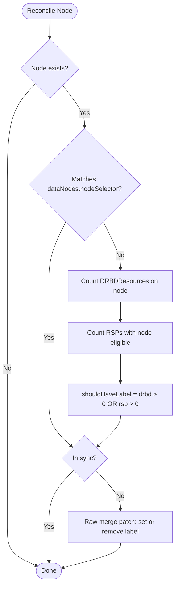
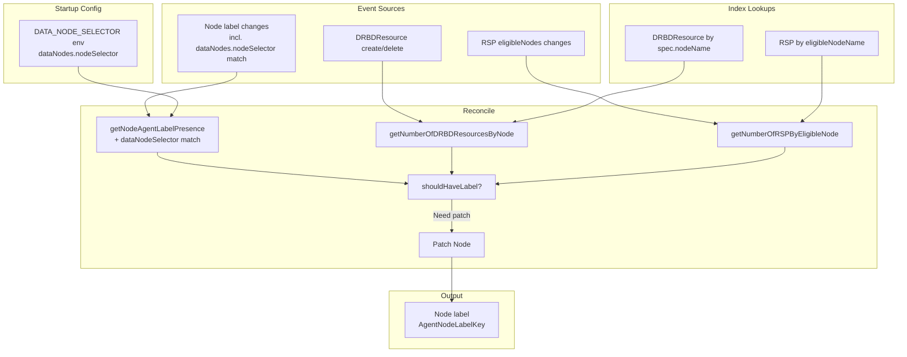

# node_controller

This controller manages the `storage.deckhouse.io/sds-replicated-volume-node` label on cluster nodes.

## Purpose

The `storage.deckhouse.io/sds-replicated-volume-node` label determines which nodes should run the sds-replicated-volume agent.
The label value is always an empty string (`""`), which matches the `nodeSelector` convention used by other components
(Deckhouse hooks, Helm templates, and the legacy `linstor-node-controller`).

The controller automatically adds this label to nodes that match the module-wide `dataNodes.nodeSelector`
or are in at least one `ReplicatedStoragePool` (RSP) `eligibleNodes` list, and removes it from nodes that satisfy neither.

Matching `dataNodes.nodeSelector` is what bootstraps a clean cluster: the label brings up the `sds-node-configurator`
agent, which creates `BlockDevice` objects needed to build `LVMVolumeGroup`s, and only then can RSPs get `eligibleNodes`.
With the default selector (`kubernetes.io/os: linux`) every Linux node gets the label, matching the legacy control plane.

**Important**: The label is also preserved on nodes that have at least one `DRBDResource`,
even if the node is not in any RSP's `eligibleNodes`. This prevents orphaning DRBD resources when RSP configuration changes.

## Interactions

| Direction | Resource/Controller | Relationship |
|-----------|---------------------|--------------|
| ← input | `DATA_NODE_SELECTOR` env | Module-wide `dataNodes.nodeSelector`; matching nodes always get the label |
| ← input | rsp_controller | Reads `RSP.Status.EligibleNodes` to decide node labels |
| ← input | DRBDResource | Reads presence of DRBDResources to preserve labels |
| → output | Node | Manages `AgentNodeLabelKey` label |

## Algorithm

A node receives the label if **at least one** of the following conditions is met (OR):

1. **Data-node selector**: The node labels match `dataNodes.nodeSelector` (`DATA_NODE_SELECTOR`).
   An empty selector matches all nodes.
2. **RSP Eligibility**: The node is in at least one `ReplicatedStoragePool`'s `status.eligibleNodes` list.
3. **DRBDResource Presence**: The node has at least one `DRBDResource` (`spec.nodeName == node.Name`).

```
shouldHaveLabel = matchesDataNodeSelector OR (rspCount > 0) OR (drbdCount > 0)
```

When the node matches the selector, the RSP and DRBDResource lookups are skipped.

RSP eligibility is always a subset of `dataNodes.nodeSelector` (rsp_controller starts from the same selector),
so condition 2 only matters for a node that has just left the selector (the selector was narrowed or the node
was relabeled): the label is kept until rsp_controller drops the node from `eligibleNodes`.

## Reconciliation Structure

The controller reconciles individual nodes (not a singleton):

```
Reconcile(nodeName)
├── getNodeAgentLabelPresence  — check if node exists, has label, value is correct, and matches the data-node selector (direct Get, UnsafeDisableDeepCopy)
├── if not matchesDataNodeSelector:
│   ├── getNumberOfDRBDResourcesByNode — count DRBDResources on node (index lookup)
│   └── getNumberOfRSPByEligibleNode — count RSPs with this node eligible (index lookup)
├── if (shouldHaveLabel && labelValueCorrect) || (!shouldHaveLabel && !hasLabel) → Done (in sync)
└── Patch node label via pre-computed raw merge patch (no full node GET or DeepCopy)
```

## Algorithm Flow



## Managed Metadata

| Type | Key | Value | Managed On | Purpose |
|------|-----|-------|------------|---------|
| Label | `storage.deckhouse.io/sds-replicated-volume-node` | `""` (empty string) | Node | Mark nodes that should run the agent |

## Watches

The controller watches three event sources:

| Resource | Events | Handler |
|----------|--------|---------|
| Node | Create, Update | Reacts to `AgentNodeLabelKey` key presence/absence or value changes, and to the node entering/leaving `dataNodes.nodeSelector` |
| ReplicatedStoragePool | Create, Update, Delete | Reacts to `eligibleNodes` changes (delta computation) |
| DRBDResource | Create, Delete | Maps to node via `spec.nodeName` |

### RSP Delta Computation

When an RSP's `eligibleNodes` changes, the controller computes the delta (added/removed nodes)
and enqueues reconcile requests only for affected nodes, not for all nodes in the cluster.

## Indexes

| Index | Field | Purpose |
|-------|-------|---------|
| DRBDResource by node | `spec.nodeName` | Count DRBDResources per node |
| RSP by eligible node | `status.eligibleNodes[].nodeName` | Count RSPs where node is eligible |

## Data Flow


