# rv_controller

This controller manages `ReplicatedVolume` (RV) resources by orchestrating datamesh formation, normal operation, and deletion.

## Purpose

The controller reconciles `ReplicatedVolume` with:

1. **Configuration initialization** — derives configuration from `ReplicatedStorageClass` (RSC) in Auto mode or from `ManualConfiguration` in Manual mode into RV status
2. **Datamesh formation** — creates replicas, establishes DRBD connectivity, bootstraps data synchronization
3. **Normal operation** — steady-state datamesh lifecycle managed by the datamesh transition engine (membership, attachment, quorum, network transitions); see [datamesh/README.md](datamesh/README.md)
4. **Deletion** — cleans up child resources (RVRs, RVAs) and datamesh state

## Interactions

| Direction | Resource/Controller | Relationship |
|-----------|---------------------|--------------|
| ← input | ReplicatedStorageClass | Reads configuration (FTT, GMDR, topology, storage pool); Auto mode only |
| ← input | ReplicatedVolume.Spec.ManualConfiguration | Reads manual configuration directly; Manual mode only |
| ← input | ReplicatedStoragePool | Reads eligible nodes, system networks, zones for formation and attach eligibility |
| ← input | ReplicatedVolumeReplica | Reads replica status (scheduling, preconfiguration, connectivity, data sync, quorum, attachment) |
| ← input | ReplicatedVolumeAttachment | Reads attachment intent (determines which nodes should be attached) |
| → manages | ReplicatedVolumeReplica | Creates/deletes during formation, normal operation (Access replicas), and deletion |
| → manages | ReplicatedVolumeAttachment | Manages finalizers; updates conditions (Attached, ReplicaReady, Ready), phase, and message during normal operation and deletion |
| → manages | DRBDResourceOperation | Creates for data bootstrap during formation |

## Algorithm

The controller reconciles individual ReplicatedVolumes:

```
if rv deleted (NotFound):
    if orphaned RVAs exist:
        reconcileRVAWaiting (set waiting conditions) + reconcileRVAMetadata (rv=nil) → Done
    else → Done

if shouldDelete (DeletionTimestamp + no other finalizers + no attached members + no Detach transitions):
    reconcileDeletion (reconcileRVAWaiting → force-delete RVRs → clear datamesh members)
    reconcileRVAMetadata (remove RVA finalizers — after conditions are set)
    reconcileMetadata (remove finalizer if no children left) → Done

ensure metadata (finalizer + labels)

if config nil: reconcileRVConfiguration (initial set from RSC or ManualConfiguration)
ensure datamesh replica membership requests (sync from RVR statuses)
ensure status size (min usable size from diskful member RVRs)

if configuration exists:
    if formation in progress (DatameshRevision == 0 or Formation transition active):
        reconcile formation (3-step process; create: config frozen; adopt: accepts replicas as-is)
        reconcileRVAWaiting (datamesh forming)
    else:
        reconcileRVConfiguration (check for config updates + set ConfigurationReady condition)
        reconcile normal operation:
            create Access RVRs for Active RVAs on nodes without any RVR
            datamesh.ProcessTransitions (membership, quorum, attachment, network)
            update RVA conditions from datamesh replica contexts
            delete unnecessary Access RVRs (redundant or unused)

reconcileRVAMetadata (add/remove RVA finalizers + labels)
reconcileRVRFinalizers (add/remove RVR finalizers)
patch status if changed
```

## Reconciliation Structure

```
Reconcile (root) [Pure orchestration]
├── getRV
├── rv == nil → getRVAs → reconcileOrphanedRVAs (reconcileRVAWaiting + reconcileRVAMetadata)
├── getRSC, getRVAs, getRVRsSorted
├── rv.spec.maintenance != "" →
│   └── reconcileMaintenance [In-place reconciliation] (the whole pass; before the deletion branch)
│       ├── applyUnderMaintenanceCond (UnderMaintenance condition; SINGLE writer)
│       ├── reconcileDataPlaneConditions (Ready + Resilient + AttachedReady — the only live status)
│       └── patchRVStatus
├── rvShouldNotExist (DeletionTimestamp + no other finalizers + no attached + no Detach transitions) →
│   ├── reconcileDeletion [In-place reconciliation] ← details
│   │   ├── reconcileRVAWaiting ("ReplicatedVolume is terminating")
│   │   ├── deleteRVRWithForcedFinalizerRemoval (loop)
│   │   ├── applyReadyCond (Ready=False/Terminating; Resilient and AttachedReady left frozen)
│   │   └── clear datamesh members + patchRVStatus
│   ├── reconcileRVAMetadata [Target-state driven]
│   │   ├── add RVControllerFinalizer + labels to non-deleting RVAs
│   │   └── remove RVControllerFinalizer from deleting RVAs (when safe)
│   │       ├── hasOtherNonDeletingRVAOnNode (duplicate check)
│   │       └── isNodeAttachedOrDetaching (datamesh state check)
│   └── reconcileMetadata [Target-state driven] (remove finalizer)
├── reconcileMetadata [Target-state driven]
│   ├── isRVMetadataInSync
│   ├── applyRVMetadata (finalizer + labels)
│   └── patchRV
├── applyUnderMaintenanceCond (removes the condition on the first pass after the field is cleared)
├── if config nil: reconcileRVConfiguration [In-place reconciliation] ← details
├── ensureDatameshReplicaRequests ← details
├── ensureStatusSize (min usable size from diskful member RVRs)
├── reconcileFormation [Pure orchestration]
│   │   ensureFormationTransition (find or create Formation transition with all steps)
│   ├── (create/v1)
│   │   ├── reconcileFormationStepPreconfigure [In-place reconciliation] ← details
│   │   │   ├── create/delete RVRs (guards for deleting/misplaced, replica count management)
│   │   │   ├── wait for deleting replicas cleanup
│   │   │   ├── safety checks (addresses, eligible nodes, spec mismatch, backing volume size)
│   │   │   └── reconcileFormationRestartIfTimeoutPassed
│   │   ├── reconcileFormationStepEstablishConnectivity [Pure orchestration] ← details
│   │   │   ├── generateSharedSecret + applyDatameshMember
│   │   │   ├── computeTargetQuorum
│   │   │   ├── verify configured, connected, ready for data bootstrap
│   │   │   └── reconcileFormationRestartIfTimeoutPassed
│   │   └── reconcileFormationStepBootstrapData [Pure orchestration] ← details
│   │       ├── createDRBDROp (new-current-uuid)
│   │       ├── verify operation status + UpToDate replicas
│   │       ├── reconcileFormationRestartIfTimeoutPassed
│   │       └── advanceFormationStep / remove transition (formation complete)
│   ├── (adopt/v1)
│   │   ├── reconcileAdoptStepVerifyPrerequisites [Pure orchestration] ← details
│   │   │   ├── collect non-deleting replicas by type (diskful, tiebreaker, access)
│   │   │   ├── gates: all scheduled, all in maintenance
│   │   │   ├── safety: addresses, backing volume size
│   │   │   └── advance → PopulateAndVerifyDatamesh
│   │   ├── reconcileAdoptStepPopulateAndVerifyDatamesh [Pure orchestration] ← details
│   │   │   ├── generateSharedSecret + applyDatameshMember (from RVR spec, all types, multiattach)
│   │   │   ├── computeTargetQuorum (lowest GMDR/QMR)
│   │   │   ├── gate: DatameshRevisionObservedByAgent >= DatameshRevision
│   │   │   ├── gate: members match active RVRs
│   │   │   └── advance → ExitMaintenance
│   │   └── reconcileAdoptStepExitMaintenance [Pure orchestration] ← details
│   │       ├── ensureDatameshMemberAddresses (sync addresses from RVR, bump revision)
│   │       ├── wait for maintenance exit (DRBDConfigured reason != InMaintenance)
│   │       └── formation complete (accepts replicas as-is, even if degraded)
│   └── reconcileRVAWaiting ("Datamesh formation is in progress")
├── reconcileRVConfiguration [In-place reconciliation] (config updates + ConfigurationReady condition)
├── reconcileNormalOperation [Pure orchestration]
│   ├── reconcileCreateAccessReplicas [In-place reconciliation] ← details
│   ├── datamesh.ProcessTransitions (membership, quorum, attachment, network)
│   │   └── see datamesh/README.md
│   ├── reconcileRVAConditionsFromDatameshReplicaContext [In-place reconciliation] ← details
│   │   ├── computeRVAAttachedCondition
│   │   ├── computeRVAReplicaReadyCondition
│   │   ├── computeRVAReadyCondition
│   │   ├── computeRVAPhaseAndMessage
│   │   ├── isRVAAttachmentFieldsInSync + applyRVAAttachmentFields
│   │   └── patchRVAStatus
│   ├── reconcileDeleteAccessReplicas [Pure orchestration] ← details
│   └── reconcileLayoutConvergence [Target-state driven] (≤1 whitelisted action/pass; ContinueAndRequeue after acting)
│       ├── computeTargetLayoutAction (pure decision: P1 retype D→TB / P2 create TB / P3 create D / P4 remove surplus TB / P5 remove surplus D / none; also drives the condition)
│       │   ├── hasLayoutChangingTransition (classified by the transition's replica types, not by Group)
│       │   ├── selectRetypeCandidate (exclude attached + gain-side zone placement + lose-side zone quorum; lexicographically last name)
│       │   │   └── isRetypeToTieBreakerZoneQuorumSafe (mirrors guardZoneFTTPreservedForRetypeToTieBreaker)
│       │   ├── pendingRetypeToTieBreakerMemberNames (any pending retype → Converging; also names it) / countPendingTieBreakerCreations
│       │   ├── pendingRetypeToDiskfulMemberNames (the other direction: vestibule / manual retype) / countPendingDiskfulCreations
│       │   │   └── isDiskfulCreationInFlight (in flight = the LAYOUT does not count it, NOT "is not a member")
│       │   ├── computeActualPendingTieBreakerSchedulingFailure (current Scheduled=False → CannotConverge)
│       │   ├── computeTargetSurplusTieBreakerRemoval (P4: orphan → wait / copies not UpToDate → wait / attached → wait / remove)
│       │   │   ├── orphanedTieBreakerMemberNames (a member without a replica is the datamesh's own force-removal)
│       │   │   └── selectSurplusTieBreakerCandidate (non-operational first, then the lexicographically last name)
│       │   ├── computeDiskfulRemovalPendingReport (departure → wait; matching D count → CannotConverge)
│       │   ├── computeTargetSurplusDiskfulRemoval → selectSurplusDiskfulCandidate → datamesh.DiskfulRemovalReadiness
│       │   ├── computeDiskfulCreationPendingReport (cannot place → CannotConverge / waiting for a resync slot → Converging)
│       │   │   ├── computeActualPendingDiskfulSchedulingFailure (current Scheduled=False → the scheduler's summary)
│       │   │   └── computeActualPendingDiskfulResyncSlotWait (Scheduled=Unknown/WaitingForResyncSlot → not a verdict)
│       │   └── isMemberAttached
│       ├── P1: base := rvr.DeepCopy(); applyRVRRetypeToTieBreaker (type=TieBreaker + clear LVG/ThinPool); patchRVR  (ChangeRole → DMTE drives it)
│       ├── P2: newRVR(..., TieBreaker, "") → SetControllerRef → createRVR → insertRVRSorted; AlreadyExists → Info + requeue
│       ├── P3: newRVR(..., Diskful, "") → SetControllerRef → createRVR → insertRVRSorted; AlreadyExists → Info + requeue
│       └── P4/P5: deleteRVR (the finalizer holds it; rvr_controller turns the deletion into a Leave and the datamesh removes the member)
├── reconcileLayoutStatus [In-place reconciliation] (status.membershipLayout + MembershipLayoutConverged condition; SINGLE writer)
│   ├── computeActualLayout (Diskful+LiminalDiskful = D, TieBreaker = TB; Access/ShadowDiskful ignored)
│   ├── computeLayoutReport → computeTargetLayoutAction (report reuses the convergence decision)
│   ├── applyMembershipLayout + applyMembershipLayoutConvergedCondTrue/False/Unknown
│   └── (not called during formation → MembershipLayoutConverged absent while forming)
├── reconcileDataPlaneConditions [In-place reconciliation] (Ready + Resilient + AttachedReady conditions; SINGLE writer)
│   ├── computeAttachedReadyReport (pure: established attachments → worst computeAttachmentVerdict)
│   ├── computeReadyReport (pure: Terminating → Forming → StatusUnknown → QuorumLost → AttachmentNotReady → Ready)
│   ├── computeResilientReport (pure: deletion→frozen, Forming → StatusUnknown → Resilient/Degraded)
│   └── applyAttachedReadyCond + applyReadyCond + applyResilientCond
├── reconcileConfiguredCondition [In-place reconciliation] (Configured condition; SINGLE writer)
│   ├── computeConfiguredReport (pure: deletion→frozen, no config→absent, revision 0 / no members → ConfigurationUnknown, else per-member revision equality)
│   └── applyConfiguredCond
├── reconcileRVAMetadata [Target-state driven] (same as deletion branch)
├── reconcileRVRFinalizers [Target-state driven]
│   ├── add RVControllerFinalizer to non-deleting RVRs
│   └── remove RVControllerFinalizer from deleting RVRs (when safe)
│       └── isRVRMemberOrLeavingDatamesh (member + RemoveReplica check)
└── patchRVStatus
```

Links to detailed algorithms: [`reconcileDeletion`](#reconciledeletion-details), [`ensureDatameshReplicaRequests`](#ensuredatameshreplicarequests-details), [`reconcileRVConfiguration`](#reconcilervconfiguration-details), [`reconcileFormationStepPreconfigure`](#reconcileformationsteppreconfigure-details), [`reconcileFormationStepEstablishConnectivity`](#reconcileformationstepestablishconnectivity-details), [`reconcileFormationStepBootstrapData`](#reconcileformationstepbootstrapdata-details), [`reconcileAdoptStepVerifyPrerequisites`](#reconcileadoptstepverifyprerequisites-details), [`reconcileAdoptStepPopulateAndVerifyDatamesh`](#reconcileadoptsteppopulateandverifydatamesh-details), [`reconcileAdoptStepExitMaintenance`](#reconcileadoptstepexitmaintenance-details), [`reconcileCreateAccessReplicas`](#reconcilecreateaccessreplicas-details), [`reconcileDeleteAccessReplicas`](#reconciledeleteaccessreplicas-details), [`reconcileRVAConditionsFromDatameshReplicaContext`](#reconcilervaconditionsfromdatameshreplicacontext-details)

## Algorithm Flow

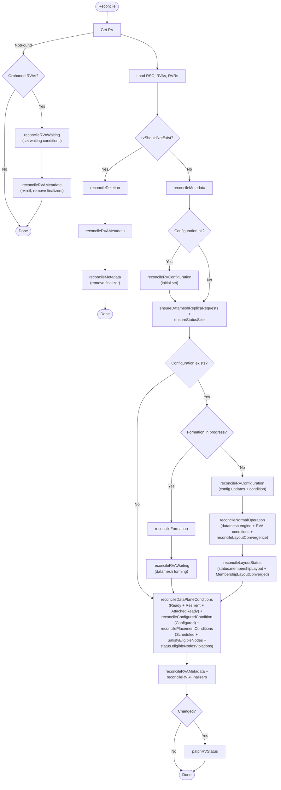

## Layout formula

The intended datamesh layout is derived from the configuration's FTT/GMDR:

```
D  (diskful voters) = FailuresToTolerate + GuaranteedMinimumDataRedundancy + 1
TB (tie-breakers)   = 1  if D is even and FailuresToTolerate == D/2, else 0
```

This is provided by `ReplicatedVolumeConfiguration.IntendedLayout()` in `api/v1alpha1/rv_types.go`,
which factors the diskful count into `v1alpha1.IntendedDiskfulCount(ftt, gmdr)` and the tie-breaker
sub-formula into `v1alpha1.TieBreakersForDiskful(diskful, ftt)`. It is
the source of truth for the **layout comparison** (the `MembershipLayoutConverged` condition and the
tie-breaker guard reuse it). Placement decision: `IntendedLayout` is a pure, deterministic,
context-free get-helper (no I/O, no cluster-state interpretation), so per `api-file-structure.mdc`
it lives in `rv_types.go` (not `rv_custom_logic_that_should_not_be_here.go`).

The datamesh guards reuse these helpers rather than re-deriving the formulas. Note that a guard
passes the **actual** current voter count (not the intended diskful count) to
`v1alpha1.TieBreakersForDiskful`, so it stays correct during transitions where the two differ.

All controller code derives the diskful and tie-breaker counts through these helpers — via
`IntendedLayout()` where both are needed together, or directly through `v1alpha1.IntendedDiskfulCount`
/ `v1alpha1.TieBreakersForDiskful` — instead of re-deriving the formula, so the D/TB formula lives in
exactly one place for controller code. The e2e helper
`pkg/framework/t_layout.go` also calls `IntendedLayout()` now (via a config built from its
`TestLayout` FTT/GMDR), so no production/framework copy of the formula remains. The deliberate
re-derivations left are the independent cross-checks in the e2e selftests
(`pkg/framework/selftest/layout_test.go` and `pkg/framework/selftest/emulate_preexisting_test.go`),
which recompute the expected layout by hand to validate the real cluster state against
`ExpectedReplicas()` rather than to reuse the formula.

## Maintenance

`rv.spec.maintenance` is a per-volume stop switch. While it holds a mode, this controller performs
no action on that volume at all — `reconcileMaintenance` is the whole of the pass — and every other
volume in the cluster keeps reconciling normally. The gate sits in the root `Reconcile` after the
children are loaded and **before** the deletion branch, so no evaluation order can let deletion slip
past it.

It is not an early return. The root reconcile takes one status patch base partway through and issues
one status patch at the very end; returning before that point would drop the observational layer with
everything else. The paused path is therefore a reconcile step of its own, with its own patch base
and its own status patch.

The mode is the shared `MaintenanceMode`, the same type the DRBD resource's field of the same name
uses, but the two fields admit different values and name different scopes: on the DRBD resource the
mode freezes DRBD operations only (the agent keeps adding its finalizer, allocating addresses,
releasing backing volume finalizers and reporting state), here it freezes everything this controller
does. Each field declares its own enum marker, so the scope of a value is always read together with
the field it sits on.

### What you can still trust, and what is frozen

| | |
|---|---|
| **Still maintained** | `Ready`, `Resilient`, `AttachedReady` — the health aggregated from the replicas |
| **Frozen at its last value** | `status.datamesh` and every transition, `status.configuration`, `status.membershipLayout` and `MembershipLayoutConverged`, `Configured`, `ConfigurationReady`, `Scheduled`, `SatisfyEligibleNodes` and the violations behind it, `status.size`, the datamesh replica requests |

The data-plane conditions are the observational layer, and that is the whole list: their inputs are
the replicas' own status, which the replica controller and the agent keep publishing even for a
paused volume — the cascade described below stops their *actions*, never their reporting. The placement conditions are treated as authoritative despite also being
derived from replica verdicts, because `SatisfyEligibleNodes` is a judgement about compliance with
the volume's configuration and the configuration is frozen; publishing a compliance verdict against
a frozen configuration is exactly the stale status the split exists to prevent. Metrics need no
explicit gate: their inputs are the frozen datamesh and formation state, so they are no-ops.

Nothing is *cleared* on entry — the frozen status keeps its last published value, the same convention
the deletion branch already uses for `Resilient`, `AttachedReady` and `Configured`.

### A paused volume does not finish deleting

Deletion handling is one of the frozen steps, so the controller's finalizer is never removed while
the volume is paused: the RV — and with it the PVC — stays in `Terminating` until `spec.maintenance`
is cleared. **This is intended behaviour for a full stop, not a defect.** If you meet an RV stuck in
`Terminating`, check `spec.maintenance` and the `UnderMaintenance` condition before looking anywhere
else.

Also frozen with it: the volume's own finalizer and labels, the replica and attachment finalizer
steps. Nothing the operator is inspecting is finalized out from under them.

**The one exception — a volume paused before it was ever reconciled.** The finalizer is added by the
metadata reconcile, which is itself one of the frozen steps, so a volume created with
`spec.maintenance` already set never acquires one. Nothing then holds it: if its PVC is deleted it
disappears at once, with no cleanup of its replicas — the opposite of the hold described above. The
normal case is unaffected, because a volume that has reconciled even once already carries the
finalizer and the pause merely prevents its removal. So: let a volume reconcile once before pausing
it, and do not pause at creation time if you are relying on the hold.

### Entering and leaving

```sh
# Pause:
kubectl patch rv <name> --type=merge -p '{"spec":{"maintenance":"NoResourceReconciliation"}}'
# Resume (the only step needed):
kubectl patch rv <name> --type=merge -p '{"spec":{"maintenance":null}}'
# See which volumes are paused (Maintenance is a priority=1 column):
kubectl get rv -o wide
```

Setting or clearing the field bumps `metadata.generation`, and the RV predicate already enqueues on
generation changes, so the pause takes effect and lifts on the next pass without any predicate of its
own. Clearing the field is the only step needed to resume: the next pass runs the full normal flow
and removes the `UnderMaintenance` condition.

### How far down the pause reaches

The pause is not confined to this controller: it cascades to the replicas and to their DRBD
resources, so that no level of the stack keeps acting on a volume the operator asked to be left
alone.

| Level | What stops | What keeps running |
|-------|-----------|--------------------|
| Volume (this controller) | Everything, deletion included | Ready, Resilient, AttachedReady |
| Replica (`rvr_controller`) | Finalizer and labels, backing volume, DRBD resource spec, deletion | The replica status observed from the DRBD resource |
| DRBD resource (agent) | Every DRBD action, and `DRBDResourceOperation`s are failed rather than queued | The state the agent reports |

The replica controller is the one that carries the pause downwards: on every pass it writes
`NoResourceReconciliationByVolume` into `drbdr.spec.maintenance` of each replica of a paused volume,
and clears that value again when the volume resumes. That step runs *before* the replica
controller's own maintenance gate, because a frozen controller writes nothing and the pause has to
be the one thing that still writes itself down.

An operator who has paused a single DRBD resource by hand uses a different value of the same field,
`NoResourceReconciliation`. The two never collide: the controller writes its own value only into an
empty field and clears only its own value back out, so a hand-set pause survives both the volume
being paused and the volume resuming.

Reporting is deliberately *not* part of what the cascade stops, at any level. The whole reason to
pause a volume is to look at it, and this controller's Ready, Resilient and AttachedReady are
aggregated from the replica status, which is in turn observed from what the agent reports. Freezing
either would leave the operator watching a stale picture of the volume they just paused.

A paused volume keeps serving I/O.

## Conditions

### ConfigurationReady

Indicates whether the RV configuration is valid and derived from the appropriate source. Set by `reconcileRVConfiguration`.

| Status | Reason | When |
|--------|--------|------|
| True | Ready | Configuration is valid and matches the source |
| False | WaitingForStorageClass | RSC not found, RSC configuration not ready, or RSC has not published a configuration for its current `metadata.generation` yet (Auto mode only) |
| False | NewerConfigurationHeld | The RSC has a newer configuration, but `configurationRolloutStrategy.type=NewVolumesOnly` keeps this volume on the one it already has (Auto mode only) |
| False | ConfigurationRolloutInProgress | The RSC has a newer configuration and `configurationRolloutStrategy.type=RollingUpdate`, but the free slots of `rollingUpdate.maxParallel` went to volumes of the class that sort earlier by name (Auto mode only) |
| False | InvalidConfiguration | Configuration is invalid: RSP not found or TransZonal zone count mismatch |

`NewerConfigurationHeld` and `ConfigurationRolloutInProgress` are reporting states, not blocks:
nothing gates on `ConfigurationReady`, so the volume keeps operating on its own configuration. The
class-level aggregate counts such a volume as `staleConfiguration` (see `rsc_controller`).

### Configured

Indicates whether every datamesh member has applied the volume's current `status.datameshRevision`.
Set by `reconcileConfiguredCondition`, which is the **single writer** of this condition.

| Status | Reason | When |
|--------|--------|------|
| — | (absent) | `status.configuration` is nil — nothing has been evaluated yet |
| — | (frozen) | `DeletionTimestamp` is set — the last known value is preserved |
| Unknown | ConfigurationUnknown | `status.datameshRevision` is 0 (never formed, or formation was restarted), or the datamesh has no members |
| True | AllReplicasConfigured | Every member's `rvr.status.datameshRevision` equals the volume's |
| False | ConfigurationInProgress | At least one member lags behind, has no RVR object, or reports a revision the volume never assigned |

**Where it sits relative to `ConfigurationReady`.** `ConfigurationReady` answers whether the
configuration itself is valid and current with respect to the storage class; `Configured` answers
whether that configuration has actually reached the replicas. The two are independent in both
directions: a volume can hold a valid configuration that has not rolled out yet
(`ConfigurationReady=True`, `Configured=False`), and a volume can have fully rolled out a
configuration that the storage class has since superseded (`ConfigurationReady=False/StaleConfiguration`,
`Configured=True`).

Neither enters `Ready`: a volume mid-rollout keeps serving I/O, so the signal is ticket-worthy, not
page-worthy.

**Why revision 0 is Unknown rather than True.** A volume that never formed sits at revision 0 and so
do its replicas, so a plain equality check would hold vacuously and report a convergence that never
happened. The guard is what makes `AllReplicasConfigured` mean something.

In practice the `ConfigurationUnknown` seen on a forming volume is the no-members one: formation
assigns revision 1 before it populates the member list, so the revision-0 branch closes within a
pass or two and does not usually make it into a status the operator observes.

**Every member type counts**, tie-breakers and Access members included: `rvr_controller` records
`status.datameshRevision` for every member it configures, gated only on datamesh membership (see
`reconciler_drbd_resource.go`). This is unlike `Scheduled`, which is a placement concept and does
not apply to Access replicas.

**Why it does NOT mirror the replica's own `Configured` condition.** `ReplicatedVolumeReplica` has a
condition of the same name, and mirroring it — the way `AttachedReady` mirrors the replica's
`Attached` — would be wrong. RVR `Configured` is written from `computeTargetDatameshRequest`
(`rvr_controller/reconciler_status.go`) and answers a different question: *does this replica have an
outstanding membership request* (join / leave / role change / backing-volume change), plus its
prerequisites (scheduling, eligibility). It never compares revisions; it reads the replica's own
`status.datameshRevision` only as `isMember := revision != 0`.

So RVR `Configured=True` means "I am a member of *some* revision and my type and backing volume
match my spec" — not "I have applied the *current* revision". Any datamesh change that leaves each
replica's own spec untouched (`ChangeQuorum`, `RepairNetworkAddresses`, `ChangeSystemNetworks`,
`EnableMultiattach`, or a neighbour joining or leaving) bumps the volume's revision and requires
every member to reconfigure DRBD — peer list, quorum settings — while leaving every membership
request empty. An RV-level mirror would report `AllReplicasConfigured` before the rollout had even
started, which is precisely the state this condition exists to catch. Rollout progress is visible in
the replica's `DRBDConfigured` condition (`Configured` → `ApplyingConfiguration`), not in its
`Configured` one.

Mirroring would also fold placement into the wrong condition: RVR `Configured` reports
`PendingScheduling`, `NodeNotEligible` and `StorageNotEligible`, which are the failure domains of
`Scheduled` and `SatisfyEligibleNodes`.

The rule behind both this condition and `AttachedReady` is the same — aggregate the source that
answers *exactly* the question being asked, which is also why `AttachedReady` mirrors the replica's
`Attached` and not its `Ready`. Here that source is the `status.datameshRevision` field. It is a
field rather than a condition, but it carries the properties that mattered: it is the replica
controller's own verdict ("fully configured for revision N", see the field docs in `rvr_types.go`),
written in exactly one place, so the report does not depend on the order in which this controller
writes its own status within a pass.

**Placement in the flow.** It runs next to the data-plane conditions rather than inside
`reconcileNormalOperation`, because a forming volume runs `reconcileFormation` instead and a
config-less volume runs neither — yet both have to be reported (a forming volume as
`ConfigurationUnknown` until the datamesh has both a revision and members, then
`ConfigurationInProgress` as the rollout runs; a config-less one as absent). The early deletion
branch (`reconcileDeletion`) does not write it at all; the condition freezes, like `Resilient` and
`AttachedReady`.

No `RVR` watch change was needed: `predicates.go` already requeues the volume on
`rvr.status.datameshRevision` changes (rollout progress).

### MembershipLayoutConverged

Indicates whether the actual datamesh layout (diskful voters + tie-breakers) matches the layout
intended by the configuration. Set by `reconcileLayoutStatus`, which is the **single writer** of
this condition. It is evaluated only post-formation (never written while a volume is forming) and
after the configuration has been acknowledged (`status.configuration` is set).

`reconcileLayoutStatus` only reports — the convergence actions live in the separate
`reconcileLayoutConvergence` step (below). Both share one pure decision function,
`computeTargetLayoutAction`, so the reported reason always agrees with what convergence does this
pass, and this remains the only writer of the condition.

The intended layout comes from `ReplicatedVolumeConfiguration.IntendedLayout()` (the source of
truth for the layout comparison — see [Layout formula](#layout-formula)); the actual layout is
counted from `status.datamesh.members` (Diskful + LiminalDiskful = diskful voters, TieBreaker =
tie-breakers; Access and ShadowDiskful are not part of the layout).

Only **layout-changing** transitions count as convergence progress — see
`hasLayoutChangingTransition`. Two conditions must hold: the transition type is a membership one
(`AddReplica`/`RemoveReplica`/`ForceRemoveReplica`/`ChangeReplicaType`), **and** the replica types
recorded in the transition touch the layout (`Diskful` or `TieBreaker`; for `ChangeReplicaType`,
either end). Other transition types (Attach/Detach, ResizeVolume, ChangeQuorum, network,
multiattach) and membership transitions confined to `Access`/`ShadowDiskful` leave the layout
unchanged and do not gate convergence. The classification deliberately goes by the record's fields
and **not** by `Group`: `ForceRemoveReplica` lives in the `Emergency` group, so a
`Group == VotingMembership` filter would silently drop it.

**Decision order in `computeTargetLayoutAction`** (fixed; each earlier step wins):

1. RV deletion → `Unknown`/`VolumeDeleting`, no action.
2. An active layout-changing transition → no new action. Normally `Converging`; a deleting
   counted copy gets the named departure report described in step 5, including the datamesh message.
3. Promotion recovery/reservation, then **any** pending retype (spec flipped, DMTE not yet
   dispatched). Promotion retains its existing recovery rules; other pending retypes report
   `Converging`, even after a configuration reversal.
4. A tie-breaker replacement deficit → create the replacement before the old TB leaves.
5. A deleting diskful member still counts in `actualD`. At surplus D counts it owns the departure
   and reports `False/Converging`, naming the replica and including its
   `status.datameshReplicaRequests[].message` when present. No second copy is selected.
   At matching D counts it reports `False/CannotConverge`: deletion is not rolled back automatically.
   This check follows promotion/retypes and TB replacement so those recovery steps retain priority,
   but precedes equality and P4/P5. A real diskful deficit still reaches P3 and its in-flight checks.
6. Equal layout counts **and no diskful creation in flight** → `Converged`; otherwise P1–P5 below.

The ordering keeps a counted layout from looking settled while membership is changing. A retype,
TB replacement, pending diskful creation, or diskful deletion can all coexist with matching counts.
A mid-flight D→TB already counts as a TB before the transition finishes. Unrelated attach/resize
or Access activity does not itself block `Converged`.

| Status | Reason | When |
|--------|--------|------|
| True | Converged | Actual layout matches the intended layout, no layout-changing transition is running, no retype is pending and no diskful copy is being created or deleted (unrelated transitions do not affect this) |
| False | Converging | A layout change is in flight: a layout-changing transition is running, a retype is pending (requested in this or an earlier pass), a tie-breaker creation is pending, or a diskful copy is being created, waiting for a resync slot, or leaving at surplus D counts; orphan cleanup also waits here |
| False | CannotConverge | A whitelist pattern applies but no admissible candidate exists (all diskful replicas are attached, no zone can host a tie-breaker, the retype would break zone quorum, or the pending replica — a tie-breaker, a replacement for a terminating one, or a diskful copy — has a current `Scheduled=False`); P5 removal violates GMDR/FTT or zone guards; or a diskful deletion remains at matching D counts after a configuration reversal/manual deletion |
| False | TransitionUnsupported | Layout mismatches outside the whitelist; no supported automatic transition (manual intervention required) |
| Unknown | VolumeDeleting | The volume is being deleted; convergence is no longer evaluated |

P5 reports messages such as `removing surplus diskful replica rv-1-2: have 3D, want 2D`.
Refusals name the blocking attachment or datamesh guard. Matching-count deletions name the replica
and explain that deletion is not rolled back automatically; see the recovery recipe below.
The choice of reason is what the degraded-layout alert reads: it fires on `TransitionUnsupported`
and `CannotConverge` only, so a volume healing a lost copy (`Converging`) stays silent while one
that cannot place the copy (`CannotConverge`) does not. The alert rule itself needs no knowledge of
the heal.
`status.membershipLayout` holds the actual layout string (e.g. `3D`, `2D+1TB`; the `+NTB` suffix is omitted
when there are no tie-breakers) and is exposed as a priority-1 print column. The field is an
optional scalar (`*string`): it stays **absent** until `reconcileLayoutStatus` first runs (i.e.
throughout formation), and an empty string is never published — absent means "not computed yet".

`Unknown`/`VolumeDeleting` is published on **both** deletion paths: by `reconcileLayoutStatus` for a
volume that still goes through normal operation (deleting but attached), and by `reconcileDeletion`
for a volume that enters the early deletion branch directly (unattached) and never reaches normal
operation. In the latter the condition is written in the same status patch that clears the datamesh
members. Leaving the previous `Converging`/`CannotConverge` message in place would promise an action
the deletion path never performs.

### Ready

Indicates whether the volume is serving I/O at the guaranteed minimum redundancy. It is an
availability + lifecycle aggregate over two levels: the datamesh as a whole (quorum and UpToDate
replicas, derived from the effective layout) and its consumers (an established attachment can be
frozen on the isolated side of a partition even while the mesh holds quorum). The consumer level
enters through a single reason, `AttachmentNotReady`; which attachment and why is reported by the
`AttachedReady` condition.

Set by `reconcileDataPlaneConditions`, which is the **single writer** of the `Ready` condition in
the normal-operation flow. `reconcileDeletion` also writes `Ready=False/Terminating` in its atomic
status patch (the early deletion branch never reaches `reconcileDataPlaneConditions`).

**Decision order in `computeReadyReport`** (fixed; each earlier step wins):

1. `DeletionTimestamp` set → `False`/`Terminating`.
2. `isFormationInProgress` (DatameshRevision==0 or active Formation transition) → `False`/`Forming`.
3. EffectiveLayout FTT or GMDR nil → `Unknown`/`StatusUnknown`.
4. FTT < 0 → `False`/`QuorumLost`.
5. `AttachedReady` is `False` → `False`/`AttachmentNotReady` (message carried over from it).
6. Otherwise → `True`/`Ready`.

Step 5 sits **below** the mesh-level rules on purpose: when the mesh itself lost quorum, a frozen
consumer is a symptom of it, and the operator needs the mesh-level root cause in the reason. It
sits **above** step 6 to close the opposite gap — the mesh holds quorum on the majority side of a
partition while the consumer is frozen on the isolated one. Only a definite `False` counts:
`AttachedReady=Unknown` (attach ramp-up, stale agent) leaves `Ready=True`, otherwise `Ready` would
flap on every pod start.

Narrowly **not** part of `Ready`: `CannotConverge`, `TransitionUnsupported`, `Resilient=False`,
config rollout/staleness, eligible-nodes conflict, scheduling deficit — those leave `Ready=True`
and surface in their own conditions (ticket, not page).

| Status | Reason | When |
|--------|--------|------|
| True | Ready | Quorum holds, enough UpToDate replicas to satisfy GMDR, and every established attachment is serving I/O |
| False | Terminating | Volume is being deleted |
| False | Forming | Formation in progress or volume never reached IO-serving state (DatameshRevision==0) |
| False | QuorumLost | Quorum lost: reachable voters + tie-breakers < quorum threshold (FTT < 0) |
| False | AttachmentNotReady | Mesh-level availability holds, but an established attachment is not serving I/O (see `AttachedReady`) |
| Unknown | StatusUnknown | Effective layout undetermined (FTT or GMDR nil, e.g. stale agents) |

### AttachedReady

Indicates whether every **established attachment** of the volume is actually serving I/O on its
node. It is the per-consumer counterpart of `Ready`: a datamesh that holds quorum as a whole can
still have a consumer frozen on the isolated side of a partition, and this condition is what
reports which one and why.

Set by `reconcileDataPlaneConditions` (single writer alongside `Ready` and `Resilient`). Frozen on
deletion (`computeAttachedReadyReport` returns `present=false`), absent until the volume has a
configuration.

An attachment is **established** when all three hold:

1. the datamesh member is marked `Attached`,
2. a non-deleting RVA exists on its node (a live consumer),
3. no `Detach`/`ForceDetach` transition is in flight for it.

Members without a consumer and members mid-detach are skipped, so a routine attach or detach never
turns the condition `False`.

The per-attachment verdict comes from `computeAttachmentVerdict`, which mirrors the **replica's
`Attached` condition** rather than reading `rvr.Status.Attachment` directly: the replica controller
is the single writer of that condition, so the verdict does not depend on the order in which this
controller writes its own RVA status within the same pass. Mirroring the replica's `Ready`
condition instead would be wrong — an isolated tie-breaker reports `Ready=False/QuorumViaPeers`
while every consumer keeps writing.

| RVR `Attached` reason | Verdict | Severity |
|---|---|---|
| `Attached` | serving | — |
| `IOSuspended` | `False`/`IOSuspended` | highest |
| `AttachmentFailed` | `False`/`AttachmentFailed` | middle |
| `AgentNotReady`, `ApplyingConfiguration`, `DetachmentFailed`, condition absent, replica missing | `Unknown`/`StatusUnknown` | lowest |

The volume-level report is the **worst** verdict across all established attachments; the message
names the first member holding it and counts the offenders.

Both the verb and the count follow the worst verdict, so the message never states more than is
known: `are not serving IO` is a fact and belongs to a definite verdict, while an Unknown one is
only the absence of a report. Under a definite worst the count covers the definite offenders only,
so it never speaks for a member that merely failed to report.

```
1/2 attachments are not serving IO: replica rv-r1 on node n1 (IO is suspended on the device)
1/1 attachments are not confirmed serving IO: replica rv-r0 on node n0 (replica Attached=False/AgentNotReady)
```

| Status | Reason | When |
|--------|--------|------|
| True | AttachedReady | Every established attachment is serving I/O |
| True | NoAttachments | No established attachment; the volume is not in use |
| False | IOSuspended | An established attachment is frozen (device attached, I/O suspended) |
| False | AttachmentFailed | An established attachment is expected to be attached but is not |
| Unknown | StatusUnknown | An established attachment is in a transient or unreported state |

**Known limitation: a node cut off from both the DRBD network and the API.** The verdict is a
mirror of the replica's `Attached` condition, so it is never fresher than the agent's last report.
A node isolated from the DRBD network *and* from the API server keeps its last reported
`Attached=True/Attached`, so a frozen consumer reads as serving until the node is detected NotReady
and the replica controller turns `Attached` into `Unknown/AgentNotReady` — which, by design, does
not lower `Ready` either. The mesh level does not cover the window: `canCompute`
(`datamesh/effective_layout.go`) needs only one live agent, and the majority side keeps FTT ≥ 0, so
neither `StatusUnknown` nor `QuorumLost` fires. Nothing in this condition distinguishes "not
reported" from "serving"; node readiness is the signal for that.

### Resilient

Indicates whether the effective redundancy (FTT/GMDR) meets the redundancy intended by the
volume's configuration. Covers the "degraded-but-serving" gap: the volume still serves IO
(`Ready=True`) but cannot tolerate the intended number of failures. Set by
`reconcileDataPlaneConditions` (single writer alongside `Ready`).

On deletion the condition is **frozen** at its last value and is not recomputed
(`computeResilientReport` returns `present=false`).

| Status | Reason | When |
|--------|--------|------|
| True | Resilient | Effective FTT ≥ intended FTT AND effective GMDR ≥ intended GMDR |
| False | Degraded | Effective redundancy below intended (FTT or GMDR < intended) |
| False | Forming | Configuration not set, or formation in progress |
| Unknown | StatusUnknown | Effective layout undetermined (FTT or GMDR nil) |

### Scheduled

Indicates whether every replica that needs a placement has one. Set by
`reconcilePlacementConditions`, which is the **single writer** of this condition.

On deletion the condition is **frozen** at its last value and is not recomputed
(`computeScheduledReport` returns `present=false`).

| Status | Reason | When |
|--------|--------|------|
| — | (absent) | `status.configuration` is nil — nothing has been evaluated yet |
| False | SchedulingInProgress | No replicas to place yet, a replica has no current verdict, or formation is still running |
| False | ReplicasNotScheduled | A replica reports `Scheduled=False` with `SchedulingFailed` or `ExtenderUnavailable` |
| True | AllReplicasScheduled | Every replica in the set is placed |

The aggregation set is every **non-deleting replica whose type is not Access**, not the datamesh
members. A replica is scheduled long before it joins the mesh, and the two cases where that matters
are the ones an operator needs to see: during formation there are no members yet, and a tie-breaker
created by layout convergence (the P2 heal) is unschedulable precisely while it is still outside the
mesh. Access replicas are excluded because the scheduler does not place them — they are created on
the node that already runs the consumer.

`ReplicasNotScheduled` outranks formation: a formation that cannot finish because the scheduler
found no candidate must say so rather than report "in progress" forever.

A verdict whose `ObservedGeneration` lags the replica generation counts as pending. The scheduler
patches `spec.nodeName` (and the storage fields) before it writes the condition, so between those
two writes the stored condition still describes the previous placement.

`WaitingForResyncSlot` (a deliberate deferral) and `WaitingForReplicatedVolume` (an ordinary
prerequisite) stay pending rather than failing — neither is something an operator can act on.

The condition never reports `Unknown`: "not placed yet" is a known answer, not an undeterminable
one, so it is a `False` — matching `Configured=False/ConfigurationInProgress` for the same shape of
state.

### SatisfyEligibleNodes

Indicates whether every datamesh member sits where the storage pool and the volume's topology allow.
Set by `reconcilePlacementConditions`, which is the **single writer** of this condition and of
`status.eligibleNodesViolations`.

On deletion the condition **and** the violations list are **frozen** at their last value
(`computeSatisfyEligibleNodesReport` returns `present=false`), so the list never outlives the
condition that explains it.

| Status | Reason | When |
|--------|--------|------|
| — | (absent) | `status.configuration` is nil, or the RSP view is unavailable — nothing has been evaluated yet |
| True | SatisfyEligibleNodes | No violations |
| False | ConflictResolutionInProgress | A `RemoveReplica` or `ForceRemoveReplica` transition is taking one of the offending members out |
| False | InConflictWithEligibleNodes | Violations exist with nothing resolving them |

`ConflictResolutionInProgress` requires both halves — a removal **and** an offending member as its
subject. Membership churn as such proves nothing: adding an Access replica for a new consumer, or
healing a tie-breaker, moves no misplaced member. A removal is also the only repair recognizable
from the outside, because the replacement half of a create-first repair names the new replica, not
the offender — and while it runs the offender is still in place and the conflict is still real.
Nothing resolves these conflicts automatically today (the storage class `RollingRepair` strategy is
a stub), so a repair in flight means an operator is performing it.

The condition reports **absent**, never `Unknown`, when it cannot evaluate. It has no `Unknown`
reason, and `rsc_controller` counts every volume whose condition is present and not True as a
placement conflict (`computeActualVolumesSummary`) — an `Unknown` would inflate the class-wide
`InConflictWithEligibleNodes` counter and put a healthy storage class into `RollingOut`.

#### Violations

`status.eligibleNodesViolations` is the structured inventory behind the condition: one
`{replicaName, nodeName, reason}` entry per misplaced member, sorted by replica name so the
published list and the offender named in the message are stable across passes. The condition is a
single verdict with one reason; the list is what tells an operator (or a future repair loop) *which*
replica to move when several are misplaced for different reasons.

Two independent checks produce violations, and they cannot both live at the replica level:

| Violation reason | Source | Why it lives here |
|---|---|---|
| `OutOfEligibleNodes` | Mirror of the replica's `SatisfyEligibleNodes=False` with reason `NodeMismatch`, `LVMVolumeGroupMismatch` or `ThinPoolMismatch` | Per-replica predicate, already decided by `rvr_controller`; this controller only mirrors the verdict, it does not re-derive it |
| `NodeTopologyMismatch` | Computed here from the zones of all voter members | Property of the member **set**, not of a member: every replica can sit on a perfectly eligible node while the volume as a whole has collapsed its voters into one zone (TransZonal) or split them across two (Zonal) |

Node eligibility is checked first: a member on a node the pool does not allow is misplaced whatever
zone that node is in, and that is the more actionable reason. A missing replica, a missing or
`Unknown` condition, or a verdict whose `ObservedGeneration` lags the replica generation is **not**
a verdict and produces no violation.

**Access members are out of scope for both checks**, and the message counts only the members that
were judged. An Access replica is created on the node that already runs a consumer rather than
chosen by the scheduler, and being diskless it puts no data anywhere. Its node can still leave the
pool afterwards, but reporting that would produce a conflict nobody can act on: the member cannot
be moved (it belongs with its consumer), no transition removes it — `reconcileDeleteAccessReplicas`
calls `deleteRVR` directly, so the report could not even reach `ConflictResolutionInProgress` — and
that cleanup refuses to touch it while it is attached. The volume would hold its storage class out
of `Ready` for as long as the workload runs. The replica's own `SatisfyEligibleNodes` still reports
the fact; it just does not enter the volume-level aggregate.

Only **voters** (`Diskful`, `LiminalDiskful`) are judged — tie-breakers and Access members carry no
data, so spreading them is a quorum-survivability question the transition guards already own:

| Topology | Rule | Basis |
|---|---|---|
| `TransZonal` | The zone must be one the pool has eligible nodes in, and the voters must not all sit in a single zone | Forbidden by both `guardTransZonalVoterPlacement` and the RSC eligible-nodes validation |
| `Zonal` | The voters occupy exactly one zone; every voter outside the home zone (the **real** zone holding the most, ties broken lexicographically) is reported | Diverges from `guardZonalSameZone` on purpose — see below |
| `Ignored` | No constraint | — |

**`TransZonal` deliberately does not judge the voters-per-zone distribution.** That distribution
has two supported modes — pure (one voter per zone) and composite (several voters in a zone, which
is what lets FTT=2/GMDR=2 run on three zones as `2D|2D|1D`, see `computeTransZonalMinZones` in
`rsc_controller`) — and the two places that define the legal shape do not fully agree on the
boundary between them: the RSC validator admits composite layouts that
`guardTransZonalVoterPlacement`, a per-addition quorum-survivability check, would block. A
voters-per-zone number here would mean picking a side in that disagreement and standing a healthy,
scheduler-produced volume up as a permanent conflict that nothing repairs.

The collapse case is reported because both sources forbid it: the guard always blocks it (losing
that zone leaves zero surviving voters, below any `qmr`) and the validator rules it out by
requiring at least two zones with disks for every FTT/GMDR combination. It is a property of the
set, so every voter is reported rather than one being singled out. Two preconditions narrow it —
at least two voters (a single one is trivially "all in one zone", true of a volume mid-formation)
and a pool declaring at least two zones (otherwise the volume had nowhere to spread to).

**Every `TransZonal` branch is gated on the pool having zones at all**, the unzoned-node one
included: a volume is not misplaced for a shape its pool never offered. A pool with no zoned nodes
is not a silent failure either — the storage class validation groups eligible nodes by zone and
refuses `TransZonal` below two, so such a pool already reports
`ConfigurationReady=False/InvalidConfiguration`. Listing every voter here would repeat that at the
wrong level and name replicas with nowhere to move them. An unzoned node in a pool that *does*
have zones stays a violation: that one is an outlier, and a fixable one.

**`Zonal` diverges from `guardZonalSameZone`, deliberately.** The guard decides whether one
incoming member may join and admits any zone holding the most voters — on an even split that is
every zone, because it has nothing to break the tie with and no reason to. The report sees the
whole set, and a set already spread over two zones is already wrong, so it asks the set-level
question instead: is exactly one zone occupied? A `2D` volume whose two nodes end up in different
zones is the likeliest Zonal violation there is, and a most-voters rule cannot see it.

Which voters are reported follows from what an operator does next: the volume has to end up in one
zone, so everything outside the home zone is misplaced. The home zone is the cheapest destination,
not the only legal one — under a tie the choice is arbitrary in substance, and the message names
where the bulk sits so the operator can consolidate elsewhere. No pool-shape guard is needed here,
unlike the collapse case: a pool spanning one zone puts every node in it, so a split cannot arise.
A volume whose nodes carry no zone at all occupies the single zone `""` and is likewise silent.

Nodes carrying **no** zone never become the home of a split, even when they hold the most voters.
Consolidating onto them satisfies the contract in no sense, and this report already calls such a
node an outlier under `TransZonal`; treating it as a destination under `Zonal` would be the
opposite reading of the same state. So the home is the largest *real* zone, and with, say, three
unzoned voters against one in `zone-a`, all three unzoned ones are reported — the shorter list
would point at the only destination that fixes nothing.

Zones come from the RSP view — the node's zone as it is **now**, not the member's `zone` field,
which is a snapshot taken when the member joined. The snapshot is only a fallback for a node the
view does not cover, and such a member is reported as `OutOfEligibleNodes` anyway.

The pool's zone span is `rspView.EligibleZones`: the distinct non-empty zones of its eligible
nodes, collected **before** the view narrows them to this volume — a question like "did the voters
collapse into one zone?" is asked against the zones the volume could have used, not the ones it
did. It is taken from status rather than `spec.zones`, because `spec.zones` is only a node selector
(an empty one admits every zone), so a pool can legitimately span zones it never declared, and the
storage class validates TransZonal against the zones of the eligible nodes for the same reason.

### UnderMaintenance

Indicates that an operator has paused this volume through `spec.maintenance`. Set by
`applyUnderMaintenanceCond`, which is the **single writer** of this condition and is called from
both the paused path and the normal path.

| Status | Reason | When |
|--------|--------|------|
| — | (absent) | `spec.maintenance` is unset — the normal state of a volume |
| True | NoResourceReconciliation | `spec.maintenance=NoResourceReconciliation`: every action of this controller on this volume is stopped |

The condition is presence-based rather than `True`/`False`: absence as the normal state keeps the
`Maintenance` print column empty for every volume that is not paused, and presence-as-signal is
already established on this object (`Configured` is absent for a volume without a configuration).
The reason names the mode, one reason per mode.

The normal-path call is the one that removes it: on the first pass after the field is cleared the
volume no longer enters the paused path, and the same helper deletes the condition.

Its print column is a **default** one, unlike the other condition-derived columns on this object,
which are priority-gated. That is deliberate: on pause `Ready` freezes, so a hidden pause is exactly
the failure mode where an operator reads a stale `Ready` and concludes the volume is fine.

See [Maintenance](#maintenance) for what freezes and what keeps updating.

### Layout convergence (`reconcileLayoutConvergence`)

A normal-operation step that performs **at most one** whitelisted action per reconcile pass to move
the actual layout toward the intended one, then returns `ContinueAndRequeue` (the split-client cache
may be stale relative to our own write, so we requeue rather than rely on the watch). The outcome is
deliberately **non-terminal**: the root `Reconcile` checks `ShouldReturn()` before `patchRVStatus`,
so a terminal outcome here would drop every status change computed in the acting pass — including
the `MembershipLayoutConverged` report describing that very action (`controller-reconciliation-flow.mdc`,
`Continue*` vs `Done*` with requeue). Preconditions: configuration acknowledged, formation complete
(guaranteed by the caller), RV not deleting, and no active layout-changing transition.

Five whitelisted patterns: **repeating the action must end in the intended layout**.
The existing in-place promotion/recovery rules run before these patterns:

- **P1 retype (r3→r2 migration)** — `actualD > intendedD && actualTB < intendedTB`: convert one
  Diskful replica into the missing tie-breaker by patching its `spec.type` to `TieBreaker`. The
  same patch clears `spec.lvmVolumeGroupName` and `spec.lvmVolumeGroupThinPoolName`: the API
  rejects backing-volume fields on a non-Diskful replica (`lvmVolumeGroupName can only be set for
  Diskful type`), so a patch that only flips the type is refused by the apiserver and the
  migration retries forever. Clearing them is safe for the data: while the member is still
  Diskful/LiminalDiskful its backing volume (and LLV name) is derived from the datamesh member
  record, not from the RVR spec, so the LLV lives until the member actually leaves. The
  existing ChangeRole → DMTE machinery drives the membership transition (no resync, no data
  movement). Candidate selection (`selectRetypeCandidate`) is deterministic and mirrors **both**
  sides of the DMTE guard set, because a candidate the DMTE would reject would have its spec flipped
  to TieBreaker while the ChangeRole transition never runs, wedging the volume in a misleading
  `Converging` state:
  - attached replicas are excluded (`member.Attached` or an active RVA on the node);
  - **gain side** (tie-breaker placement): for TransZonal, replicas whose zone holds more than one
    diskful voter are excluded (`guardTransZonalTBPlacement`); for Zonal, replicas outside the
    primary zone, i.e. not in a zone with the maximum diskful-voter count (`guardZonalSameZone`);
  - **lose side** (zone quorum, TransZonal only): the retype must keep quorum survivable for the
    loss of any zone — `isRetypeToTieBreakerZoneQuorumSafe`, mirroring
    `guardZoneFTTPreservedForRetypeToTieBreaker`. Without this mirror a legitimately
    non-convergible layout (e.g. two zones holding 2D and 1D — losing the 2D zone breaks quorum
    whichever replica is retyped) would pick a candidate whose dispatch stays blocked forever.

  Among the remaining candidates it picks the lexicographically last RVR name. No admissible
  candidate → `CannotConverge`, with a reason distinguishing "violates zone placement" (gain side)
  from "losing a zone would lose quorum" (lose side).
- **P2 tie-breaker deficit** — `actualD == intendedD && actualTB < intendedTB`: create the missing tie-breaker
  (`newRVR(..., TieBreaker, "")` → `SetControllerRef` → `createRVR` → `insertRVRSorted`; the name is
  deterministic, so a stale-cache retry converges via `AlreadyExists`).
  The scheduler places it and it joins the datamesh via the standard
  `tiebreaker/v1` plan. This also closes the "new r2 volume lives at 2D until healed" window and
  restores a manually deleted tie-breaker. While the created tie-breaker is not yet a member the
  report distinguishes progress from a verdict: only a **current** `Scheduled=False` (its
  `ObservedGeneration` equals the RVR generation) is the scheduler's answer for this spec and yields
  `CannotConverge` with the scheduler's own message
  (`computeActualPendingTieBreakerSchedulingFailure`); a missing, `Unknown` or stale `Scheduled`
  means the scheduler has simply not (re-)evaluated the replica yet → `Converging`. Once it becomes
  `Scheduled=True` the report goes back to `Converging`.
- **In-place R2 → R3 promotion** — with target `FTT=1, GMDR=1` and actual `2D+TB`,
  reserve the existing TB by patching its RVR `spec.type` to `Diskful`. It keeps its RVR UID,
  DRBD Node ID and node; no fourth replica or node is required. Selection waits for both existing
  disks to be UpToDate and for current configured/connected reports. TransZonal promotion requires
  three distinct zones. The scheduler assigns an LVG on the TB's own node using normal capacity
  scoring and **both sender and receiver resync budgets**, even though `nodeName` is already set.
  Until backing storage is ready, the datamesh member remains a functioning TB. No eligible storage
  on that node is `CannotConverge`; `WaitingForResyncSlot` is `Converging`.

  `tb-to-d/v2` keeps `q=2` throughout: **TB → D∅** enables peer bitmaps and waits for every
  current configured/connected acknowledgement; **D∅ → D** attaches the disk and waits until all
  current voting copies are UpToDate; **qmr↑** then commits `qmr=2` and waits for all acknowledgements.
  Only that final acknowledgement commits baseline GMDR=1 and releases the rollout slot.
  A persisted v1 transition is still settled with its original steps.

  Standalone quorum reconciliation and the raises embedded in membership plans preserve `qmr=1`
  for R3 growth/repair while baseline GMDR is still zero and fewer than three current UpToDate copies
  exist. This hold starts at the configuration intent, before the TB request is published. An already
  committed `qmr=2` is never automatically reduced: that older stuck state can still be converted,
  but one-node failure tolerance returns only after the third copy synchronizes.

  A Diskful replica already in flight is never removed to make room. If it exists before the
  reservation, no TB is reserved and the add-first path (P3, then P4) keeps it. If it appears after
  the reservation, both its Join and the TB promotion are blocked and the conflict is reported as
  `CannotConverge`; no replica is deleted automatically. A repair of a lost original voter takes
  priority over the reserved TB's first storage assignment.

  Before dispatch, a target reverted to R2 cancels an empty promotion reservation through an
  optimistic-lock spec patch, provided no LVG, backing volume or membership request exists.
  If storage was already assigned but the plan has not started, automatic cancellation is refused
  and reported as `CannotConverge`. If an original voter disappears before dispatch, the TB keeps
  its role while normal diskful repair restores the two source copies, then v2 can start.

  Restart resumes the persisted step. A target reverted during an active plan does not roll the
  disk conversion back: the plan finishes without an unnecessary qmr increase, then normal layout
  convergence can demote a copy again. An emergency removal of an original voter lets the surviving
  synchronized members finish the promotion without raising qmr, releasing the voting slot for
  repair; that repair keeps the same qmr hold until three copies are current.

- **P3 heal (diskful deficit)** — `actualD < intendedD`: create the
  missing diskful copy (`newRVR(..., Diskful, "")` → `SetControllerRef` → `createRVR` →
  `insertRVRSorted`). The in-place TB promotion owns the R2→R3 deficit first; P3 repairs
  missing data-bearing members in other layouts.
  It fires on the member going missing, whatever removed it — a graceful Leave, a
  `ForceRemoveReplica`, a manual `ForceLeave`, or the datamesh's own cleanup of an orphan. A copy
  whose *member* is alive but whose *disk* is gone is invisible here on purpose: `computeActualLayout`
  counts members by type, not by data, and that case is a replace (remove + add), not an add.

  The replica is created **blind** — no node, no volume group, no thin pool — and the verdict on
  whether it can be placed is read back from the scheduler. Mirroring the scheduler's admissibility
  check here would mean re-implementing its entire phase pipeline (node readiness, volume-group
  readiness, occupancy, zoning, extender, capacity), which would drift from the original on its
  first change. That is the opposite choice from P1 deliberately: the DMTE guards P1 mirrors are
  cheap and live in the same package.

  The tie-breaker count is deliberately NOT part of the condition. A copy deficit is healed by a
  copy whatever the tie-breakers are doing: with **fewer** tie-breakers than intended (r1→r2,
  r1→r3, 3D → 4D+1TB) the copy goes in first and P2 supplies the tie-breaker on a later pass; with
  **more** (e.g. 4D+1TB → 5D, or an older R2→R3 whose extra copy was already placed),
  the copy goes in first and P4 takes the leftover tie-breaker away. Healthy R2→R3 is handled
  by the in-place promotion above before P3 is considered. Either way repetition arrives at the intended layout, which is what the
  whitelist criterion asks for. The condition used to carry `&& actualTB <= intendedTB`, and it
  had to: without P4 the upsize would have healed the copy and then sat at `3D+1TB` forever.

  Report while the copy is on its way in: a **current** `Scheduled=False` yields `CannotConverge`
  with the scheduler's summary (`cannot place diskful replica (have 2D, want 3D): rv-1-2: no
  eligible node available`); a `Scheduled=Unknown/WaitingForResyncSlot` — how the resync limiter
  publishes a deferred placement — yields `Converging` with a message that names the wait, because
  a queued slot is progress and `diskful replica creation pending` alone would read as a scheduler
  that cannot place the copy; anything else yields the plain `Converging`.

- **P4 tie-breaker surplus** — `actualD == intendedD && actualTB > intendedTB`: delete one
  tie-breaker replica (`deleteRVR`). The deletion is the whole action: the RV controller finalizer
  holds the object, `rvr_controller` turns the deletion timestamp into a `Leave` request, the
  datamesh runs the `tiebreaker/v1` removal plan under its own guards, the finalizer comes off once
  the member has left and the DRBD resource on that node is torn down. Nothing new appears in that
  chain — it is the path a hand-deleted tie-breaker has always taken.

  This removes a surplus witness after an add-first growth has finished. The in-place R2→R3
  promotion does not remove a witness: the same member becomes the third diskful copy. It is written over
  a tie-breaker SURPLUS rather than over the special case "none is intended", so `2D+2TB` at an r2
  class converges as well; splitting the two would mean two nearly identical whitelist entries.

  Three gates stand before the action, all of them reporting `Converging` (never `CannotConverge`
  — each is a state that resolves itself):
  - **an orphaned tie-breaker** (a member with no replica object): the datamesh force-removes it
    without any tie-breaker guard, and deleting a working one in parallel would take the count
    below the intended one and hand it straight back to P2.
  - **the copies are not all UpToDate** (`status.effectiveLayout.upToDateVoters < intendedD`, the
    same count the resync limiter reads). Quorum does not ask for this: `guardTBSufficient`
    releases the tie-breaker as soon as the voter count turns odd, which happens when the new copy
    JOINS — long before its resync ends. Without the gate the witness would be dropped from a
    volume carrying two copies of the data out of three. The gate lives here, not in the datamesh
    guards, on purpose: it protects the AUTOMATIC path only, and a human deleting a tie-breaker by
    hand keeps doing so under the quorum arithmetic alone.
  - **the candidate is attached** (`member.Attached` or an active RVA on its node): `guardNotAttached`
    would block the Leave. Transient, so it is waited out.

  Candidate selection is deterministic — a repeated pass must pick the same tie-breaker, or
  convergence would delete them in turn. A tie-breaker that is **not operational**
  (`datamesh.IsTieBreakerOperational`, the criterion `guardTBSufficient` and formation apply) goes
  first, so the volume parts with the worst of them; among equals the lexicographically last member
  name wins, the same arbitrary-but-stable rule P1 uses. A tie-breaker already being deleted needs
  no place in that order: while one is leaving, the replacement domain (step 4) owns the pass and
  P4 is not reached at all — which is also what keeps convergence from removing a SECOND tie-breaker
  while the first is on its way out, and from creating a replacement for one it removed itself.

- **P5 diskful surplus** — `actualD > intendedD && actualTB >= intendedTB`: delete one surplus
  Diskful RVR through `deleteRVR`, with its UID precondition and finalizers intact. The replica
  controller publishes `Leave`; the existing `remove-diskful*/v1` plan lowers q/qmr as needed,
  detaches the disk, and removes the member. A vanished candidate or UID conflict requeues.

  `selectSurplusDiskfulCandidate` accepts only exact `Diskful` members with `spec.type: Diskful`.
  It excludes `member.Attached` and any active RVA on the member's node. It calls
  `datamesh.DiskfulRemovalReadiness`, which evaluates the actual datamesh guards against the **new**
  configuration: `guardNotAttached`, `guardVolumeAccessLocalForDemotion`, `guardGMDRPreserved`,
  `guardFTTPreserved`, and the TransZonal zone GMDR/FTT guards. Surviving UpToDate copies must be
  **greater than** target GMDR; the subject is subtracted only if it is itself UpToDate. Voters
  must exceed `IntendedDiskfulCount`. Zone FTT models a removal (`evaluateZoneFTT(..., false)`),
  so the subject supplies no future TB. No candidate means `False/CannotConverge` with the refusal.

  Among admissible candidates, a **non-UpToDate copy comes first**, then the lexicographically
  last name. A deleting counted member, including a manually deleted one, is already the chosen
  departure regardless of ranking changes: `False/Converging` names it and includes the datamesh's
  own request message. Its D count remains until the member loses voter status/leaves; active
  membership transitions also block another action. A diskful orphan (member with no RVR) holds P5
  back with `Converging` while the datamesh force-removes it.

  Supported paths for FTT/GMDR ≤ 1 include `3D→2D` (1/1→0/1), `3D→1D`, `2D→1D`,
  `2D+TB→1D` (P5 first, then P4), and an extra manual copy `3D+TB→2D+TB`.
  `4D→2D+TB` uses P1 and then P5.

Ordering / whitelist notes: convergence runs **after** `ProcessTransitions`. The five patterns
are mutually exclusive: D deficit → P3; equal D counts split by TB deficit/surplus → P2/P4;
D surplus with missing TB → P1, otherwise → P5. Thus case order carries no meaning.

**Limitations.** Shrinking to one copy (`FTT=0/GMDR=0`) requires `topology: Ignored`; the API is
unchanged. TransZonal `3D→2D` requires a zone configuration change and is outside this task's scope;
P5 does not bypass zone guards. Gracefully removing an unreachable replica waits for the node to
return and acknowledge the removal, or for an operator's explicit `ForceLeave` when the member is
unreachable and detached. Convergence does not force-remove finalizers. An extra diskful copy
added by hand is now trimmed automatically, so **“add a copy, then delete the old one” is no longer
an ordinary replacement recipe**: P5 may choose the new, not-yet-UpToDate copy. A coordinated
replacement workflow must reserve its intent; normal convergence has no such reservation.

#### Diskful deletion after a configuration reversal

A deleting D/D∅ member at `actualD == intendedD` is `False/CannotConverge`, even if the raw layout
matches exactly. The message names the replica, carries any datamesh blocked message, and says
that deletion is not rolled back automatically. For example, reverting `3D→2D` back to 3D before
Leave dispatch makes `guardFTTPreserved` reject removal (`voters == IntendedDiskfulCount`).
A deletion timestamp cannot be undone by restoring `spec.type` or backing-volume fields.

Recovery: **restore the smaller configuration**, let the pending Leave finish under its guards,
and then request growth again if needed. Alternatively, to retain the larger configuration,
**create a replacement Diskful RVR while this specific deletion is already pending**, and let it
join under the scheduler and datamesh guards. Once voter count and surviving UpToDate/zone
redundancy permit removal, the pending Leave can proceed. The existing departure blocks P5 from
selecting the added copy as a second removal. Do not assume that dispatch waits for the new copy
to finish resync: it proceeds when the guards pass. Placement must permit the additional member;
if it does not, use the smaller-configuration recovery path. `ForceLeave` is not a way to undo a
reachable member's deletion: its own guards require an unreachable, detached member.

Ordering against the tie-breaker replacement (step 4) is unchanged and settles a real collision:
`computeTargetTieBreakerReplacement` declines while `actualD != intendedD`, so a volume that lost a
copy *and* has a tie-breaker leaving heals the copy first. It converges — the copy arrives, the
counts level, the leaving tie-breaker is still counted, and the replacement fires on the next pass.
Data recovery ahead of quorum arithmetic is the intended priority.

#### Diskful copies in flight

A diskful copy is **in flight** when the layout does not count it: it has no member, or its member
is neither `Diskful` nor `LiminalDiskful` (`isDiskfulCreationInFlight`). Two properties of that
definition are load-bearing.

**It is defined over the layout, not over membership.** The formula P2 can afford — "the replica is
not a member" — leaks here. An add-diskful plan that has to raise quorum enters the member as
`Access` first (the *vestibule*), so the replica **is** a member while the layout still does not
count it. Read as idle, convergence adds a second copy: the copy count overshoots the intended one,
a full resync is spent for nothing, and P5 must remove the excess copy. The
invariant that must hold is that counted copies plus copies in flight never exceed the intended copy
count through convergence's own doing.

**The gate is "at least one in flight", not "one per missing copy".** For a tie-breaker the deficit
is structurally at most one, so P2's two possible formulas are indistinguishable; a diskful deficit
can be two (r1→r3, or two copies lost out of four), and the per-deficit formula would put two
replicas in flight before either became a member. There is nothing to gain — all add-diskful plans
sit in one transition group, which the concurrency tracker serialises per volume, so the second join
waits anyway — and something to lose: the second replica occupies a node (any RVR carrying a node
counts as occupying it), takes a volume-group reservation and gets a logical volume, so capacity is
allocated up front and idles. Do not "unify" the two counters.

The creation-in-flight term in step 6 keeps pending work visible after a configuration reversal.
The counts can match while an unplaceable RVR still exists. If it eventually joins, P5 trims the
surplus, but the resync and storage reservation were unnecessary. Until then the scheduler's
verdict or progress remains visible; convergence does not delete an unjoined pending creation.

#### Configuration flip-flop (known limitation)

The whitelist is one-directional: convergence retypes D→TB and creates a tie-breaker, and it never
flips a completed diskful demotion back. The exception is an unstarted TB promotion with no
storage assignment or membership request: it can return to TB when the target returns to R2.
Reverting the class (r2 → r3) inside the retype window — between the
`spec.type` patch and the DMTE dispatch — therefore leaves the retype **stranded**, and it is not
rolled back automatically. The volume never reports `Converged` while this lasts (step 3 of the
decision order fires on any pending retype), and the `Converging` message names the flipped
replica. Two outcomes, depending on when the revert lands:

| Branch | What happened | Resulting state | Recovery |
|--------|---------------|-----------------|----------|
| **A — the DMTE dispatched under the r2 configuration** | The lose-side guards passed (`D_min = FTT+GMDR+1 = 2` at r2), so the ChangeRole transition runs to completion | The retype finishes: `2D+1TB` against an intended `3D` | Nothing. This is the upsize, and it converges on its own by promoting the existing tie-breaker on its current node. The volume reports `Converging` with the step it is on throughout |
| **B — the configuration was already r3 at dispatch time** | `guardFTTPreserved` blocks the transition permanently (`D_min = FTT+GMDR+1 = 3`, voters = 3, so `3 <= 3`); the retype never runs and **no data is lost** — the guard did its job | Raw layout stays `3D` and matches the intended one, but the volume reports `Converging` **forever** | Undo the flip: patch the RVR back to `spec.type: Diskful` **together with** the backing-volume fields the retype cleared (`spec.lvmVolumeGroupName`, plus `spec.lvmVolumeGroupThinPoolName` on a thin pool), copying the values from the volume's datamesh member record, which still carries them |

Both fields must go in the **same** patch as the type: the API rejects backing-volume fields on a
non-Diskful replica, and a Diskful replica without them counts as unscheduled, so the scheduler
would assign the storage itself (possibly a different LVG on that node). Deleting the flipped RVR
is **not** an escape in branch B: the Leave request hits the very same `guardFTTPreserved` and
hangs the same way, only with a terminating replica on top.

In both branches the class-level aggregate keeps the volume out of `aligned` (a present and False
`MembershipLayoutConverged` counts as `staleConfiguration`, see `rsc_controller`), so
`ConfigurationRolledOut` stays False until the replica is repaired.

Branch B is **not covered by the layout alert**, which fires on `TransitionUnsupported` and
`CannotConverge` only: a healthy cluster sits in an honest but permanent `Converging`. A proper way
out (revoking the retype decision and re-picking a candidate) needs the execution-record protocol
of the **RVR authorization design contract** — see the note at the end of this section.

**Tie-breaker replacement (strict create-first).** Deleting a live tie-breaker (node drain, manual
`kubectl delete rvr`) does not release it from the datamesh: the RV controller finalizer holds the
RVR, it keeps working as a DRBD peer, and the datamesh guard `guardTBSufficient` releases it only
once a replacement is **operational** (applied the current datamesh revision, `DRBDConfigured=True`
for its current spec, every connection to the data-bearing members confirmed `Connected` by a fresh
reporter). Tiebreak protection is therefore never lost, not even for a moment.

Convergence supplies the replacement (`computeTargetTieBreakerReplacement`, step 4 of the decision
order). Two properties matter:

- `computeActualLayout` is **not** touched: `status.membershipLayout` keeps reporting the raw member
  composition, so the replacement window is honestly shown as `2D+2TB`.
- the replacement deficit is computed **separately**, as `intendedTB` minus the tie-breaker members
  whose RVR is *not* being deleted (`deletingTieBreakerMemberNames`), with in-flight creations
  counted by `countPendingTieBreakerCreations` so no second replacement is ever created.

| State | Action / report |
|-------|-----------------|
| Old tie-breaker terminating, no replacement | Create it (P2 `newRVR` → `createRVR`); `Converging` |
| Replacement created, not a member yet | `Converging` |
| Replacement carries a **current** `Scheduled=False` (no free eligible node) | `CannotConverge` with the scheduler's message; the old tie-breaker keeps working, the replacement RVR stays pending and is placed as soon as a node frees up |
| Replacement joined the datamesh (operational or not) | `Converging`; releasing the old one is the guard's decision |
| No replacement needed (the layout asks for fewer tie-breakers than stay behind) | `Converging`; the departure alone settles the layout, or leaves a surplus for P4 on the pass after it |
| Old tie-breaker gone | `2D+1TB`, `Converged` |

The last row is not incidental. At a correct diskful count this step owns the WHOLE departure
window, surplus included, and that is what keeps P4 from removing a second tie-breaker while the
first is still leaving — without P4 having to track departures of its own, and without convergence
ever creating a replacement for a tie-breaker it removed itself.

Out of scope on purpose: a member whose RVR is gone entirely is an **orphan**, force-removed by the
datamesh without tie-breaker guards, and the plain P2 deficit then heals the layout — creating a
replacement in parallel would race with that. A wrong diskful count is likewise left to the caller,
which heals the copy first.

If the cluster has no free eligible node the deletion simply waits (nothing else is blocked). To
finish it, remove the finalizer from the terminating RVR: it becomes an orphan, is force-removed,
and the replacement is scheduled onto the freed node — the step-by-step recipe lives in
`debug_and_problem_solving.md` (project knowledge base).

**volumeAccess=Local.** A retype under `volumeAccess=Local` is allowed as long as the candidate is
unattached. A TieBreaker serves no I/O in **any** access mode, so the blanket `guardVolumeAccessNotLocal`
(written for `Access` replicas, which do serve I/O) does not belong on the D→TB plans and is not
attached to them. The real Local invariant — "the attached node must keep its Diskful" — is enforced
by the DMTE guard `guardVolumeAccessLocalForDemotion`, and preselection additionally never picks an
attached replica. Note the two checks are not the same thing: preselection reads the cache at
decision time, while the guard is evaluated at dispatch time.

> **Known gap (tracked elsewhere).** An attachment appearing *between* the retype patch and the DMTE
> dispatch is a scheduling race that this step does not close: there is no dispatch-time
> workload/RVA guard, no execution-record revoke and no rollback/repick here. That protocol is
> specified in the **RVR authorization design contract** (project docs,
> `docs/rvr-authorization-design-contract.md` in the project workspace) and implemented separately;
> the branch is not merged or released before it lands. Do not add a partial preflight/rollback
> here — it would contradict the cache-only execution-record model of that contract.

**Safety invariant:** P4/P5 use normal RVR deletion with finalizers intact, and P5 preselection
uses the same removal guards as datamesh dispatch. Each departure finishes before another copy
is selected. Manual extra copies are trimmed under those guards. A manual creation that claims
the deterministic replica id convergence picked is a benign `AlreadyExists` race.
Which volumes migrate is decided upstream, by the configuration rollout
(`reconcileRVConfiguration`): under `NewVolumesOnly` a volume that already has a configuration
never sees the new layout at all, while under `RollingUpdate` at most `rollingUpdate.maxParallel`
volumes of the class carry it before it has converged — the ones still awaiting it are ordered by
name and the leading ones take the free slots together, each slot freed only by a
`MembershipLayoutConverged=True/Converged`. A layout blocked by attachment, redundancy or placement guards (`CannotConverge`) therefore reaches at most `maxParallel` volumes. For the upsize r2→r3 the
same rule sets the pace of a class-wide growth: a volume holds its slot for the whole of it — the
TB reserves a disk, waits for a resync slot, is promoted, resyncs, and confirms the final qmr —
so `maxParallel` bounds how many volumes resync at once on top of whatever the resync limiter
already allows per node.

Migration monitoring:

```sh
# Per-volume layout and convergence reason (Layout is a default column):
kubectl get rv
kubectl get rv <name> -o jsonpath='{.status.membershipLayout}{"  "}{range .status.conditions[?(@.type=="MembershipLayoutConverged")]}{.status}/{.reason}: {.message}{end}{"\n"}'

# Class-wide rollout aggregate:
kubectl get rsc <name> -o jsonpath='{.status.volumes}{"\n"}'
```

### Attached (on RVA)

Set by `reconcileRVAConditionsFromDatameshReplicaContext` during normal operation, or by `reconcileRVAWaiting` when the RV is unavailable.

| Status | Reason | When |
|--------|--------|------|
| True | Attached | Volume is attached and ready to serve I/O on the node (if RV is deleting: with pending-deletion note) |
| False | Attaching | Attach transition in progress |
| False | Detaching | Detach transition in progress |
| False | Detached | Volume has been detached from the node |
| False | Pending | Waiting for slot, quorum, node readiness, etc. |
| False | WaitingForReplica | Replica not yet joined datamesh or not Ready |
| False | WaitingForReplicatedVolume | RV deleted, not found, or datamesh forming |
| False | NodeNotEligible | Node not in RSP eligible nodes |
| False | ReplicatedVolumeTerminating | RV is being deleted; node is not yet attached (new attachments blocked) |
| False | VolumeAccessLocalityNotSatisfied | No Diskful replica on node (VolumeAccess=Local) |

### ReplicaReady (on RVA)

Mirrors the RVR Ready condition for the replica on this node. Set by `reconcileRVAConditionsFromDatameshReplicaContext`. Removed by `reconcileRVAWaiting` when the RV is unavailable.

| Status | Reason | When |
|--------|--------|------|
| True/False/Unknown | *(mirrored from RVR Ready)* | RVR exists and has Ready condition |
| Unknown | WaitingForReplica | No RVR or no Ready condition on RVR |

### Ready (on RVA)

Aggregate condition: Ready=True iff Attached=True AND ReplicaReady=True AND not deleting.

| Status | Reason | When |
|--------|--------|------|
| True | Ready | Attached and replica is ready |
| False | NotAttached | Attached condition is not True |
| False | ReplicaNotReady | ReplicaReady is False |
| False | Terminating | RVA has DeletionTimestamp |
| Unknown | ReplicaNotReady | ReplicaReady is Unknown |

### Phase (on RVA)

Quick operational state summary. Derived from DeletionTimestamp and Attached condition reason. Set alongside conditions by `reconcileRVAConditionsFromDatameshReplicaContext` and `reconcileRVAWaiting`.

| Phase | When |
|-------|------|
| Terminating | DeletionTimestamp is set |
| Attached | Attached=True |
| Attaching | Attached=False, Reason=Attaching |
| Detaching | Attached=False, Reason=Detaching |
| Pending | Everything else (waiting for prerequisites) |

Message is passthrough from the Attached condition, except when Phase=Attached and ReplicaReady != True — the ReplicaReady message is shown to surface degradation.

## Metrics

### sds_rv_condition_problem_timestamp_seconds

Per-volume export of the conditions that are in a problem state. It exists so that a broken volume —
for example one that lost a replica, keeps serving I/O on a lowered quorum and will not heal by
itself — is noticed without watching conditions by hand, together with the moment the problem
started.

**Source.** `collectRVConditionProblems` in the current-metrics collector
(`images/controller/internal/metrics/current_metrics_collector.go`), which builds every series from
the controller cache at scrape time. The reconciler does **not** write this gauge: it remains the
single writer of the conditions, and the metric is a pure read of the status it publishes.

**Semantics.** Labels `name`, `storage_class`, `condition`, `status`, `reason`; the value is the
condition's `lastTransitionTime` as Unix seconds, so `time() - value` is how long the problem lasts
(`lastTransitionTime` moves only on a status change, so a reason change keeps the value). A series is
emitted only for a problem state:

| Condition | Problem state |
|-----------|---------------|
| `Ready`, `Resilient`, `AttachedReady`, [MembershipLayoutConverged](#membershiplayoutconverged), `ConfigurationReady` | status is not `True` |
| `UnderMaintenance` | the condition is present |

A volume without the `Ready` condition has no status published yet: normally only until its first
reconcile, but a volume stuck before it (for example, its storage pool does not exist) would
otherwise be invisible. It is reported as `condition="Ready"` with `status` and `reason` `Absent` and
its `creationTimestamp` as the value; other absent conditions are not reported, one series per such
volume is enough. A healthy volume and a deleting one (its conditions are frozen) produce no series. `Configured`, `Scheduled` and
`SatisfyEligibleNodes` are not exported per volume: they are mostly transient and, during an outage,
duplicate `Resilient` and `MembershipLayoutConverged`; their aggregate is in `sds_rv_condition_count`.

**Removal.** There is nothing to remove: the collector rebuilds all series on every scrape, so a
reason change replaces the series, and a recovered condition or a deleted volume simply stops being
emitted (no `DeleteLabelValues`, no finalizer bookkeeping). Cardinality follows the number of broken
volumes, not the total.

**Alerting.** `D8ReplicatedVolumeLayoutDegraded`
(`monitoring/prometheus-rules/replicated-volume-layout.yaml`) fires on
`max by (name, reason) (sds_rv_condition_problem_timestamp_seconds{condition="MembershipLayoutConverged",reason=~"TransitionUnsupported|CannotConverge"})`
held for 15m and resolves once the series disappears. Only those two reasons are verdicts that need a
human: `Converging` is transient (this deliberately leaves flip-flop branch B — a permanent honest
`Converging` — outside the alert's scope, see
[Configuration flip-flop](#configuration-flip-flop-known-limitation)), while `VolumeDeleting` is not a
degradation at all (and deleting volumes are not exported). `max by` collapses duplicate series coming
from several controller replicas (the ServiceMonitor drops `pod`, but `instance` survives). Because the
comparison is against the layout intended by the configuration, a volume configured to run on a
single replica reports `Converged` and never alerts. The rule ships as a static `.yaml` with no
`newControlPlane` gate: the series is exported only by this controller, whose ServiceMonitor is
already gated, so on the old control plane the expression matches nothing.

## Formation Steps

Datamesh formation uses one of two plans depending on whether pre-existing replicas need to be adopted. Each plan is a 3-step process tracked in `rv.Status.DatameshTransitions[].Steps`.

- **create/v1** — creates fresh DRBD replicas, bootstraps connectivity and data.
- **adopt/v1** — adopts pre-existing DRBD replicas (in maintenance mode) into the datamesh.

### create/v1 Formation

Each step has a timeout; if progress stalls, formation restarts from scratch.

#### Step 1: Preconfigure

Creates diskful replicas and waits for them to become preconfigured (DRBD setup complete, ready for datamesh membership).

**Actions:**
1. Initialize datamesh configuration (SystemNetworkNames, Size, DatameshRevision=1)
2. Identify misplaced replicas (SatisfyEligibleNodes=False) and deleting replicas (DeletionTimestamp set)
3. Collect active diskful replicas (excluding misplaced and deleting)
4. Create missing diskful replicas only when no deleting or misplaced replicas exist (prevents zombie accumulation)
5. Remove excess/misplaced replicas
6. Wait for all deleting replicas to be fully removed (restart formation if timeout)
7. Wait for scheduling and preconfiguration (replicas split into pending scheduling / scheduling failed / preconfiguring; scheduling failure messages from RVR Scheduled=False conditions are shown inline)
8. Safety checks: addresses, eligible nodes, spec consistency, backing volume size

#### Step 2: Establish Connectivity

Adds preconfigured replicas to the datamesh and waits for DRBD peer connections.

**Actions:**
1. Generate shared secret for DRBD peer authentication
2. Add diskful replicas as datamesh members (with zone, addresses, LVG info)
3. Set effective layout (FTT/GMDR from configuration) and quorum parameters
4. Wait for all replicas to apply DRBD configuration (DRBDConfigured=True)
5. Wait for all replicas to connect to each other (ConnectionState=Connected)
6. Wait for the tie-breakers of the layout to become **operational** (see [Tie-breaker readiness](#tie-breaker-readiness-in-createv1-formation))
7. Wait for data bootstrap readiness (BackingVolume=Inconsistent + Replication=Established)

#### Step 3: Bootstrap Data

Triggers initial data synchronization via DRBDResourceOperation and waits for completion.

**Actions:**
1. Create DRBDResourceOperation (type: CreateNewUUID)
   - Single replica (any pool type): clear-bitmap (no peers to synchronize with)
   - Multiple replicas, thin provisioning: clear-bitmap (no full resync needed)
   - Multiple replicas, thick provisioning: force-resync (full data synchronization)
2. Wait for operation to succeed
3. Wait for all replicas to reach UpToDate state
4. Re-check tie-breaker readiness (see [Tie-breaker readiness](#tie-breaker-readiness-in-createv1-formation)); if it was lost during the bootstrap — wait, do not complete
5. Remove Formation transition (formation complete); requeue to enter normal-operation path

**Timeout calculation:**
- Base: 1 minute
- Force-resync (multi-replica thick provisioning): + volume size / 100 Mbit/s (worst-case bandwidth estimate)
- Clear-bitmap (single replica or thin provisioning): base only

#### Tie-breaker readiness in create/v1 formation

A tie-breaker that is a datamesh **member** is not yet a **working** tie-breaker: adding it to the datamesh only proves that the agents applied the configuration revision, not that DRBD established the connections that make the tie break real. Completing formation at that point publishes a 2D+1TB volume with the protection of a bare 2D — the first node failure costs quorum.

`computeActualTieBreakerReadiness` therefore gates formation on exactly four conditions:

1. the datamesh tie-breaker members are exactly the active (non-deleting) tie-breaker replicas;
2. every tie-breaker has applied the current `DatameshRevision` (`>=`: being ahead is cache skew, not staleness);
3. every tie-breaker has `DRBDConfigured=True` with a current `ObservedGeneration`;
4. every tie-breaker↔data-bearing-member connection is confirmed `Connected` by at least one side whose own report is fresh (agent ready and at the current revision).

Nothing else is required: a tie-breaker has no backing volume, no replication state and no quorum of its own, and demanding a fresh report from *both* sides would stall formation on a single lagging agent.

Gates 2-4 are `datamesh.IsTieBreakerOperational` — the very criterion the datamesh guard `guardTBSufficient` applies before releasing a leaving tie-breaker (see [datamesh/README.md](datamesh/README.md), "tie-breaker replacement"). Formation and convergence ask the same question and, by construction, cannot answer it differently.

The check runs twice on the create/v1 path: as a gate in **Establish Connectivity** (a stalled tie-breaker there restarts formation on the usual timeout, exactly like a stalled diskful replica) and as a final re-check in **Bootstrap Data**, immediately before the Formation transition is removed — a data bootstrap can take minutes, and connectivity can be lost in the meantime. The final re-check only **waits** (it does not restart formation): the diskful replicas are already bootstrapped and UpToDate, and the restart helper measures elapsed time from the *start* of formation, so a transient blip would otherwise destroy a fully synchronized layout. A tie-breaker that never recovers stays visible as an explicit wait message.

The **adopt/v1** path is deliberately NOT gated: adopt accepts pre-existing replicas as-is, even degraded ones, and normal operation heals them afterwards — gating it would keep such volumes in formation forever.

#### Formation Restart

When formation stalls (any safety check fails or progress timeout is exceeded), formation restarts:

1. Wait for timeout since formation started (to avoid thrashing)
2. Log error (formation timed out)
3. Delete formation DRBDResourceOperation if exists
4. Delete all replicas (with finalizer removal)
5. Reset the datamesh status fields (DatameshRevision, Datamesh, BaselineGuaranteedMinimumDataRedundancy, transitions, DatameshReplicaRequests)
6. Re-derive configuration via `reconcileRVConfiguration` (formation starts from scratch, so a pending configuration change is picked up here if the rollout strategy allows it)
7. Requeue for fresh start

**The configuration fields are deliberately NOT reset.** `Configuration == nil` is the marker of
"this volume never received a configuration", which the `NewVolumesOnly` rollout strategy uses to
tell new volumes from existing ones. Clearing it on restart would make a restarting volume look
brand new and let it silently adopt a configuration that was explicitly held back from it.

### adopt/v1 Formation

Unlike create/v1, the adopt plan never creates or deletes RVRs. It expects pre-existing RVRs (created externally) to be in maintenance mode. The adopt plan handles all replica types: Diskful, TieBreaker, and Access. Adopt accepts replicas as-is — it does not validate replica counts, backing volume states, eligible nodes, or spec consistency against the RSC configuration. Any discrepancies are resolved by normal operation after formation completes.

#### Step 1: Verify Prerequisites

Waits for pre-existing RVRs to satisfy minimal prerequisites before populating the datamesh.

**Gates (in order):**
1. All replicas (D+TB+A) are scheduled
2. All replicas are in maintenance mode
3. All replicas have addresses for required system networks
4. Backing volume size is sufficient (diskful only)

#### Step 2: Populate and Verify Datamesh

Populates the datamesh from pre-existing replicas. Member fields are taken directly from RVR spec (not from DatameshRequest), because adopt accepts the pre-existing replica configuration as-is.

**Actions (populate):**
1. Resolve shared secret for DRBD peer authentication: if the `adopt-shared-secret` annotation is set, its value is used (must be non-empty, max 64 chars); otherwise a random secret is generated
2. Add all replicas as datamesh members (from RVR spec: type, zone, addresses, LVG; tracks multiattach from attachment status)
3. Set lowest possible GMDR/QMR (GMDR=0, QMR=1) so that replicas with degraded backing volumes can still be adopted; quorum is computed from actual member composition
4. Increment DatameshRevision

**Gates (verify, in order):**
1. All replicas have observed the datamesh revision (`DatameshRevisionObservedByAgent >= DatameshRevision`)
2. Datamesh members match active RVRs

#### Step 3: Exit Maintenance

Syncs addresses and waits for all datamesh member replicas to exit maintenance mode. Adopt accepts replicas as-is — even degraded replicas complete formation; normal operation handles recovery afterward.

**Actions:**
1. `ensureDatameshMemberAddresses`: if any RVR address changed since populate, update the member and bump DatameshRevision so agents re-converge

**Gates (in order):**
1. No replicas are in maintenance (`DRBDConfigured` reason != `InMaintenance`)

On success: removes the Formation transition (formation complete).

## Attachment Lifecycle

Attachment (making a datamesh volume Primary on a node) is managed by the datamesh transition engine during normal operation. The engine handles slot allocation, multiattach toggling, attach/detach guards, quorum checks, and transition confirmation. See [datamesh/README.md](datamesh/README.md) for the engine's architecture and transition plans.

Key concepts:

- **Slot**: controlled by `rv.Spec.MaxAttachments`
- **Multiattach**: managed automatically when multiple nodes need attachment
- **Transition confirmation**: replicas confirm via `DatameshRevision`

## Managed Metadata

| Type | Key | Managed On | Purpose |
|------|-----|------------|---------|
| Finalizer | `sds-replicated-volume.deckhouse.io/rv-controller` | RV | Prevent deletion while child resources exist |
| Label | `sds-replicated-volume.deckhouse.io/replicated-storage-class` | RV | Link to ReplicatedStorageClass |
| Finalizer | `sds-replicated-volume.deckhouse.io/rv-controller` | RVA | Prevent deletion while node is attached or detaching; safe to remove if another non-deleting RVA exists on the same node (duplicate) |
| Label | `sds-replicated-volume.deckhouse.io/replicated-volume` | RVA | Link to parent ReplicatedVolume |
| Label | `sds-replicated-volume.deckhouse.io/replicated-storage-class` | RVA | Link to ReplicatedStorageClass |
| Finalizer | `sds-replicated-volume.deckhouse.io/rv-controller` | RVR | Prevent deletion while RVR is a datamesh member or leaving datamesh; force-removed during formation restart / RV deletion |
| OwnerRef | controller reference | DRBDResourceOperation | Owner reference to RV |

## Watches

| Resource | Events | Handler |
|----------|--------|---------|
| ReplicatedVolume | Generation, DeletionTimestamp, ReplicatedStorageClass label, Finalizers changes | For() (primary) |
| ReplicatedStorageClass | ConfigurationGeneration changes | mapRSCToRVs (index lookup) |
| ReplicatedVolumeAttachment | DeletionTimestamp, Finalizers, Attached condition status changes | mapRVAToRV |
| ReplicatedVolumeReplica | Conditions (Scheduled, DRBDConfigured, SatisfyEligibleNodes, Ready, Attached), DatameshRequest, DatameshRevision, DatameshRevisionObservedByAgent, Addresses, Quorum, Attachment, BackingVolume, Peers (incl. BackingVolumeState, ConnectionEstablishedOn), DeletionTimestamp, Finalizers changes | mapRVRToRV |
| ReplicatedStoragePool | EligibleNodesRevision changes; Create. Deletion deliberately ignored | mapRSPToRVs (index lookup) |
| DRBDResourceOperation | Create/Delete of *-formation ops, Phase changes, Generation changes | Owns() |

The pool watch is what keeps the placement conditions level-triggered. The node/LVG/thin-pool axis
of `SatisfyEligibleNodes` reaches this controller transitively — the replica controller re-evaluates
its own eligibility verdict on a pool change and the resulting condition change wakes us — but the
**zone** axis does not: no replica verdict looks at zones, so a node moving between zones changes
nothing on any RVR. `spec.zones` is deliberately not watched, being immutable; the revision moves on
exactly what is read here, the eligible nodes and their zones.

**Fan-out.** The revision is pool-wide, so one node going `NotReady` enqueues every volume of the
pool at once. There is no narrower key available — the revision is what the pool publishes — and
the same shape is already in use by `rvr_scheduling_controller`, which maps the same event onto the
same index. On a large pool this is a burst worth watching on the reconcile-latency metric after
rollout. Deletion is not watched at all: a deleted pool has no eligible nodes to recompute from,
and `getRSP` treats a missing pool as an error, so each woken volume would only log a failure and
back off; a pool that comes back arrives as a Create.

## Indexes

| Index | Field | Purpose |
|-------|-------|---------|
| `IndexFieldRVByReplicatedStorageClassName` | `spec.replicatedStorageClassName` | Map RSC events to RVs |
| `IndexFieldRVByStoragePoolName` | `status.configuration.replicatedStoragePoolName` | Map RSP events to RVs |
| `IndexFieldRVAByReplicatedVolumeName` | `spec.replicatedVolumeName` | List RVAs for an RV |
| `IndexFieldRVRByReplicatedVolumeName` | `spec.replicatedVolumeName` | List RVRs for an RV |

## Data Flow

```mermaid
flowchart TD
    subgraph inputs [Inputs]
        RSCStatus[RSC.status.configuration]
        RSP[RSP.status]
        RVRStatus[RVR.status]
        RVAStatus[RVA.status]
    end

    subgraph reconcilers [Reconcilers]
        ReconcileMeta[reconcileMetadata]
        ReconcileFormation[reconcileFormation]
        ReconcileNormalOp[reconcileNormalOperation]
        ReconcileDeletion[reconcileDeletion]
    end

    subgraph ensures [Ensure Helpers]
        EnsurePending[ensureDatameshReplicaRequests]
        EnsureSize[ensureStatusSize]
        DMEngine["datamesh.ProcessTransitions"]
    end

    subgraph configReconciler [Configuration]
        ReconcileConfig["reconcileRVConfiguration<br/>(Auto: RSC, Manual: spec)"]
    end

    subgraph outputs [Outputs]
        RVMeta[RV metadata]
        RVStatus[RV.status]
        RVRManaged[RVR create/delete]
        DRBDROp[DRBDResourceOperation]
        RVAConditions["RVA conditions + phase/message"]
    end

    RSCStatus --> ReconcileConfig
    RVRStatus --> EnsurePending
    RVRStatus --> EnsureSize
    RVRStatus --> ReconcileFormation
    RSP --> ReconcileFormation
    RVRStatus --> ReconcileNormalOp
    RSP --> ReconcileNormalOp
    RVAStatus --> ReconcileNormalOp
    RVAStatus --> ReconcileDeletion
    RVRStatus --> DMEngine
    RVAStatus --> DMEngine
    RSP --> DMEngine

    ReconcileMeta --> RVMeta
    ReconcileConfig --> RVStatus
    EnsurePending --> RVStatus
    EnsureSize --> RVStatus
    DMEngine --> RVStatus
    ReconcileFormation --> RVStatus
    ReconcileFormation --> RVRManaged
    ReconcileFormation --> DRBDROp
    ReconcileNormalOp --> RVStatus
    ReconcileNormalOp --> RVRManaged
    ReconcileNormalOp --> RVAConditions
    ReconcileDeletion --> RVAConditions
    ReconcileDeletion --> RVRManaged
    ReconcileDeletion --> RVStatus
```

---

## Detailed Algorithms

### reconcileDeletion Details

**Purpose:** Handles RV deletion — updates RVA conditions, removes RVR finalizers and deletes RVRs, clears datamesh members.

**Algorithm:**

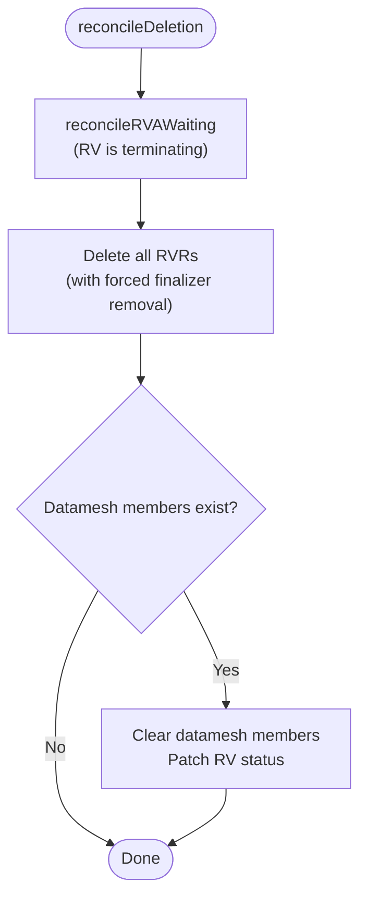

**Data Flow:**

| Input | Output |
|-------|--------|
| `rvas` | Patched RVA conditions (Attached=False, Ready=False) |
| `rvrs` | All RVRs deleted (finalizers removed first) |
| `rv.Status.Datamesh.Members` | Cleared to nil |

---

### ensureDatameshReplicaRequests Details

**Purpose:** Synchronizes `rv.Status.DatameshReplicaRequests` with the current `DatameshRequest` from each RVR. Uses a sorted merge algorithm for determinism.

**Algorithm:**

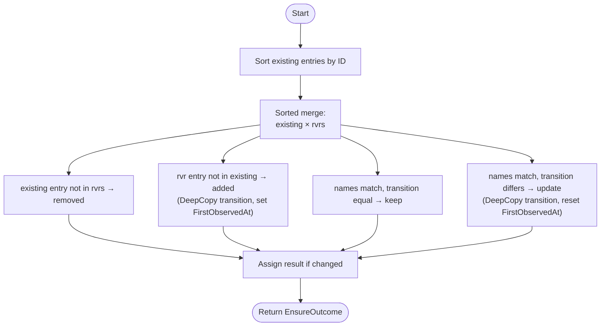

**Data Flow:**

| Input | Description |
|-------|-------------|
| `rv.Status.DatameshReplicaRequests` | Existing membership requests |
| `rvrs[].Status.DatameshRequest` | Current membership request per RVR |

| Output | Description |
|--------|-------------|
| `rv.Status.DatameshReplicaRequests` | Synchronized list (sorted by ID) |

---

### reconcileFormationStepPreconfigure Details

**Purpose:** Creates the replicas that make up the volume's target layout — diskful replicas **and**, for layouts with a tie-breaker (`TB > 0`, e.g. r2 = 2D+1TB), a diskless tie-breaker — and waits for all of them to become preconfigured (DRBD setup complete, ready for datamesh membership). Performs safety checks before advancing. Creating the tie-breaker here (rather than healing it afterwards via layout convergence) closes the window where a fresh r2 volume would live at 2D without a tie-breaker.

**Tie-breaker count** comes from `ReplicatedVolumeConfiguration.IntendedLayout()` (the single source of truth), not a second formula. Diskful and tie-breaker replicas are created through the same `newRVR` → `SetControllerRef` → `createRVR` → `insertRVRSorted` path with no DMTE and no Access stage, so the volume never passes through a diskless→diskful transition.

**Behavior when a tie-breaker cannot be placed:** the tie-breaker RVR is scheduled by `rvr_scheduling_controller` like any other replica. If no node/zone can host it (e.g. fewer than three nodes for `Ignored`, three zones for `TransZonal`, or three nodes in the volume's zone for `Zonal`, or the `guardTransZonalTBPlacement` precondition rejects every zone that already holds a diskful voter), the scheduler sets `Scheduled=False` on the tie-breaker RVR. Formation surfaces this in the same scheduling-wait gate as diskful replicas (`scheduling failed [#N]` with the scheduler's message) and keeps waiting — it does not silently hang, and it does not advance to a 2D-only datamesh.

This is a secondary safety net: `rsc_controller`'s `validateEligibleNodes` already accounts for the tie-breaker (it requires `D + TB` total nodes/zones, not just `D`) and marks the RSC `Ready=False` (`InsufficientEligibleNodes`) when the pool cannot host the full layout, so an under-provisioned class is rejected before any volume starts forming. The formation-time gate matters only for clusters that shrank (or whose nodes became ineligible) after the class was validated.

**File:** `reconciler_formation.go`

**Algorithm:**

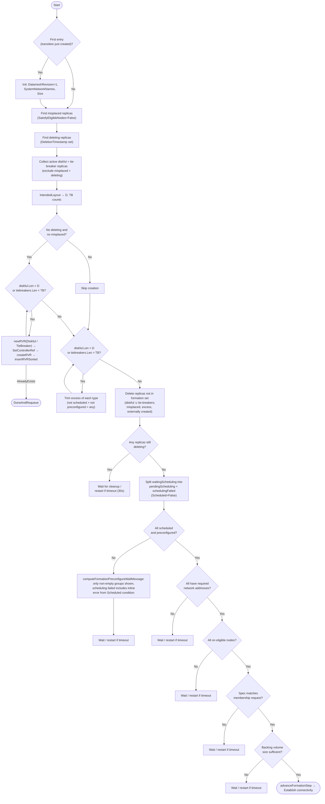

**Data Flow:**

| Input | Description |
|-------|-------------|
| `rv.Spec.Size` | Target volume size |
| `rv.Status.Configuration` (FTT, GMDR) | Determines the target layout via `IntendedLayout()`: D diskful + TB tie-breakers |
| `rsp` | Storage pool view (eligible nodes, system network names) |
| `rvrs` | Current replicas (status: scheduled, preconfigured, addresses, backing volume) |

| Output | Description |
|--------|-------------|
| `rv.Status.DatameshRevision` | Set to 1 on first entry |
| `rv.Status.Datamesh.SystemNetworkNames` | Copied from RSP |
| `rv.Status.Datamesh.Size` | RV spec size rounded up to 4Ki (4096 bytes) |
| RVR create/delete | Replica count adjusted |
| Formation transition messages | Progress/error reporting |

---

### reconcileFormationStepEstablishConnectivity Details

**Purpose:** Adds preconfigured replicas — diskful **and** tie-breakers — to the datamesh (with shared secret and quorum) in a single bulk-add, then waits for DRBD configuration, peer connections, and replication establishment among the **diskful** members, and finally for the tie-breakers to become operational ([Tie-breaker readiness](#tie-breaker-readiness-in-createv1-formation)). Tie-breakers are diskless, so they take no part in the *diskful* gates (backing volume, replication state) — but their own readiness is gated: the volume must leave formation at a target layout that actually works (e.g. 2D+1TB with a tie-breaker that is connected), not merely at one that is populated. Quorum is computed by `computeTargetQuorum`, which counts only diskful voters, so the tie-breaker does not change the threshold — but it does make DRBD see an odd node count, which is what `q = floor(D/2)+1` assumes for an even-D layout.

**File:** `reconciler_formation.go`

**Algorithm:**

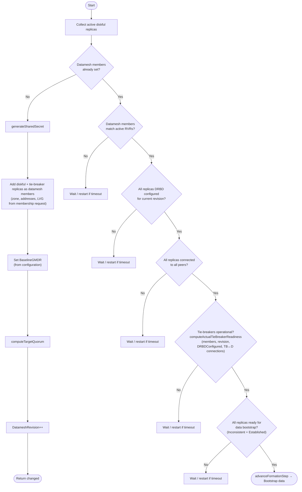

**Data Flow:**

| Input | Description |
|-------|-------------|
| `rvrs` | Replica status (DRBDConfigured, peers, backing volume state) |
| `rsp.EligibleNodes` | Zone information for datamesh members |

| Output | Description |
|--------|-------------|
| `rv.Status.Datamesh.SharedSecret` | Generated DRBD shared secret |
| `rv.Status.Datamesh.Members` | Datamesh member list |
| `rv.Status.BaselineGuaranteedMinimumDataRedundancy` | Set from Configuration GMDR |
| `rv.Status.Datamesh.Quorum` | Quorum threshold (derived from configuration) |
| `rv.Status.DatameshRevision` | Incremented revision |

---

### reconcileFormationStepBootstrapData Details

**Purpose:** Creates a DRBDResourceOperation to trigger initial data synchronization, waits for completion, re-checks that the tie-breakers are still operational, and finalizes formation.

**File:** `reconciler_formation.go`

**Algorithm:**

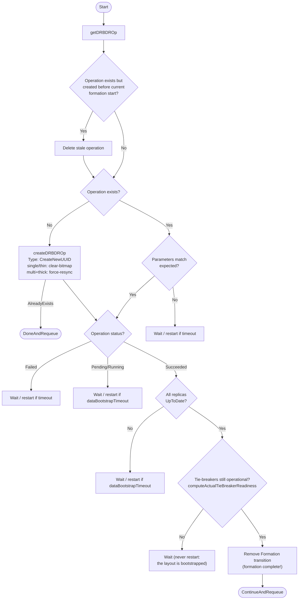

**Data Flow:**

| Input | Description |
|-------|-------------|
| `rv.Status.Datamesh.Members` | Diskful members (target for operation, count determines single/multi-replica) |
| `rsp.Type` | LVM or LVMThin (together with replica count determines sync mode) |
| `rv.Status.Datamesh.Size` | Volume size (for force-resync timeout calculation) |

| Output | Description |
|--------|-------------|
| `DRBDResourceOperation` | Created/verified data bootstrap operation |
| `rv.Status.DatameshTransitions` | Formation transition removed on success |

---

### reconcileAdoptStepVerifyPrerequisites Details

**Purpose:** Waits for pre-existing RVRs to satisfy minimal prerequisites before populating the datamesh. Unlike create/v1, this step never creates or deletes RVRs and does not validate replica counts or configuration consistency — adopt accepts replicas as-is.

**File:** `reconciler_formation.go`

**Algorithm:**

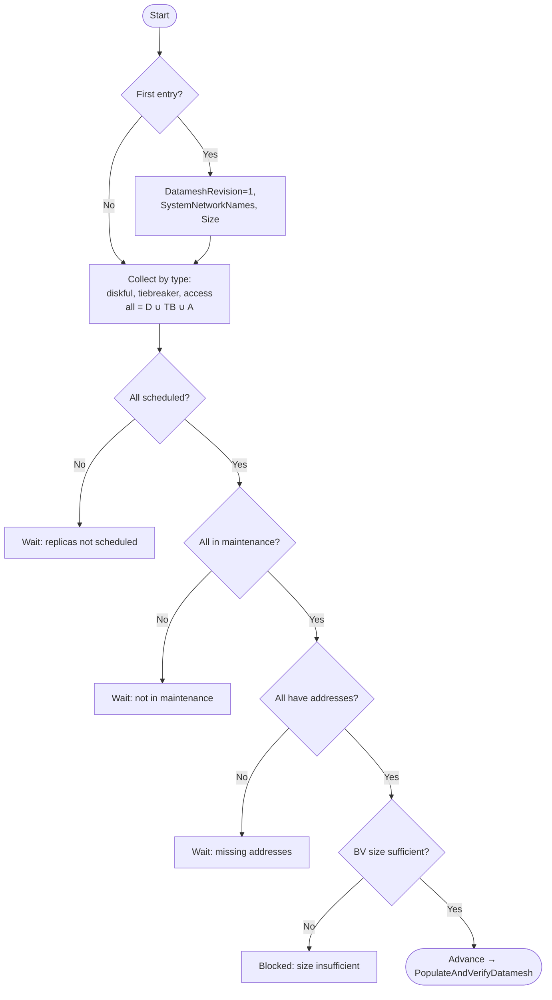

**Data Flow:**

| Input | Description |
|-------|-------------|
| `rvrs` | Replica statuses (scheduling, maintenance, addresses, backing volume size) |
| `rsp` | System network names |

| Output | Description |
|--------|-------------|
| `rv.Status.DatameshRevision` | Set to 1 on first entry |
| `rv.Status.Datamesh.SystemNetworkNames` | Copied from RSP |
| `rv.Status.Datamesh.Size` | RV spec size rounded up to 4Ki (4096 bytes) |
| Formation transition step messages | Progress/error reporting |

---

### reconcileAdoptStepPopulateAndVerifyDatamesh Details

**Purpose:** Populates the datamesh (shared secret, members, quorum) from pre-existing replicas using RVR spec fields directly. Uses lowest possible GMDR/QMR so degraded replicas can be adopted. Verifies agents have observed the configuration before advancing.

**File:** `reconciler_formation.go`

**Algorithm:**

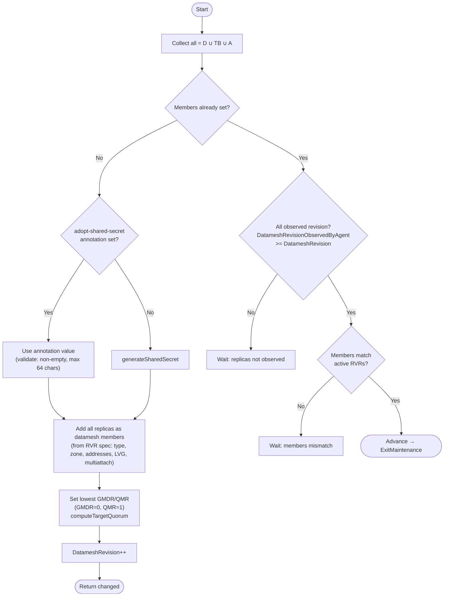

**Data Flow:**

| Input | Description |
|-------|-------------|
| `rvrs` | Replica spec (type, LVG, thinpool) and statuses (DatameshRevisionObservedByAgent, addresses, attachment) |
| `rsp.EligibleNodes` | Zone information for datamesh members |

| Output | Description |
|--------|-------------|
| `rv.Status.Datamesh.SharedSecret` | DRBD shared secret (from `adopt-shared-secret` annotation or generated) |
| `rv.Status.Datamesh.Members` | Datamesh member list (all types, from RVR spec) |
| `rv.Status.Datamesh.Multiattach` | Set if multiple members are attached |
| `rv.Status.BaselineGuaranteedMinimumDataRedundancy` | Set to 0 (lowest, for degraded replica adoption) |
| `rv.Status.Datamesh.Quorum` | Computed from actual member composition |
| `rv.Status.Datamesh.QuorumMinimumRedundancy` | Set to 1 (lowest) |
| `rv.Status.DatameshRevision` | Incremented revision |

---

### reconcileAdoptStepExitMaintenance Details

**Purpose:** Syncs addresses from RVRs and waits for all datamesh member replicas to exit maintenance mode, then completes formation. Adopt accepts replicas as-is — even degraded replicas (ConfigurationFailed, not Ready, etc.) complete formation; normal operation handles recovery afterward.

**File:** `reconciler_formation.go`

**Algorithm:**

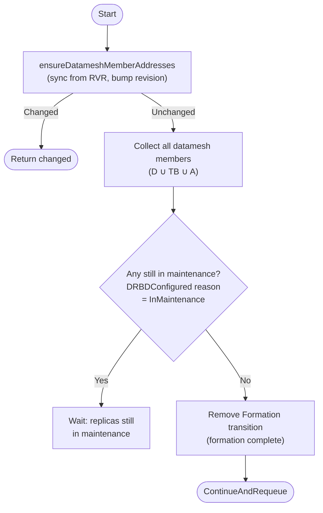

**Data Flow:**

| Input | Description |
|-------|-------------|
| `rvrs` | Replica statuses (addresses, DRBDConfigured condition) |
| `rv.Status.Datamesh.Members` | Datamesh member list (for address sync and maintenance check) |

| Output | Description |
|--------|-------------|
| `rv.Status.Datamesh.Members[].Addresses` | Updated from RVR if changed |
| `rv.Status.DatameshRevision` | Bumped if addresses changed |
| `rv.Status.DatameshTransitions` | Formation transition removed on success |

---

### reconcileRVAConditionsFromDatameshReplicaContext Details

**Purpose:** Updates status conditions (Attached, ReplicaReady, Ready), phase, message, and attachment fields (devicePath, ioSuspended, inUse) on each RVA based on datamesh replica contexts returned by `datamesh.ProcessTransitions`. Called from `reconcileNormalOperation` after the datamesh engine runs.

**File:** `reconciler_rva.go`

**Algorithm:**

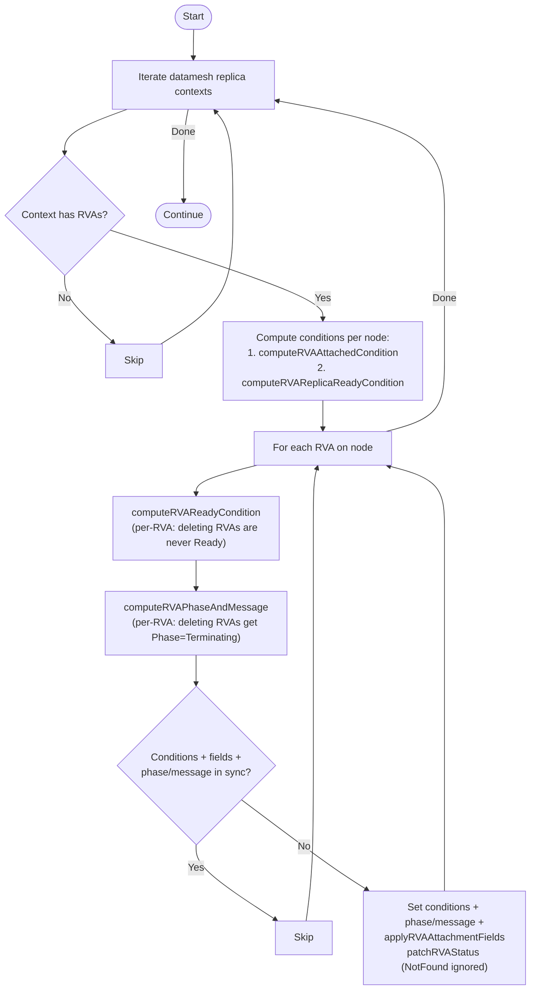

**Key behaviors:**
- Conditions are identical for all RVAs on the same node (Attached and ReplicaReady are per-node). Ready and Phase differ per RVA (deleting RVAs are always Ready=False/Terminating and Phase=Terminating).
- `AttachmentConditionReason()` and `AttachmentConditionMessage()` on each replica context are set by the datamesh engine (dispatchers, guards, slot status) — this reconciler is a pure mapper from those fields to RVA conditions.
- Phase is derived from DeletionTimestamp + Attached condition reason. Message is passthrough from the Attached condition, except when Phase=Attached and ReplicaReady != True — the ReplicaReady message is used to surface degradation (e.g., quorum loss).
- Attachment fields (devicePath, ioSuspended, inUse) are copied from `rvr.Status.Attachment` if available, cleared otherwise.

**Data Flow:**

| Input | Description |
|-------|-------------|
| `[]datamesh.ReplicaContext` | Per-node: attachment condition reason/message, RVR pointer, RVA pointers |

| Output | Description |
|--------|-------------|
| RVA conditions | Attached, ReplicaReady, Ready conditions set per RVA |
| RVA phase/message | Phase and Message set per RVA |
| RVA status fields | devicePath, ioSuspended, inUse copied from RVR |

---

### reconcileRVConfiguration Details

**Purpose:** Derives `rv.Status.Configuration` from the appropriate source (RSC in Auto mode, `ManualConfiguration` in Manual mode), validates TransZonal zone count via RSP, and sets the `ConfigurationReady` condition. Also updates `ConfigurationGeneration` and `ConfigurationObservedGeneration`.

**Caller control:** This function does NOT have an internal formation freeze guard. Instead, callers decide when to call it:
- **Root Reconcile:** when `Configuration` is nil (initial set)
- **Normal operation:** always (check for config updates)
- **Formation reset (create/v1):** after clearing `Configuration` to nil (re-derive)

During create formation, callers do NOT call this function (config is frozen). During adopt formation, this function is also NOT called — adopt accepts replicas as-is and any pending config change is picked up by normal operation after formation completes.

**Algorithm:**

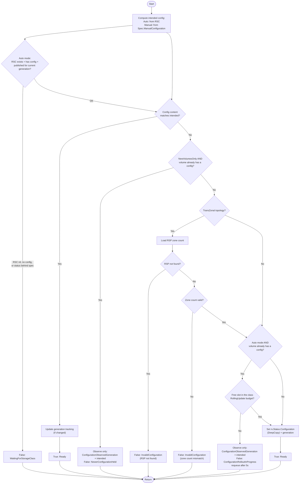

**Generation tracking:**
- Auto mode: `ConfigurationGeneration` = the RSC configuration generation whose **content** is stored in `rv.Status.Configuration`; `ConfigurationObservedGeneration` = the newest RSC configuration generation the volume has seen. The two differ exactly while the volume has seen a newer configuration it has not applied: either it is held back by `NewVolumesOnly`, or it is waiting for a free `RollingUpdate` slot. Both cases advance only the observed generation, so the class aggregate does not hang in "pending observation" while the volume keeps its own configuration.
- Manual mode: both are 0 (no RSC rollout tracking)

**RSC status freshness:** the RSC configuration is read only when `rsc.status.configurationGeneration == rsc.metadata.generation`. While the class controller has not accepted the latest spec edit, its status still carries the previous generation; applying it would hand a volume a configuration the user has already replaced — and under `NewVolumesOnly` the volume would hold that superseded configuration forever, because it stops being "new" the moment it gets one. The wait resolves itself: the RV watches RSC `status.configurationGeneration`, so the next publish triggers a reconcile. A spec edit the class controller never accepts (invalid configuration) keeps volumes waiting — deliberately, instead of silently provisioning from a stale configuration.

**NewVolumesOnly (observe, do not apply):** when the class rollout strategy is `NewVolumesOnly` and the volume already has a configuration whose content differs from the intended one, the volume keeps both its content and its `ConfigurationGeneration`, advances `ConfigurationObservedGeneration` (so the class aggregate does not hang in "pending observation"), and reports `ConfigurationReady=False/NewerConfigurationHeld`. A nil strategy — the class controller has not written the default yet — counts as `RollingUpdate`. Strategy transitions need no extra handling: `NewVolumesOnly → RollingUpdate` rolls held volumes out through the normal path, and `RollingUpdate → NewVolumesOnly` rolls nothing back. The hold applies even if the intended configuration is invalid: the volume is not "fixed" silently, the escape is a strategy switch or a volume recreation.

**Content-based fast path:** Instead of generation-based skipping, the function compares `*rv.Status.Configuration == *intended` (struct equality on 5 scalar fields). This avoids generation collision bugs when switching between Auto and Manual modes. It runs before the `NewVolumesOnly` hold on purpose: equal content means the volume is already aligned with the new generation, so there is nothing to hold back.

**RollingUpdate budget (`maxParallel`):** a volume that already carries a configuration is admitted to the rollout only when the class has a free slot; the helpers live in [`reconciler_rollout.go`](reconciler_rollout.go). The gate sits behind the fast path, the `NewVolumesOnly` hold and the validation: an aligned volume needs no slot, a held volume is not rolling out at all, and an invalid configuration must be reported as invalid rather than queued.

The decision needs no ledger and no sibling watch. One indexed list of the class (`getRVsByRSC`) is classified against the intended configuration and the generation the class published it under, with the in-memory volume always replacing its own listed copy:

- **active** — stores the intended configuration but has not been observed to finish with it: either it adopted that content in an earlier configuration epoch (`status.configurationGeneration` is behind), or it has not published `MembershipLayoutConverged=True/Converged` for its current `metadata.generation`. It occupies a slot.
- **converged** — adopted the intended configuration in the current epoch and published that verdict. Its slot is free.
- **pending** — stores an older configuration and needs a slot.
- **excluded** — deleting, Manual, forming, or never configured. Neither occupies nor waits for a slot.

Convergence is read from the condition rather than from the member counts, because the counts can match the intended layout while the volume is not converged at all: a retype already flipped on a replica spec (`Converging`), or a replacement tie-breaker that cannot be placed (`CannotConverge`). Those signals come from the replicas of that volume, which the classifier does not read — one indexed listing is its whole I/O budget. Reading a peer's condition is sound because `reconcileLayoutStatus` recomputes it in the same pass, and therefore writes it in the same object version, as `status.configuration`. A missing or stale verdict counts as active, which costs the volume one extra pass and never releases a slot early.

The generation is checked alongside the content because equal content does not identify the epoch: a class edited `A → B → A` leaves a volume that converged on the first `A` byte-identical to one that has just adopted the second, and a lagging listing serves exactly that object together with the verdict it earned back then. `status.configurationGeneration` is stamped by the very write that admits a volume, so it is never late — no volume of the current epoch is mistaken for an older one. A volume of an older epoch is counted as active rather than dropped: it needs no slot (its next pass takes the content-equal fast path and restamps the generation), but a stale reader cannot tell it apart from one that really is mid-rollout, and dropping it is what would let the class exceed `maxParallel`.

The free slots (`maxParallel - activeCount`, never below zero) go to the leading pending volumes by name — all of them in the same pass, so `maxParallel: 2` starts two migrations at once rather than chaining them. The order is total and stable, so every worker computes the same frontier from the same cache, and a stale listing can only under-admit: a volume that has just been admitted is still seen either as active or as a pending volume ahead of the same later names. A volume that misses out keeps its content and `ConfigurationGeneration`, advances `ConfigurationObservedGeneration`, reports `ConfigurationReady=False/ConfigurationRolloutInProgress`, and requeues after 5s — nothing else wakes it when a sibling converges.

Lowering `maxParallel` below the number of active volumes does not stop them (that would strand half-migrated layouts); it only admits nobody new. A volume that can never converge (`MembershipLayoutConverged=False/TransitionUnsupported` or a blocked migration) holds its slot indefinitely, which is the point: the budget bounds how many volumes a bad configuration reaches, not just how fast a good one spreads. `MaxConcurrentReconciles` is unrelated — it is a worker count, not a rollout policy.

**Data Flow:**

| Input | Description |
|-------|-------------|
| `rv.Spec.ConfigurationMode` | Auto or Manual |
| `rv.Spec.ManualConfiguration` | Manual mode source (guaranteed present by CEL) |
| `rsc` | ReplicatedStorageClass (may be nil; Auto mode only) |
| `rsc.Generation` / `rsc.Status.ConfigurationGeneration` | Freshness gate: the published configuration must belong to the current spec generation |
| `rsc.Spec.ConfigurationRolloutStrategy` | Rollout strategy (nil = RollingUpdate) and its `rollingUpdate.maxParallel` budget (nil = 5, the default the class controller writes) |
| `rsc.Status.Configuration` | RSC configuration (Auto mode source) |
| RSP (loaded via `getRSPZoneCount`) | Zone count for TransZonal validation |
| Volumes of the class (listed via `getRVsByRSC`) | Rollout budget accounting (Auto mode, existing volumes only) |

| Output | Description |
|--------|-------------|
| `rv.Status.Configuration` | Set/updated configuration (unchanged while a newer one is held or queued) |
| `rv.Status.ConfigurationGeneration` | RSC generation the stored content came from (Auto) or 0 (Manual) |
| `rv.Status.ConfigurationObservedGeneration` | Newest RSC generation seen; equal to ConfigurationGeneration unless a newer configuration is held (`NewVolumesOnly`) or queued for a rollout slot (`RollingUpdate`) |
| `ConfigurationReady` condition | Reports configuration state |

---

### reconcileCreateAccessReplicas Details

**Purpose:** Creates Access RVRs for active (non-deleting) RVAs on nodes that do not yet have any RVR. Called from `reconcileNormalOperation` before `datamesh.ProcessTransitions`.

**File:** `reconciler_access_replicas.go`

#### Creation guards

| # | Guard | Outcome |
|---|-------|---------|
| 1 | RV deleting | No creation (detach-only mode) |
| 2 | VolumeAccess=Local | No creation |
| 3 | RSP nil | No creation |
| 4 | RVR already exists on node (any type, including deleting) | Skip node |
| 5 | Node not in eligible nodes, or !nodeReady, or !agentReady | Skip node |
| 6 | Replica limit reached (32 RVRs) | Stop creation (break loop) |
| 7 | Duplicate RVA on same node | Deduplicate (one creation per node) |

All guards passed: create the Access RVR via `newRVR(..., Access, nodeName)` (sets `spec.type=Access`, `spec.nodeName`) → `SetControllerRef` → `createRVR` → `insertRVRSorted`. On `AlreadyExists`: requeue.

**Data Flow:**

| Input | Description |
|-------|-------------|
| `rv.DeletionTimestamp` | Detach-only mode check |
| `rv.Status.Configuration.VolumeAccess` | Local blocks Access creation |
| `rvas` | Active RVAs determine which nodes need Access replicas |
| `rvrs` | Existing replicas (any type on node blocks creation) |
| `rsp.EligibleNodes` | Node readiness check |

| Output | Description |
|--------|-------------|
| RVR create | Access RVRs created for eligible nodes |

---

### reconcileDeleteAccessReplicas Details

**Purpose:** Deletes Access RVRs that are redundant (another datamesh member on the same node) or unused (no active RVA on the node). Called from `reconcileNormalOperation` after `datamesh.ProcessTransitions`.

**File:** `reconciler_access_replicas.go`

#### Deletion guards

| # | Guard | Outcome |
|---|-------|---------|
| 1 | Not Access type | Skip |
| 2 | Already deleting (DeletionTimestamp set) | Skip |
| 3 | Attached (datamesh member with attached=true) | Skip (hard invariant) |
| 4 | Active Detach or AddReplica transition for this replica | Skip (avoid churn) |
| 5 | Another datamesh member on same node | **Delete** (redundant, even if RVA exists) |
| 6 | No active (non-deleting) RVA on node | **Delete** (unused) |

Deletion via `deleteRVR` (sets DeletionTimestamp). The existing pipeline handles the rest:
- If datamesh member: rvr_controller forms leave request, the datamesh engine's membership dispatcher creates RemoveReplica transition, `reconcileRVRFinalizers` removes finalizer after completion.
- If not datamesh member: `reconcileRVRFinalizers` removes finalizer directly.

**Data Flow:**

| Input | Description |
|-------|-------------|
| `rv.Status.Datamesh.Members` | Attached check, redundancy check (other member on same node) |
| `rv.Status.DatameshTransitions` | Active Detach/AddReplica check |
| `rvrs` | Access RVRs to evaluate |
| `rvas` | Active RVAs determine which nodes still need Access replicas |

| Output | Description |
|--------|-------------|
| RVR delete | Unneeded Access RVRs deleted (DeletionTimestamp set) |
